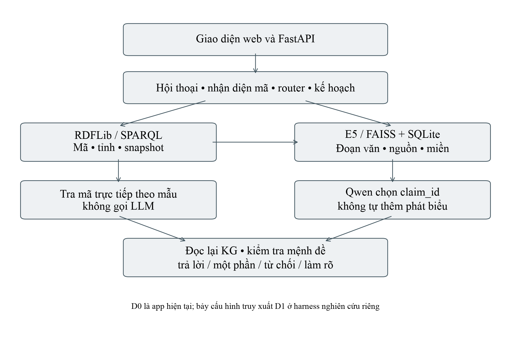
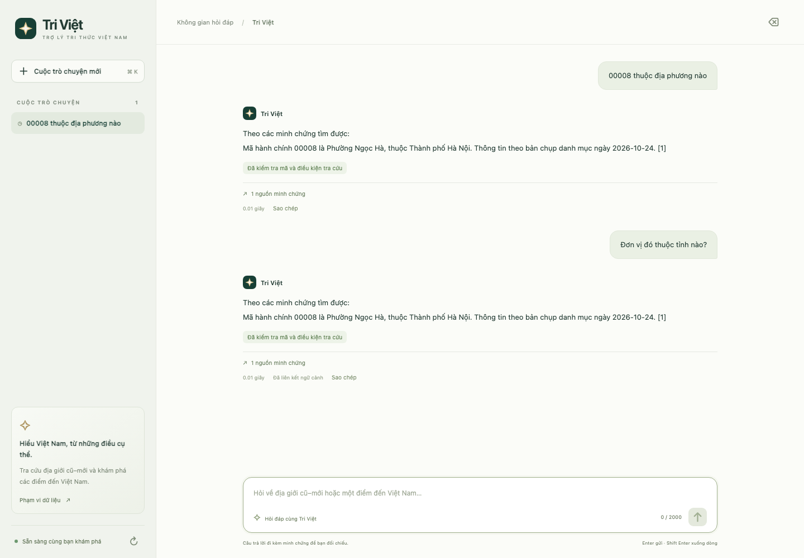
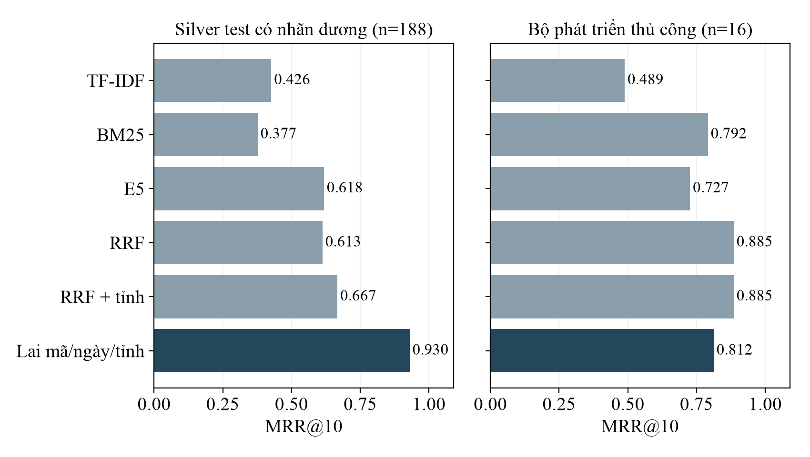
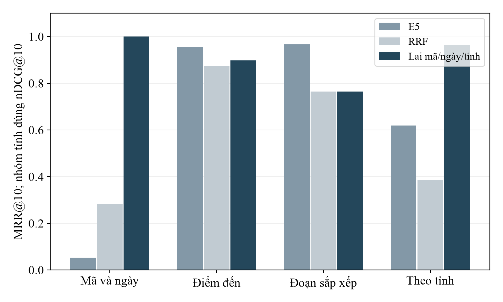

# HỆ THỐNG HỎI ĐÁP TỰ ĐỘNG VỀ ĐỊA GIỚI HÀNH CHÍNH MỚI VÀ THÔNG TIN DU LỊCH VIỆT NAM

ĐỒ ÁN TỐT NGHIỆP - TRƯỜNG ĐẠI HỌC TÔN ĐỨC THẮNG - KHOA CÔNG NGHỆ THÔNG TIN

Nguyễn Anh Kiệt - 52300123; Trần Cao Phong - 52300144. GVHD: TS. Trần Thanh Phước. Thành phố Hồ Chí Minh, năm 2026.

# LỜI CẢM ƠN

Nhóm tác giả trân trọng cảm ơn giảng viên hướng dẫn TS. Trần Thanh Phước và Khoa Công nghệ thông tin, Trường Đại học Tôn Đức Thắng. Những yêu cầu về dữ liệu, đối chứng phương pháp và thực nghiệm giúp nhóm định hướng việc xây dựng sản phẩm gắn với bằng chứng có thể kiểm tra. Nhóm cũng ghi nhận đóng góp của các tác giả công trình, thư viện và nguồn dữ liệu được dẫn trong báo cáo.

Báo cáo trình bày các kết quả của hệ thống Tri Việt và những giới hạn còn cần hoàn thiện. Các ý kiến phản biện về chất lượng nhãn, nguồn hành chính và khả năng ứng dụng là cơ sở để nhóm tiếp tục cải thiện đồ án.

# CAM ĐOAN VỀ NGUỒN VÀ KẾT QUẢ

Nhóm tác giả chịu trách nhiệm rà soát nội dung, số liệu và các phát biểu trong báo cáo trước khi nộp. Các thành phần phương pháp, phần mềm và dữ liệu có sẵn được ghi nguồn; kết quả thực nghiệm được phân biệt với thiết kế đề xuất và công việc chưa thực hiện. Báo cáo không xem các phép kiểm thử trên tập nhỏ là bảo đảm tính đúng của mọi câu trả lời.

Nhóm tác giả

Nguyễn Anh Kiệt                         Trần Cao Phong

# TÓM TẮT

Đồ án xây dựng Tri Việt, hệ thống hỏi đáp văn bản về địa giới hành chính cũ–mới và du lịch Việt Nam theo kiến trúc KG, RAG và mô hình ngôn ngữ. Sản phẩm sử dụng RDFLib/SPARQL cho dữ kiện có cấu trúc, multilingual E5 và FAISS cho truy xuất, Qwen3-0.6B qua Transformers để chọn mệnh đề có minh chứng. Câu hỏi mã hành chính được kiểm tra theo mã, tỉnh và snapshot rồi trả theo mẫu không cần LLM.

Nghiên cứu so sánh bảy cấu hình trên D0 gồm 31.949 tài liệu và D1 gồm 38.993. D1 bổ sung 3.351 đoạn hành chính riêng biệt, 372 điểm du lịch và 3.321 dòng quan sát đối chiếu có ngày; tổng số điểm du lịch là 825. Tập silver có 263 câu, trong đó 211 test gồm 188 câu dương và 23 ca không có snapshot; 16 câu thủ công được giữ riêng. Trên D1 silver test, tổ hợp mã/ngày/tỉnh đạt MRR@10 0,9297, so với E5 0,6181 và RRF 0,6127. Trên bộ thủ công, RRF đạt 0,8854, cao hơn tổ hợp 0,8125. Kết quả hỗ trợ lợi ích có điều kiện, chưa chứng minh ưu thế tổng quát.

Đồ án có pipeline, graph, index, API và giao diện local; lần kiểm kê code đạt 353 unit test. Hạn chế gồm nhãn chưa được duyệt độc lập đầy đủ, dữ liệu thời gian theo mốc, chưa GIS bán kính và chưa thực nghiệm benchmark ngoài cùng đánh giá Faithfulness độc lập. Đóng góp được đặt ở tổ chức dữ liệu và phối hợp phương pháp cho bài toán, không khẳng định phát minh thuật toán toàn cầu.

Từ khóa: địa giới hành chính; hỏi đáp; Knowledge Graph; RAG; truy xuất lai; snapshot; du lịch Việt Nam.

# ABSTRACT

This thesis develops Tri Viet, a Vietnamese text question answering assistant for administrative changes and tourism. The system combines RDFLib and SPARQL, multilingual E5 embeddings with FAISS, and Qwen3-0.6B through Transformers for selecting evidence-backed claims. Simple administrative-code queries use a structured lookup and deterministic rendering with code, province and snapshot checks.

Seven retrieval configurations are compared on the existing corpus D0 with 31,949 documents and the expanded corpus D1 with 38,993 documents. The source-derived silver set contains 263 questions, including a 211-question test split with 188 answerable cases and 23 unsupported-date cases. A previous set of 16 manually authored development questions is reported separately. On D1 silver test, the constrained hybrid achieves MRR@10 of 0.9297, compared with 0.6181 for E5 and 0.6127 for RRF. On the manual development set, ordinary RRF achieves 0.8854 and exceeds the constrained method at 0.8125. These findings support task-specific benefits rather than universal superiority.

The contribution is a source-traceable dataset and an evaluated integration for the project domain. The results do not establish general factual accuracy or elimination of hallucinations. Independent annotation, external benchmarks, geometric queries and semantic answer evaluation remain necessary work.

Keywords: administrative geography; question answering; knowledge graph; retrieval augmentation; constrained retrieval; Vietnam tourism.


# CHƯƠNG 1 MỞ ĐẦU

## 1.1 Giới thiệu

Việc tra cứu một địa danh Việt Nam ngày càng đòi hỏi xác định cả tên gọi, cấp hành chính và thời điểm mà thông tin được ghi nhận. Cùng một mã đơn vị có thể xuất hiện ở nhiều danh mục lịch sử với tên khác nhau. Một địa chỉ du lịch trong bài giới thiệu cũ có thể vẫn dùng huyện hoặc tỉnh trước sắp xếp, trong khi người dùng hỏi bằng tên tỉnh hiện tại. Nếu hệ thống chỉ tìm những đoạn văn gần nghĩa và để mô hình ngôn ngữ suy diễn phần còn thiếu, câu trả lời có thể trôi chảy nhưng không đáp ứng điều kiện người dùng yêu cầu.

Đồ án nghiên cứu và xây dựng Tri Việt, hệ thống hỏi đáp bằng tiếng Việt về địa giới hành chính cũ và mới cùng thông tin du lịch Việt Nam. Chương này xác định vấn đề, câu hỏi nghiên cứu, phạm vi thực hiện và loại bằng chứng cần có. Việc làm rõ phạm vi ngay từ đầu giúp đánh giá sản phẩm theo khả năng thực tế, thay vì đồng nhất một giao diện trò chuyện hoạt động được với một hệ thống đã giải quyết đầy đủ bài toán không gian và thời gian.

Một lỗi thực tế có tính điển hình là câu hỏi “00008 thuộc địa phương nào” từng nhận một địa chỉ điểm du lịch ở Điện Biên. Đoạn địa chỉ đó có nguồn trong corpus nhưng không xác nhận mã 00008. Như vậy, có trích dẫn chưa đủ để chứng minh câu trả lời đúng với câu hỏi. Sau sửa, luồng tra mã bắt buộc lấy bản ghi KG, giữ số 0 đầu, kiểm tra điều kiện và dựng câu trực tiếp. Trên snapshot đang lưu ngày 24/10/2026, mã này gắn với Phường Ngọc Hà, Thành phố Hà Nội. Đây là kết luận trong phạm vi danh mục của ứng dụng, không phải xác nhận pháp lý độc lập cho mọi thời điểm.

Vấn đề thứ hai thể hiện qua câu hỏi “Điểm tham quan nào gần Hội An nhất trong bán kính 5 km?”. Quan hệ thuộc tỉnh và phần mô tả địa chỉ không đủ để tính bán kính. Cần có tọa độ, mốc xuất phát, hệ quy chiếu và phép tính khoảng cách phù hợp. Phiên bản hiện tại chủ động từ chối xác nhận điều kiện này. Phản hồi đó là biểu hiện của ranh giới năng lực đã được thiết kế, đồng thời là một khoảng trống cần ghi nhận so với kế hoạch ban đầu.

## 1.2 Công trình liên quan

RAG kết hợp bộ truy xuất với mô hình sinh để sử dụng tri thức bên ngoài trọng số mô hình [1]. Đồ án vận dụng nguyên tắc dựa vào minh chứng, nhưng không triển khai lại toàn bộ thiết kế huấn luyện của công trình gốc. Trong sản phẩm, LLM chủ yếu chọn mã mệnh đề do máy chủ chuẩn bị, còn câu tra mã hành chính có đường trả lời theo mẫu không cần LLM. Thiết kế này thu hẹp khả năng diễn giải tự do để tăng khả năng kiểm tra từng phát biểu.

Multilingual E5 cung cấp biểu diễn văn bản đa ngôn ngữ và được chọn làm encoder cho tìm kiếm ngữ nghĩa [2]. FAISS đảm nhiệm lập chỉ mục và truy vấn vector [3]. Hai thành phần có chức năng khác nhau: encoder quyết định biểu diễn, còn chỉ mục quyết định cách tổ chức và tìm kiếm các vector đã tạo. Việc tạo lại chỉ mục sau khi bổ sung corpus không đồng nghĩa huấn luyện lại encoder.

BM25 và TF-IDF đại diện cho truy xuất từ vựng. RRF gộp các danh sách xếp hạng mà không cần coi điểm BM25 và cosine là cùng thang đo [4]. Những phương pháp này được sử dụng làm đối chứng. Đóng góp của đồ án nằm ở tổ chức dữ liệu hai miền, phối hợp truy xuất với điều kiện mã, ngày và tỉnh, cùng thiết kế kiểm tra đầu ra trong ngữ cảnh cụ thể của dự án; không phải phát minh lại BM25, E5 hoặc RRF.

BEIR nhấn mạnh nhu cầu so sánh nhiều họ phương pháp trên các tập dữ liệu khác nhau [5]. GS-QA, MapQA và nghiên cứu Tourism QA cho thấy bài toán địa lý hoặc du lịch có những loại đầu vào và đáp án rất khác nhau [6–8]. Các bộ này liên quan đến định hướng của đồ án, nhưng chưa được thực nghiệm trong sản phẩm hiện có. Vì vậy, kết quả trên corpus dự án và câu hỏi tự xây dựng không được ghi thành điểm benchmark của những bộ dữ liệu công khai đó.

## 1.3 Phương pháp và phạm vi nghiên cứu

### 1.3.1 Câu hỏi nghiên cứu

RQ1 xem xét mức độ khác nhau giữa tìm kiếm từ vựng, tìm kiếm ngữ nghĩa và kết hợp hạng khi câu hỏi chứa mã đơn vị, ngày snapshot, tên điểm đến hoặc từ khóa tỉnh. Giả thuyết làm việc là thông tin có tính định danh chính xác cần được xử lý khác với mô tả trải nghiệm; một phương pháp duy nhất khó tối ưu cho mọi nhóm câu hỏi.

RQ2 xem xét tác động của dữ liệu mới. Corpus mở rộng có thể bổ sung tài liệu cần thiết cho những câu hỏi trước đây không có đáp án, nhưng cũng có thể làm thay đổi thứ hạng của câu hỏi cũ. Thí nghiệm vì thế chạy cùng giao thức trên D0 và D1, đồng thời báo cáo riêng nhóm câu hỏi đã có trước mở rộng.

RQ3 xem xét hiệu quả của tổ hợp có ràng buộc. Biến thể đề xuất dùng phân miền, từ khóa tỉnh cũ và mới, điều kiện mã và ngày trước khi chọn kết quả từ các danh sách xếp hạng. Cần đánh giá thêm tỷ lệ từ chối khi ngày yêu cầu không có bằng chứng, vì xếp hạng được một tài liệu không đồng nghĩa tài liệu đó xác nhận ngày được hỏi.

RQ4 xác định mức độ đáp ứng kế hoạch triển khai. Một đồ án hoàn chỉnh phải đối chiếu các yêu cầu về dữ liệu, backend, giao diện, đánh giá và đóng gói với tệp code và báo cáo có thể kiểm tra. Các mục chưa có bằng chứng không được mặc nhiên xem là đã hoàn thành.

### 1.3.2 Mục tiêu và đóng góp

Mục tiêu kỹ thuật là xây dựng pipeline thu thập có provenance, biểu diễn các danh mục hành chính theo phiên bản, tạo nhánh tìm kiếm văn bản và tích hợp giao diện hỏi đáp có trích dẫn. Mục tiêu nghiên cứu là thiết lập các baseline, xây dựng dữ liệu mở rộng có thể kiểm kê, thử biến thể lai và trình bày kết quả kèm giới hạn. Hai nhóm mục tiêu liên hệ với nhau nhưng có tiêu chí đánh giá khác nhau: kiểm thử API đo hành vi phần mềm, còn chỉ số truy xuất đo khả năng tìm tài liệu theo nhãn đã biết.

Đóng góp thứ nhất là sản phẩm Tri Việt với đường tra mã theo KG và đường chọn mệnh đề bằng LLM. Đóng góp thứ hai là bộ dữ liệu nghiên cứu mở rộng giữ đồng thời snapshot, liên kết chuyển đổi, dòng đối chiếu có ngày và thông tin điểm tham quan. Đóng góp thứ ba là thực nghiệm bảy cấu hình trên hai phiên bản corpus, có ablation và phân tích theo loại câu hỏi. Những đóng góp này tạo thành kết quả sơ bộ có thể tái kiểm tra; chưa đủ để khẳng định một thuật toán mới có tính tổng quát toàn cầu.

### 1.3.3 Đối tượng sử dụng và phạm vi

Người dùng mục tiêu là người tra cứu địa phương và người tìm thông tin điểm đến trong phạm vi Việt Nam. Đầu vào hiện tại là văn bản tiếng Việt; giao diện chưa nhận ảnh, chưa nhận dạng địa điểm từ ảnh và chưa cung cấp tìm kiếm ảnh. Lịch sử hội thoại được lưu tại trình duyệt; hệ thống chưa có tài khoản người dùng hoặc đồng bộ hội thoại qua máy chủ.

Miền hành chính gồm danh mục và quan hệ chuyển đổi cũ, mới; miền du lịch gồm điểm đến vật thể và nội dung tham quan phù hợp. Chủ đề di sản phi vật thể đã được loại khỏi corpus hoạt động theo phạm vi điều chỉnh của dự án. Việc giữ thông tin tham quan một di tích không có nghĩa mở lại toàn bộ miền hỏi đáp di sản trước đây. Hồ sơ sáp nhập doanh nghiệp xuất hiện trong tài liệu mẫu nhưng không có bộ dữ liệu và luồng ứng dụng tương ứng trong sản phẩm hiện tại.

Về thời gian, dữ liệu nền có ba mốc 30/06/2025, 01/07/2025 và 24/10/2026. Lần quan sát bảng NSO ngày 30/10/2026 được giữ riêng. Các mốc này không tạo thành timeline liên tục. Về không gian, quan hệ thuộc tỉnh đã được xử lý; polygon, giao nhau, gần nhất và bán kính chưa có bộ thực thi được kiểm chứng. Về mô hình, cấu hình đã chạy sử dụng Qwen3-0.6B qua Transformers, không phải LLaMA-2 qua vLLM như phương án dự kiến trong PDF kế hoạch.

### 1.3.4 Phương pháp thực hiện

Nghiên cứu bắt đầu bằng kiểm kê thư mục code, cấu hình và artifacts. Sau đó, các trường dữ liệu được ánh xạ sang schema có cấu trúc; văn bản được tách đoạn để lập chỉ mục. Câu hỏi có mã được nhận diện trước bộ phân loại thống kê. Với các câu còn lại, router và quy tắc chọn KG, RAG hoặc kết hợp. Các mệnh đề chỉ được xuất khi vượt qua bước kiểm tra tương ứng với loại minh chứng.

Thực nghiệm truy xuất sử dụng cùng câu hỏi và cùng cách tính điểm trên D0 và D1. Tham số RRF và cấu hình ứng viên được cố định trước khi xem kết quả test. Tập câu hỏi silver được chia theo nhóm thực thể, còn 16 câu phát triển thủ công được báo cáo riêng. Việc chấm câu trả lời cuối bằng người đánh giá độc lập là một công việc tiếp theo, không được thay bằng tỷ lệ unit test đạt.

## 1.4 Thực nghiệm định hướng và kết quả ban đầu

Đối với lỗi mã 00008, kiểm thử hồi quy kiểm tra đồng thời miền, route, mã, tên đơn vị, tỉnh, mốc dữ liệu và nguồn KG. Các ca âm gồm mã không có trong dữ liệu, nhiều mã trong một câu, mã bưu chính, mã đặt phòng, số trong tên “Phường 12”, ngày không hợp lệ và bản ghi thay đổi giữa hai lần đọc. Mô hình sinh và retriever được giả lập để báo lỗi nếu bị gọi trong đường tra mã đơn giản. Cách kiểm thử này xác nhận được một thuộc tính kiến trúc cụ thể: kết quả tra mã không phụ thuộc việc LLM có đang sẵn sàng hay không.

Lần kiểm tra lại code trong đợt viết báo cáo đạt 353 unit test. Báo cáo HTTP đã lưu của bản sửa tra mã ghi 65/65 ca đạt, còn kiểm tra Chromium ghi 33/33. Hai bộ sau là bằng chứng lịch sử của D0; không được dùng để tuyên bố đã kiểm thử end-to-end bản D1. Chương 5 trình bày kết quả truy xuất mới, được chạy riêng trên D1.

Corpus tăng từ 31.949 tài liệu ở D0 lên 38.993 ở D1. D1 có 825 điểm du lịch được gắn tỉnh theo bộ lọc nguồn, phủ 34 tỉnh/thành trong dữ liệu. Số lượng này là phạm vi đã thu thập, không phải danh sách toàn bộ điểm du lịch Việt Nam. Trên bộ test silver của D1, biến thể lai đạt MRR@10 bằng 0,9297, trong khi E5 đạt 0,6181. Tuy nhiên, trên 16 câu thủ công, RRF thông thường đạt 0,8854 và cao hơn biến thể có ràng buộc 0,8125. Phản chứng này là cơ sở để tiếp tục đánh giá thay vì chọn phương pháp chỉ theo điểm tổng thuận lợi.

Mục tiêu Accuracy/F1 tiệm cận 90–98% trong kế hoạch được hiểu là mục tiêu cần định nghĩa phép đo, không phải kết quả đã có của toàn hệ thống. Accuracy 1,0 trên 17 ca KG hoặc tỷ lệ HTTP 65/65 không chứng minh độ đúng 100% của nguồn dữ liệu và mọi câu trả lời. Các chỉ số được giữ đúng đơn vị đo xuyên suốt báo cáo.

## 1.5 Kết luận

Chương 1 xác lập bài toán kết hợp hai miền tri thức, yêu cầu bảo toàn điều kiện tra cứu và nhu cầu phân biệt các loại bằng chứng. Hệ thống có kết quả phần mềm và thực nghiệm ban đầu, đồng thời còn khoảng trống về benchmark công khai, hình học địa lý và đánh giá ngữ nghĩa độc lập. Các chương tiếp theo lần lượt trình bày cơ sở lý thuyết, dữ liệu và phương pháp, thiết kế triển khai, kết quả thực nghiệm và tổng kết đóng góp. Mỗi chương giữ cấu trúc giới thiệu, công trình liên quan, phương pháp hoặc dữ liệu, thực nghiệm và kết luận để có thể đối chiếu mục tiêu với bằng chứng ngay trong từng chủ đề.


# CHƯƠNG 2 CƠ SỞ LÝ THUYẾT VÀ CÔNG TRÌNH LIÊN QUAN

## 2.1 Giới thiệu

Chương này giải thích các lựa chọn kỹ thuật cần thiết để đọc và đánh giá hệ thống. Trọng tâm là biểu diễn tri thức, truy xuất từ vựng và ngữ nghĩa, gộp hạng, định tuyến và kiểm tra minh chứng. Việc lựa chọn lý thuyết tập trung vào những thành phần thực sự tham gia biểu diễn, truy xuất và kiểm tra dữ kiện của bài toán.

Hai sai lầm cần tránh là xem một truy vấn có cú pháp đúng như bảo đảm sự thật tuyệt đối và xem một vector có cosine cao như chứng minh quan hệ địa lý hoặc hiệu lực pháp lý. KG chỉ trả các sự kiện được mã hóa trong graph. Retriever chỉ xếp hạng tài liệu theo biểu diễn và phép đo đã chọn. Tính đúng của câu trả lời còn phụ thuộc chất lượng nguồn, ánh xạ thực thể, điều kiện truy vấn và khả năng đáp ứng đầy đủ câu hỏi.

## 2.2 Công trình liên quan

### 2.2.1 RAG và truy xuất ngữ nghĩa

Lewis và cộng sự nghiên cứu RAG như một hướng kết hợp tri thức tham số với truy xuất ngoài mô hình [1]. E5 cung cấp một họ encoder đa ngôn ngữ để biểu diễn query và passage [2]. Đồ án sử dụng các thành phần có sẵn này ở mức suy luận và lập chỉ mục. Không có thực nghiệm fine-tune E5 hoặc Qwen trong phạm vi kết quả được báo cáo.

Công trình về thư viện FAISS mô tả các thành phần phục vụ tìm kiếm vector [3]. Ở dự án này, vector đã chuẩn hóa được lập chỉ mục bằng IndexIDMap2 kết hợp IndexFlatIP. Vì vậy, không có cơ sở ghi rằng sản phẩm đang dùng IVF-PQ, HNSW hoặc tìm kiếm FAISS GPU chỉ vì các lựa chọn đó được nêu trong phần khảo sát. Cấu hình chỉ mục là một thành phần cần kiểm chứng từ file, không phải suy ra từ tên thư viện.

### 2.2.2 Kết hợp xếp hạng và đánh giá

RRF là một phương pháp gộp thứ hạng đã có trước đồ án [4]. BEIR cung cấp kinh nghiệm đánh giá nhiều họ retriever trên các bộ dữ liệu không đồng nhất [5]. Hai tham khảo này hỗ trợ quyết định thực nghiệm nhiều baseline và giữ ablation riêng, thay vì mặc định một phương án lai luôn tốt hơn tìm kiếm đơn lẻ.

RAGAs nghiên cứu các chiều đánh giá của hệ thống RAG [9]. Đồ án phân biệt chất lượng tài liệu truy xuất, tính được hỗ trợ của phát biểu và tính đúng ngoài đời. Việc chưa chạy đánh giá Faithfulness bằng người chấm hoặc bộ đánh giá độc lập được ghi nhận như một giới hạn. Cơ chế kiểm tra chuỗi và dữ kiện có cấu trúc trong code không tự trở thành điểm Faithfulness theo một giao thức bên ngoài.

### 2.2.3 Hỏi đáp địa lý và du lịch

GS-QA nghiên cứu câu hỏi trên dữ liệu không gian có nhiều kiểu thực thể, phép toán và dạng đáp án [6]. MapQA phiên bản về choropleth maps làm việc với hình ảnh bản đồ [7]. Tourism QA nghiên cứu tìm thực thể phù hợp từ dữ liệu đánh giá du lịch [8]. Chúng đặt ra các yêu cầu dữ liệu khác nhau; không thể chuyển tên gọi “MapQA” thành một tập câu hỏi văn bản tự tạo rồi coi đó là kết quả benchmark của công trình gốc.

Đồ án hiện có dữ liệu danh mục và bài giới thiệu điểm đến, chưa có bộ reviews tương ứng để thực nghiệm đúng nhiệm vụ của Tourism QA. Các câu hỏi bán kính và gần nhất cũng chưa có nguồn hình học và bộ thực thi để đối chiếu GS-QA. Khoảng trống này ảnh hưởng đến mức độ hoàn tất kế hoạch, nhưng không phủ nhận giá trị của bộ thực nghiệm miền hẹp đang có.

## 2.3 Phương pháp và các khái niệm sử dụng

### 2.3.1 RDF và truy vấn có điều kiện

RDF biểu diễn sự kiện theo bộ ba chủ thể, quan hệ và đối tượng. Với một phiên bản đơn vị hành chính, các quan hệ có thể lưu mã, tên, kiểu đơn vị, tỉnh trực thuộc, mốc snapshot và provenance. SPARQL cung cấp cách truy vấn các mẫu graph cùng điều kiện lọc [10]. Một kết quả đúng trong graph nghĩa là nó khớp mẫu và điều kiện của graph hiện tại; vẫn cần kiểm tra graph có phản ánh đúng nguồn hay không.

Mã cần được lưu như chuỗi. Chuỗi “00008” và số nguyên 8 không có cùng khả năng bảo toàn định danh trong danh mục. Cũng không nên gộp hai đơn vị chỉ vì cùng mã ở hai mốc khác nhau. Khóa logic của một bản ghi snapshot cần có ngữ cảnh thời gian và loại đơn vị, còn quan hệ chuyển đổi cũ–mới là một đối tượng thông tin riêng với khả năng chuyển một phần.

Một snapshot tại ngày t chỉ chứng minh những trường nguồn ghi tại t. Nếu không có khoảng hiệu lực đủ căn cứ, không được nội suy rằng các trường đó giữ nguyên đến mọi ngày tiếp theo. Với khoảng đóng có hai đầu, điều kiện thuộc khoảng có thể được kiểm tra trực tiếp. Với khoảng mở, một mốc được biết không tự xác nhận các ngày ngoài mốc đó. Những nguyên tắc này được mã hóa trong truy vấn và kiểm tra hậu truy xuất.

### 2.3.2 TF-IDF

TF-IDF tăng trọng số cho từ vừa xuất hiện trong tài liệu, vừa có khả năng phân biệt tài liệu so với corpus. Một dạng thường dùng là tf(t,d) nhân idf(t), sau đó chuẩn hóa vector để so sánh. Trong thí nghiệm, CountVectorizer tạo ma trận từ vựng và TfidfTransformer tạo biểu diễn chuẩn hóa. Câu hỏi và corpus được đưa qua cùng quy tắc chuẩn hóa phục vụ so khớp.

Ưu điểm của cách này là dễ kiểm tra và giữ tín hiệu của mã số, tên riêng hoặc từ hiếm. Hạn chế là những cách diễn đạt gần nghĩa nhưng ít từ chung có thể không được xếp cao. Dấu tiếng Việt được xử lý trong chuỗi phục vụ tìm kiếm; nội dung gốc của tài liệu vẫn được giữ. Không sử dụng bản chuẩn hóa để viết lại các câu nguồn.

### 2.3.3 BM25

BM25 tính mức phù hợp dựa trên tần suất từ, độ hiếm của từ và chuẩn hóa chiều dài tài liệu. Với tf là tần suất từ trong tài liệu, dl là độ dài và avgdl là độ dài trung bình, thành phần bão hòa được dùng trong thí nghiệm là tf × (k1 + 1) / [tf + k1 × (1 - b + b × dl / avgdl)]. Trọng số idf sử dụng log[1 + (N - df + 0,5) / (df + 0,5)].

Các giá trị k1 = 1,2 và b = 0,75 được cố định trong lượt đo. Đếm từ trên ma trận thưa cho phép tính điểm mà không cần lưu một vector đặc cho từng tài liệu. Đây là baseline thực thi trong script nghiên cứu; bộ tìm kiếm dự phòng FTS5 của ứng dụng là một đường triển khai khác và không được coi là cùng kết quả chỉ vì cùng sử dụng ý tưởng tìm kiếm từ vựng.

### 2.3.4 E5 và cosine

Encoder chuyển văn bản sang vector 768 chiều. Tiền tố query và passage được sử dụng theo cấu hình encoder của hệ thống; bước mở rộng thuật ngữ cũng cần được giữ nhất quán khi tái sử dụng vector. Nếu vector được chuẩn hóa về độ dài một, tích vô hướng bằng cosine. Do đó, IndexFlatIP có thể thực hiện tìm kiếm cosine khi cả hai phía tuân thủ cùng điều kiện chuẩn hóa.

Cosine là điểm tương tự của biểu diễn, không phải xác suất câu trả lời đúng. Một mã số ngắn có thể khó được encoder phân biệt, và hai đoạn mô tả gần nhau về ngữ nghĩa vẫn có thể thuộc hai tỉnh hoặc hai thời điểm khác nhau. Bộ lọc metadata và phép tra khóa chính xác được dùng để xử lý các điều kiện không nên giao hoàn toàn cho độ tương tự.

### 2.3.5 RRF và bộ lọc

Với một tài liệu d có thứ hạng r_i(d) trong danh sách thứ i, điểm RRF được tính bằng tổng 1 / [k + r_i(d)] trên những danh sách có d. Trong thí nghiệm, k = 60 và mỗi nguồn cung cấp tối đa 200 ứng viên chunk. Các chunk cùng tài liệu được gộp theo doc_id trước khi đánh giá tài liệu.

Gộp hạng có thể đưa tài liệu được cả hai nguồn hỗ trợ lên cao, nhưng cũng có thể kéo một kết quả ngữ nghĩa tốt xuống nếu kết quả đó ít được nhánh từ vựng hỗ trợ. Bộ lọc tỉnh có thể cải thiện câu hỏi danh sách điểm đến, song sẽ làm mất kết quả nếu tỉnh được phân giải sai. Vì vậy, từng bước thêm bộ lọc được xem là một cấu hình cần đo, không phải một cải tiến hiển nhiên.

### 2.3.6 Router và sinh có kiểm soát

Router có hai nhiệm vụ: dự đoán hướng xử lý kg/rag/hybrid và dự đoán miền administration/tourism. Cấu hình dùng TF-IDF từ, cụm ký tự và Logistic Regression, kết hợp quy tắc. Điểm do quy tắc gán không phải xác suất đã được hiệu chuẩn. Một confidence cao ở tầng định tuyến không thể thay cho sự tồn tại của bản ghi phù hợp trong nguồn.

Qwen3-0.6B được dùng ở đường chọn mệnh đề [11]. Máy chủ tạo danh sách mệnh đề được phép với claim_id, nội dung, loại minh chứng và các trường kiểm tra. Mô hình trả JSON chứa tối đa ba ID. Đầu ra ngoài registry, khóa trùng hoặc câu bổ sung không đúng hợp đồng bị loại. Phương pháp này khác với để LLM tự viết một bài tổng hợp dài rồi hy vọng bộ kiểm tra phát hiện mọi suy diễn sai.

## 2.4 Thực nghiệm minh họa và cách đọc chỉ số

Accuracy phân loại là tỷ lệ nhãn dự đoán đúng trên số câu có nhãn. Với route và domain, joint accuracy yêu cầu cả hai cùng đúng. F1 của bộ binding KG dựa trên true positive, false positive và false negative của các dòng kết quả có đáp án đầy đủ. Không lấy F1 đó thay cho F1 trả lời tự nhiên. Với một câu hỏi danh sách, đáp án chuẩn còn phải cho biết danh sách có đầy đủ hay chỉ có các phần tử dương đã biết.

Hit@k xác định có ít nhất một tài liệu dương trong k kết quả đầu. MRR@10 lấy nghịch đảo thứ hạng của tài liệu dương đầu tiên trong top 10, hoặc 0 nếu không có. nDCG@10 xét vị trí của các tài liệu dương so với thứ tự lý tưởng. Known-positive Recall@10 đo phần nhãn dương đã được tìm thấy, nhưng nhãn chưa đầy đủ sẽ giới hạn cách diễn giải mọi chỉ số này.

Với câu hỏi không có snapshot phù hợp, trả một tài liệu gần nghĩa có thể là một lỗi xử lý dù tài liệu đó tồn tại. Thực nghiệm vì thế báo tỷ lệ từ chối đúng riêng trên các ca không có snapshot. Một bộ tìm kiếm luôn trả kết quả thường không có cơ chế từ chối; so sánh với biến thể có điều kiện đồng thời đo thêm chính sách an toàn, chứ không chỉ đo khả năng xếp hạng.

Trong một ví dụ minh họa, nếu thứ hạng tài liệu đúng lần lượt là 1, 2 và không xuất hiện trong top 10, MRR bằng (1 + 1/2 + 0) / 3 = 0,5. Nếu một tập KG gồm 17 ca đều đạt, accuracy theo ca là 1,0, nhưng không thể suy ra 17 ca đã bao phủ mọi mã, ngày, địa danh và lỗi dữ liệu. Ví dụ này làm rõ lý do báo cáo luôn đi kèm mẫu số và phạm vi câu hỏi.

Khoảng bất định được ước lượng bằng bootstrap theo nhóm thực thể trong bộ silver test. Việc lấy mẫu theo nhóm tránh coi ba snapshot của cùng mã là ba quan sát hoàn toàn độc lập. Tuy nhiên, khoảng tin cậy thống kê vẫn chỉ áp dụng cho cơ chế xây dựng mẫu hiện có; nó không sửa được thiên lệch do câu hỏi tự sinh hoặc nhãn dương chưa được người độc lập duyệt.

Kết quả truy xuất thực tế của D1 cho MRR@10 lần lượt là 0,3769 với BM25, 0,6181 với E5 và 0,6127 với RRF trên silver test có nhãn dương. RRF không vượt E5 ở điểm tổng của lượt đo này; kết hợp nhiều nguồn điểm vì vậy vẫn cần được kiểm chứng theo tập câu và nhiệm vụ. Chi tiết điều kiện chạy và nhóm câu hỏi nằm ở Chương 5.

## 2.5 Kết luận

Chương 2 cung cấp các khái niệm để diễn giải kết quả ở đúng tầng: truy vấn graph, xếp hạng tài liệu, định tuyến và câu trả lời. Thiết kế kết hợp được xây trên những phương pháp có sẵn và phải chịu kiểm chứng bằng ablation. Các đặc tính như có nguồn, đúng mẫu câu hoặc khớp snapshot giúp tăng khả năng kiểm tra, nhưng không tạo ra một bảo đảm rằng dữ liệu nguồn đúng tuyệt đối. Cơ sở này dẫn tới cách tổ chức dữ liệu và phương pháp được trình bày trong Chương 3.


# CHƯƠNG 3 DỮ LIỆU VÀ PHƯƠNG PHÁP NGHIÊN CỨU

## 3.1 Giới thiệu

Chương 3 mô tả cách xây dựng dữ liệu, thiết kế bộ câu hỏi và xác lập các cấu hình so sánh. Chương này trả lời hai câu hỏi về provenance: mỗi bản ghi bắt nguồn từ đâu và có thể hỗ trợ điều kiện nào. Đồng thời, chương phân biệt dữ liệu có sẵn trong dự án với phần mới thu thập để tránh coi việc tải lại một bảng như hàng nghìn sự kiện hành chính mới.

Ký hiệu D0 chỉ corpus hoạt động trước đợt mở rộng, có 31.949 tài liệu. D1 là release nghiên cứu riêng có 38.993 tài liệu. D1 giữ nguyên toàn bộ ID và nội dung D0, thêm đoạn hành chính có nguồn, điểm du lịch mới và các dòng quan sát bảng NSO được gắn ngày riêng. Hai bộ dùng cùng một giao thức truy xuất trong thí nghiệm; ứng dụng local không tự đổi sang D1 sau khi script nghiên cứu hoàn tất.

## 3.2 Công trình và nguồn dữ liệu liên quan

Nguồn danh mục cộng đồng vietnam-provinces phiên bản 2026.9.0 cung cấp dữ liệu nền và liên kết chuyển đổi [12]. Đây là dữ liệu có sẵn được tái sử dụng, không phải kết quả nhóm tự điều tra thực địa. Bộ nền cần được giữ phiên bản và đối chiếu nguồn chính thức khi có thể. Việc thư viện có quan hệ chuyển đổi không tự chứng minh đầy đủ hiệu lực pháp lý của từng phần địa bàn.

Bảng đối chiếu NSO cung cấp tên, mã, tỉnh, văn bản tham chiếu và ghi chú theo các cột thời gian [13]. Nguồn Chính phủ gồm bài tổng hợp và liên kết toàn văn nghị quyết, phục vụ thu thập các đoạn nói về đơn vị cũ và đơn vị hình thành sau sắp xếp [14]. Cơ sở dữ liệu ngành Du lịch cung cấp danh sách theo tỉnh và trang chi tiết điểm đến [15]. Nguồn có thẩm quyền được ưu tiên, nhưng trường còn thiếu hoặc mốc thời gian chưa xác định vẫn phải được biểu diễn là chưa biết.

Các hướng nghiên cứu hỏi đáp địa lý và du lịch [6–8] gợi ý rằng bộ dữ liệu cần không chỉ có văn bản, mà còn có điều kiện và kiểu đáp án. Đối với phạm vi hiện tại, điều kiện thực thi được là mã, tỉnh và snapshot có trong nguồn. Dữ liệu hình học cần cho khoảng cách và vùng không gian là một lớp khác, chưa có đầy đủ trong release này.

## 3.3 Phương pháp và dữ liệu

### 3.3.1 Hợp đồng bản ghi

Mỗi bản ghi có record_id, record_type, domain, source_name, source_url và đối tượng data. Các loại chính gồm administrative_snapshot, administrative_conversion, administrative_reference, administrative_source_document, administrative_legal_passage và tourism_place. Tài liệu RAG giữ ID liên kết với bản ghi, tiêu đề, văn bản, miền và nguồn. SQLite metadata liên kết chunk với doc_id để có thể đi từ kết quả vector về bản ghi nguồn.

Ở snapshot, các trường cần thiết là snapshot, snapshot_date, level, code, name, province_code, province_name và các trường hiệu lực khi được ghi nhận. Bản ghi lịch sử phù hợp có thêm district_code hoặc district_name. Ở chuyển đổi, dữ liệu giữ old_code, old_name, new_code, new_name và is_partial. Không dùng tên hiện tại để viết đè tên của baseline năm 2025.

Ở điểm du lịch, tên, địa chỉ và mô tả được giữ từ nguồn. province_code và province_name được gắn theo bộ lọc danh sách chính thức của nguồn du lịch; trường province_mapping_basis mô tả căn cứ ánh xạ. Điều này giúp truy xuất bằng tỉnh mới khi nguồn nhóm các mã tỉnh cũ, nhưng không chứng minh từng địa chỉ đã được quy đổi đến xã mới. address_time_scope ghi rõ giới hạn đó.

Ở đoạn hành chính, description là văn bản nguồn được giữ nguyên. Thông tin section và URL phục vụ đặt đoạn vào ngữ cảnh. Khi hai đoạn chỉ khác số thứ tự hoặc dấu câu, một bản được giữ cùng danh sách URL bổ sung. Dữ liệu không tự tạo hiệu lực từ ngày thu thập; trường chưa xác định có thể là null. Cờ partial_transfer_mentioned chỉ ghi nhận cụm từ về chuyển một phần, không thay thế quá trình suy luận hay thẩm định toàn bộ sự kiện.

### 3.3.2 Quy tắc thời gian

Có bốn loại thời điểm cần phân biệt: ngày xuất bản, ngày thu thập, ngày quan sát danh mục và khoảng hiệu lực pháp lý. Một trang được tải ngày 30/10/2026 vẫn có thể mô tả sự kiện năm 2025. Ngược lại, cột đối chiếu 31/10/2025 không phải danh mục trước tháng 7/2025. Các trường này được lưu riêng để tránh suy diễn sai thứ tự trước và sau sắp xếp.

Ba snapshot nền là legacy ngày 30/06/2025, reorganized2025 ngày 01/07/2025 và current ngày 24/10/2026. Tên current chỉ có nghĩa đây là bản được phần mềm chọn khi không yêu cầu ngày; nó không có cơ chế tự tiến theo đồng hồ. Bảng NSO được quan sát lại ngày 30/10/2026 nhưng vẫn là các dòng reference, không tự tạo một khoảng hiệu lực mới cho mọi node.

Khi có snapshotDate, câu hỏi theo ngày chỉ được xác nhận tại ngày tương ứng trong dữ liệu. Khoảng hiệu lực hai đầu có thể được kiểm tra nếu nguồn đủ căn cứ. Không nội suy mốc còn thiếu từ hai snapshot. Nếu người dùng hỏi “hôm nay”, “trước ngày” hoặc một khoảng năm chưa được bộ thực thi hỗ trợ, phản hồi phải nêu giới hạn thay vì bỏ qua điều kiện rồi trả lời như câu không có thời gian.

### 3.3.3 Thu thập và lưu bằng chứng

PublicCrawler lưu HTML cache, URL, trạng thái HTTP hoặc cached, số byte, SHA256 và thời điểm xử lý. Robots được kiểm tra trước khi truy cập; yêu cầu tới cùng host được giãn cách. Các trang bảng có phân trang được đi qua bằng công cụ trình duyệt để lưu DOM của từng trang hiển thị. Bảng NSO được kiểm tra đủ 3.321 mã không trùng trước khi đưa vào bước chuẩn hóa.

Đợt nghiên cứu thu từ một bài tổng hợp và 33 trang nghị quyết liên kết của Chính phủ. Có 6.108 đoạn sau bước chọn đoạn theo nội dung sắp xếp; khử trùng các biến thể số thứ tự và dấu câu còn 3.351 đoạn. Những con số này là số đoạn văn, không phải số nghị quyết, số tỉnh hoặc số sự kiện sáp nhập riêng biệt.

Ở nhánh du lịch, script đi theo tỉnh và các phân trang công khai của điểm đến, khu du lịch và vui chơi giải trí. URL đã có trong D0 được bỏ qua để ưu tiên bản ghi mới. Mục tiêu thu thập là tối đa 20 bản ghi mới mỗi tỉnh trong lượt chạy, không phải cam kết mọi tỉnh đều có đúng 20 điểm hoặc đã được thu thập toàn bộ. Kết quả có thêm dữ liệu ở 27 tỉnh; tổng corpus vẫn phủ 34 tỉnh/thành nhờ các bản đã có.

### 3.3.4 Làm sạch và kiểm soát chất lượng

Chuẩn hóa Unicode và khoảng trắng giúp thống nhất chuỗi mà vẫn giữ nội dung nguồn. Bộ lọc chủ đề loại các câu về di sản phi vật thể khỏi phần mô tả du lịch, đồng thời giữ điểm tham quan vật thể phù hợp. Trong các điểm mới, audit ghi nhận 38 câu nguồn được loại. Không bỏ dấu toàn văn để quyết định xóa nội dung vì có thể nhầm tên địa lý với tên loại hình nghệ thuật.

Khử trùng được thực hiện trên khóa phục vụ so sánh, không ghi đè văn bản bằng chuỗi đã bỏ dấu câu. Các URL bổ sung được giữ để truy nguyên. Các bản raw còn cho phép đọc lại câu trước khi lọc. Quy trình này khác với “tăng số lượng dữ liệu” bằng việc giữ lặp nhiều bản gần giống nhau mà không báo cáo tỷ lệ trùng.

Kiểm tra bảo toàn so sánh ID và nội dung của từng bản D0 với D1. Checksum của active corpus được đối chiếu với giá trị trước thu thập. Kết quả cho thấy D0 không bị thay trong đợt nghiên cứu. Các archives không được sửa lại. Một sai sót vệ sinh archive không hoạt động của giai đoạn trước đã được ghi trong hồ sơ bảo trì; không sử dụng các archive đó làm đầu vào train hoặc truy xuất của D1.

### 3.3.5 Xây dựng câu hỏi và nhãn

Tập silver có 263 câu được sinh từ mã, ngày, tên điểm đến, đoạn sắp xếp và từ khóa tỉnh. Mỗi câu có ID, danh sách relevant_doc_ids, nhóm thực thể, split, loại câu, nguồn câu hỏi và trạng thái nhãn. Nhãn được suy từ nguồn để hỗ trợ phát triển, chưa được người độc lập xác nhận toàn bộ. Một câu danh sách tỉnh có thể có nhiều tài liệu dương; một câu ngày không có snapshot có danh sách dương rỗng.

Nhóm thực thể được băm SHA256 để chia dev/test theo quy tắc cố định. Các snapshot cùng mã ở cùng split. Tập dev có 52 câu; test có 211 câu, gồm 188 câu có nhãn dương và 23 câu không có snapshot phù hợp. Cách chia theo nhóm giảm một dạng rò rỉ thực thể, nhưng không loại được tương đồng giữa các khuôn câu tự sinh.

Bộ 16 câu phát triển thủ công trước đó được giữ riêng để làm kiểm tra chéo với kết quả silver. Những câu này đã có vai trò phát triển từ trước và không được gọi là test kín. Phiếu annotation_review.csv chứa câu hỏi, nguồn, đoạn hỗ trợ và chỗ người duyệt ghi nhận xét. Mọi chỉ số hiện tại được đọc như known-positive metrics vì có thể còn tài liệu mới tương đương chưa được đánh dấu dương.

### 3.3.6 Các cấu hình thực nghiệm

Cấu hình M1 dùng TF-IDF. M2 dùng BM25. M3 dùng E5. M4 gộp BM25 và E5 bằng RRF. M5 thêm lọc miền vào M4. M6 thêm điều kiện tỉnh và ánh xạ tên tỉnh cũ–mới vào M5. M7 thêm đường tra khóa hành chính theo mã và ngày vào M6. Cấu hình cuối là tổ hợp đề xuất cho bài toán, có thể trả tập rỗng khi không có snapshot đáp ứng điều kiện.

Mỗi nhánh xếp hạng nhận cùng corpus chunk của phiên bản đang xét. Candidate limit là 200 chunk; kết quả được gộp theo tài liệu và đánh giá top 10. Bộ router D0 được đóng băng cho cả hai corpus để hạn chế việc gộp hiệu ứng thêm dữ liệu với thay mô hình phân miền. Router D1 vẫn được train lại, nhưng có báo cáo riêng và không thay router trong thí nghiệm truy xuất này.

Cấu hình thời gian đọc điều kiện từ câu hỏi, dựng kế hoạch và tra metadata bản ghi. Nó không đọc relevant_doc_ids để chọn đáp án. Các câu về bảng đối chiếu hoặc ghi chú chuyển đổi được giữ ở nhánh văn bản thay vì mặc nhiên coi mọi mã xuất hiện trong câu là yêu cầu lấy tên snapshot. Các ca nhiều mã hoặc loại mã khác cần làm rõ được xử lý theo chính sách tương ứng.

## 3.4 Thực nghiệm kiểm kê dữ liệu

Bảng 3.1 Thành phần corpus theo loại bản ghi

| Loại bản ghi | D0 | D1 |
|---|---|---|
| Snapshot hành chính | 17520 | 17520 |
| Liên kết chuyển đổi | 10618 | 10618 |
| Hồ sơ thuộc tính văn bản | 37 | 37 |
| Dòng quan sát đối chiếu | 3321 | 6642 |
| Đoạn hành chính riêng biệt | 0 | 3351 |
| Điểm du lịch | 453 | 825 |
| Tổng tài liệu | 31949 | 38993 |

D1 có 38.168 tài liệu hành chính và 825 tài liệu du lịch. 6.642 reference bao gồm hai lần quan sát 3.321 dòng; chúng không đại diện 6.642 đơn vị hành chính riêng biệt. Tương tự, 6.642 node Ward trong KG là tổng các phiên bản, không có nghĩa Việt Nam có 6.642 đơn vị cấp xã hiện hành trong danh mục mà ứng dụng chọn.

Bảng đối chiếu quan sát lại không có thay đổi ở các trường tên, tỉnh, văn bản tham chiếu và ghi chú được script so sánh với lần trước. Giá trị của lần thu thập mới ở đây là bằng chứng quan sát có thời gian và khả năng kiểm tra lại nguồn. Kết luận “không có thay đổi ở các trường được so sánh” cũng không thay thế một cuộc thẩm định pháp lý đầy đủ về mọi đơn vị và mọi văn bản.

Dữ liệu du lịch phân bố không đều. Một số tỉnh chỉ có hai điểm trong corpus, trong khi các địa phương khác có hơn ba mươi. Do đó, một phản hồi không tìm được điểm không chứng minh địa phương không có điểm du lịch. Khi đánh giá tìm theo tỉnh, cần nêu đây là danh sách trong dữ liệu đang có và theo dõi độ phủ từng tỉnh riêng.

Bảng CSV administrative_crosswalk.csv có 10.618 liên kết chuyển đổi nền với mã, tên, tỉnh cũ, huyện cũ khi có, đơn vị mới và cờ chuyển một phần. Đây là cách xuất dữ liệu đã có để đối chiếu, không được tính lần nữa là 10.618 sự kiện mới do đợt crawl phát hiện. Khả năng gắn từng cạnh với một khoản cụ thể trong văn bản pháp lý vẫn là công việc cần kiểm chứng tiếp.

Đợt xây chỉ mục cuối tạo 41.280 vector 768 chiều. Những đoạn có nội dung và cấu hình encoder không đổi được tái sử dụng từ chỉ mục trước; đoạn mới được mã hóa lại. Dữ liệu đóng băng trung gian được giữ để có thể giải thích quá trình tái sử dụng. Cấu hình cuối không đánh dấu việc tạo embedding là fine-tune mô hình.

## 3.5 Kết luận

Dữ liệu mở rộng có thể truy nguyên và có phân biệt giữa bản ghi mới, quan sát mới và biến thể trùng. Thiết kế câu hỏi cho phép so sánh trên dữ liệu cũ và mới, nhưng chất lượng nhãn còn ở mức phát triển. Những giới hạn về timeline, độ phủ du lịch và pháp lý từng cạnh cần được duy trì trong báo cáo kết quả. Chương 4 chuyển từ hợp đồng dữ liệu sang cách thực hiện hệ thống và cơ chế kiểm tra các điều kiện này.


# CHƯƠNG 4 THIẾT KẾ VÀ TRIỂN KHAI HỆ THỐNG

## 4.1 Giới thiệu

Chương này trình bày sản phẩm đã triển khai và giải thích mối liên hệ giữa quyết định thiết kế với lỗi cần ngăn chặn. Kiến trúc ba lớp được hiện thực bằng các module Python, kho RDF, chỉ mục FAISS, SQLite metadata và giao diện web. Các chức năng có trong app D0 được tách khỏi các cấu hình mới chỉ chạy trong script nghiên cứu D1.

Phần triển khai có hai nguyên tắc chính. Thứ nhất, mọi kết quả phải có đường liên kết tới bản ghi hoặc đoạn nguồn đã được truy xuất. Thứ hai, một điều kiện chưa được dữ liệu và bộ thực thi xác nhận không được lược bỏ trong câu trả lời. Hai nguyên tắc này dẫn tới đường trả lời trực tiếp cho mã hành chính, giới hạn nội dung LLM được chọn và chính sách báo thiếu bằng chứng khi không gian hoặc thời gian vượt phạm vi.

## 4.2 Công trình và thiết kế liên quan

RDF và SPARQL tạo cơ sở cho việc biểu diễn và truy vấn quan hệ [10]. RAG và E5 cung cấp cơ sở cho nhánh văn bản [1,2], còn Qwen3 là họ mô hình của thành phần ngôn ngữ đang sử dụng [11]. Các tham khảo này xác định thành phần kỹ thuật, không tự chứng minh rằng bản cài đặt đã đạt mọi đặc tính được mô tả trong công trình gốc.

Một đường tích hợp graph và văn bản có thể lọc ứng viên theo thực thể trước khi tìm mô tả. Tuy nhiên, đây không đồng nghĩa triển khai hệ thống GraphRAG gồm community detection và community summarization. Dự án sử dụng KG theo mẫu truy vấn và phạm vi nguồn; không báo cáo kết quả như thể đã cài đặt toàn bộ một framework GraphRAG khác.

Cơ chế provenance và kiểm tra phát biểu giúp theo dõi câu trả lời ở mức chi tiết. Song việc câu đúng với một đoạn nguồn vẫn khác việc nguồn đó đúng trong thực tế. Kiến trúc vì thế giữ source_verified=false theo phạm vi hiện tại và dùng nhãn giao diện phân biệt “có minh chứng trích dẫn” với kiểm tra điều kiện tra mã. Đánh giá độc lập về nguồn và nội dung vẫn cần được tổ chức riêng.

## 4.3 Phương pháp thiết kế và triển khai

### 4.3.1 Thành phần và lưu trữ

Frontend sử dụng HTML, CSS và JavaScript thuần, được FastAPI phục vụ cùng origin. Không có bước build React/Vue. API tiếp nhận JSON, kiểm tra schema, giải quyết tham chiếu hội thoại rồi gọi lớp xử lý câu hỏi hoặc lớp trả lời. Cấu hình đường dẫn đọc từ biến môi trường và file cấu hình của dự án; dữ liệu và artifacts mặc định nằm cạnh thư mục SOURCE.



KG được RDFLib nạp từ Turtle vào bộ nhớ. Truy vấn SPARQL lấy từ mười mẫu có tham số trong thư mục queries. Có file RDF/XML và CSV phục vụ kiểm tra hoặc nạp Neo4j, nhưng đường query chính của API không sử dụng Neo4j. Chỉ mục FAISS lưu vector; SQLite chunks giữ doc_id, chunk_id, văn bản, miền, tiêu đề và nguồn. Không có bảng tài khoản người dùng hoặc kho lịch sử hội thoại ở backend.

Các dịch vụ được tái sử dụng trong một process qua cơ chế single_instance. Khóa thực thi mô hình tuần tự hóa công việc E5/Qwen trong process để hạn chế tranh chấp tài nguyên, nhất là khi sử dụng MPS. Khóa này không phải cơ chế điều phối nhiều worker hoặc nhiều máy. Vì vậy, hướng dẫn vận hành local ưu tiên một process và không suy ra năng lực phục vụ tải lớn từ việc demo hoạt động được.

### 4.3.2 Tiếp nhận và lập kế hoạch câu hỏi

QuestionRequest yêu cầu câu hỏi dài 2–2.000 ký tự sau chuẩn hóa và top_k trong khoảng 1–20 ở HTTP. ChatRequest bổ sung tối đa 12 lượt lịch sử với role user hoặc assistant. Các giới hạn này được schema kiểm tra; giá trị không hợp lệ trả lỗi validation thay vì đi thẳng vào mô hình.

Bộ nhận diện hành chính dùng chung ở router, planner, hội thoại và cross-check. Nó bảo toàn mã dưới dạng chuỗi, hiểu một số cách hỏi không dấu và phân biệt các trường hợp như mã bưu chính, mã đặt phòng, nhiều mã hoặc số đứng riêng. Các số trong “Phường 12” hay “Quận 10” được xem xét như phần tên địa phương, không tự coi là mã tỉnh.

Với mã được nhận diện rõ, route được ưu tiên về administration/kg. Điều này tránh phụ thuộc hoàn toàn vào dự đoán thống kê trên một câu rất ngắn. Planner chọn tra mã mặc định hoặc tra tại ngày/tỉnh khi có điều kiện rõ ràng. Khi ngày sai, có khoảng thời gian chưa hỗ trợ hoặc yêu cầu bán kính, kế hoạch ghi điều kiện chưa đáp ứng và không thực thi một truy vấn hiện tại thay thế.

Với câu không thuộc đường mã, router dùng mô hình TF-IDF/Logistic Regression, danh sách tên/alias và quy tắc. Nhãn route và query plan là hai lớp thông tin khác nhau. Dự đoán kg chỉ định hướng xử lý; planner vẫn phải tìm mẫu và tham số hợp lệ. Khi một truy vấn thực thể chung không tìm được dữ kiện, RAG fallback có thể được dùng, nhưng các truy vấn mã 03 và 09 không mở rộng sang RAG khi thiếu KG.

### 4.3.3 Tra cứu hành chính theo thời gian

Truy vấn 03_unit_by_code lấy bản được phần mềm đánh dấu current. Truy vấn 09_unit_at_time kiểm tra mã cùng ngày hoặc tỉnh cụ thể. Bộ thực thi và bộ kiểm tra sau truy vấn cùng xét điều kiện: snapshot phải đúng ngày, hoặc phải có khoảng hiệu lực đủ căn cứ. So sánh tỉnh ở đường thực thi sử dụng toàn tên sau chuẩn hóa dấu và tiền tố; chuỗi con như “Hà” không đủ để khớp “Hà Nội”.

Processor loại dòng sai mã, sai loại thực thể, thiếu tên hoặc thiếu tỉnh ở loại đơn vị cần tỉnh. Nếu không còn dòng phù hợp, dịch vụ trả lời báo missing_verified_code và không tạo trích dẫn giả. Nếu nhiều dòng phù hợp không thể phân giải, hệ thống yêu cầu thêm ngày hoặc địa phương. Việc thiếu dòng không được diễn đạt thành bằng chứng rằng mệnh đề người dùng hỏi là sai.

Câu tra mã đơn giản được dựng từ một bản ghi duy nhất bằng mẫu có kiểm tra. Trước khi trả lời, cùng kế hoạch KG được truy vấn lại; tập định danh và các giá trị đã sử dụng được so sánh. Như vậy, đường này có thể hoạt động ngay cả khi LLM chưa được nạp. Mốc snapshot được nêu trong câu để người dùng không nhầm bản danh mục lưu sẵn với một dịch vụ pháp lý cập nhật tức thời.

### 4.3.4 Nhánh RAG và hybrid của ứng dụng

FaissRetriever mã hóa query, tìm vector tương tự và nối kết quả với metadata SQLite. Bộ lọc miền và danh sách tài liệu hoặc tên thực thể được áp vào tập ứng viên. Với hybrid, KG có thể cung cấp source_record_ids và tên để giới hạn văn bản mô tả. Nếu graph không cung cấp đủ định danh nguồn, processor giữ cảnh báo; không coi việc tìm được một đoạn văn chung là đã xác nhận cùng thực thể.

Nếu thiếu file chỉ mục nhưng còn metadata phù hợp, đường dự phòng có thể dùng ứng viên từ FTS5 rồi mã hóa và xếp hạng vector trên tập đó. Chế độ được công bố là lexical_candidates_faiss. Chế độ này có phạm vi ứng viên và độ trễ khác full_faiss; kết quả lịch sử hai chế độ không được gộp để tuyên bố một mức chất lượng chung.

build_evidence lựa chọn các dòng KG và chunk đủ điều kiện. Ngưỡng mặc định cho RAG là 0,70, giới hạn evidence là 6. Các câu trích xuất được chọn theo ranh giới câu và mức giao từ với câu hỏi. Đây là heuristic ở tầng chuẩn bị mệnh đề, không phải cross-encoder reranker. Các giá trị cấu hình chưa được chứng minh là tối ưu qua một nghiên cứu siêu tham số độc lập.

### 4.3.5 LLM và kiểm tra mệnh đề

Danh sách allowed_claims được tạo trên máy chủ. Mệnh đề fact gồm trường, giá trị, mã evidence và mẫu diễn đạt; mệnh đề extractive là câu được trích từ văn bản. Qwen trả một JSON claim_ids. Bộ parse từ chối ID lạ, ID trùng, khóa bổ sung hoặc nội dung vượt hợp đồng. Vì vậy, mô hình không được tự viết thêm câu mô tả hoặc suy ra dữ kiện ngoài danh sách.

CrossChecker kiểm tra mệnh đề fact so với giá trị KG và câu render tương ứng; mệnh đề extractive phải khớp câu nguồn. Với câu mã, hợp đồng truy vấn được dựng lại từ câu hỏi để phát hiện việc planner làm mất mã, ngày hoặc tỉnh. Khi KG được đọc lại mà tập thành viên hoặc giá trị đã thay, hệ thống không xuất nội dung dựa trên snapshot cũ.

Có ba giới hạn cần nêu. Một trích đoạn đúng nguyên văn có thể chỉ trả lời một phần câu hỏi. Một nguồn chính thức vẫn có thể cần kiểm tra ngày hiệu lực. Và một mệnh đề được hỗ trợ không chứng minh mọi phát biểu người dùng mong muốn đã có đủ. Dịch vụ dùng trạng thái partial khi thiếu trường hoặc phần mô tả, abstained khi thiếu bằng chứng và needs_clarification khi cần làm rõ.

### 4.3.6 Hội thoại và giao diện

Bộ giải quyết tham chiếu dùng các lượt user để tìm chủ đề; không dùng mã hoặc địa danh do assistant bịa trong lịch sử làm bằng chứng. Câu tiếp nối có thể giữ mã và ngày qua nhiều lượt. Nếu người dùng nêu mã mới rõ ràng, mã đó được ưu tiên. Lịch sử mơ hồ hoặc chỉ có một loại mã khác sẽ dẫn tới yêu cầu làm rõ thay vì đoán từ một lượt cũ không liên quan.

Giao diện lưu cuộc trò chuyện tại localStorage, có thao tác gửi, hủy ở trình duyệt, thử lại, sao chép và mở nguồn. Hủy fetch chỉ giải phóng trạng thái phía trình duyệt; không bảo đảm dừng tức thời việc thực thi mô hình ở máy chủ. Dữ liệu lịch sử cũ không được tự viết lại sau khi sửa code. Người dùng cần gửi lại câu hỏi để nhận kết quả theo luồng mới.



### 4.3.7 Ranh giới với phương pháp nghiên cứu mới

Bảy cấu hình TF-IDF/BM25/E5/RRF và các điều kiện bổ sung được thực thi trong script run_research_experiments.py. Đây là một harness nghiên cứu có thể đọc D0 hoặc D1, không phải toàn bộ bộ điều phối đang phục vụ /v1/chat. Việc một cấu hình có điểm tốt trong harness không có nghĩa nó đã được thay vào app, có giao diện hoặc có kiểm thử end-to-end tương ứng.

Tương tự, các đoạn pháp lý mới chủ yếu được bổ sung vào văn bản RAG; builder không tự suy diễn toàn bộ đoạn thành các cạnh chuyển đổi đã được xác thực. Các cạnh nền vẫn đi từ bộ chuyển đổi có cấu trúc. Mọi kết luận về mức giảm ảo giác do khai thác đoạn mới cần một thí nghiệm câu trả lời riêng.

## 4.4 Thực nghiệm phần mềm và đối chứng chức năng

Lần kiểm tra lại đạt 353 unit test, bao phủ dữ liệu, KG, truy xuất, API, sinh, cross-check và hội thoại. Các ca dùng fake hoặc hashing encoder kiểm tra tính chất phần mềm, không được tính như các câu hỏi chấm chất lượng bằng mô hình thật.

Báo cáo HTTP của bản sửa mã D0 có 65 ca đạt, bao gồm câu có mã không tiền tố, câu không dấu, ngày/tỉnh sai, mã không tồn tại, input sai schema và hội thoại. Trong 19 phản hồi trả theo structured_kg của báo cáo này, thời gian generation ghi bằng 0 và nguồn được sử dụng là KG. Đây là bằng chứng của đường xử lý, không phải so sánh độ trễ tổng quát giữa mọi kiểu câu.

Báo cáo UI D0 ghi 33 kiểm tra Chromium đạt. Có hai trao đổi backend thật và nhiều tình huống mô phỏng lỗi mạng, 503 hoặc JSON không hợp lệ. Các kiểm tra cũng xác nhận nhãn tra mã được lưu đúng sau khi tải lại lịch sử, nguồn không an toàn không được tạo liên kết, và văn bản có HTML được hiển thị như văn bản. Không diễn giải 33 check thành 33 điểm đánh giá factuality độc lập.

Các tình huống ngoại lệ được đối chiếu như sau. Mã không được KG xác nhận dẫn tới từ chối và không chuyển sang đoạn du lịch gần nghĩa. Nhiều mã cần làm rõ. Câu có yêu cầu mô tả chưa đủ thì trả partial. Yêu cầu bán kính hoặc gần nhất không có bộ dữ liệu và phép tính tương ứng thì không được xác nhận. Câu hỏi ngoài phạm vi được giải thích theo miền ứng dụng, không tiếp tục trả lời mở.

Ngày 18/11/2026, candidate D1 được nạp đồng bộ graph, router và FAISS trên cổng 8011, đạt 65/65 ca HTTP và 33/33 kiểm tra UI. Health xác nhận full_faiss và Qwen/Transformers sẵn sàng. Kết quả ở research_validation_2026-11-18 bổ sung bằng chứng tương thích tích hợp; chưa phải chấm factuality, benchmark tải hoặc nghiệm thu triển khai cloud.

## 4.5 Kết luận

Hệ thống đã hiện thực đường KG, truy xuất văn bản, chọn mệnh đề và kiểm tra câu trả lời. Runtime Qwen3/Transformers và tra mã trực tiếp được ghi đúng trong bảng đối chứng. Chương 5 đánh giá nghiên cứu trên D0/D1, tách biệt với kiểm thử phần mềm ở chương này.


# CHƯƠNG 5 THỰC NGHIỆM VÀ PHÂN TÍCH KẾT QUẢ

## 5.1 Giới thiệu

Chương 5 trả lời các câu hỏi nghiên cứu bằng số đo đã lưu và nêu rõ giới hạn của từng phép đo. Đối tượng đánh giá gồm độ phủ dữ liệu, khả năng truy xuất, cơ chế xử lý ca thiếu snapshot, router và các kiểm thử của sản phẩm. Chương không thay mục tiêu trong kế hoạch bằng một tỷ lệ duy nhất, vì một hệ thống có nhiều tầng với các đơn vị đánh giá khác nhau.

Kết quả được phân biệt thành ba lớp. Lớp thứ nhất là kiểm tra phần mềm và truy vấn trên các ca được thiết kế. Lớp thứ hai là benchmark phát triển truy xuất trên câu hỏi có nhãn suy từ nguồn. Lớp thứ ba là đánh giá câu trả lời và tính đúng ngoài đời, hiện chưa có đầy đủ người chấm độc lập. Sự phân biệt này đặc biệt quan trọng khi đưa kết quả vào một báo cáo tốt nghiệp.

## 5.2 Công trình và nguyên tắc đánh giá liên quan

BEIR cho thấy việc đánh giá truy xuất cần xét nhiều phương pháp và nhiều kiểu tập dữ liệu [5]. Đồ án vận dụng nguyên tắc so sánh có đối chứng, nhưng chưa chạy bộ benchmark BEIR. Các kết quả trong chương không phải điểm zero-shot BEIR, GS-QA, MapQA hoặc Tourism QA.

RAGAs phân biệt các chiều của chất lượng RAG [9]. Trong phạm vi sản phẩm, mệnh đề fact có thể kiểm tra với graph và trích đoạn có thể kiểm tra với văn bản. Tuy nhiên, mức độ bám câu hỏi, độ đầy đủ, tính đúng của nguồn và chất lượng diễn đạt cần những tiêu chí chấm riêng. Một kiểm tra exact match không thay mọi chiều đánh giá ngữ nghĩa.

RRF là phương pháp gộp thứ hạng đã được công bố [4]. Thí nghiệm cần giữ lại trường hợp RRF tốt hơn và kém hơn retriever riêng, thay vì chỉ chọn một tập câu thuận lợi để quảng bá hướng lai. Tương tự, bộ lọc có thể tăng độ đúng điều kiện nhưng cũng làm giảm khả năng trả lời khi cách diễn đạt chưa được hỗ trợ.

## 5.3 Phương pháp và dữ liệu thực nghiệm

### 5.3.1 Phiên bản và môi trường

D0 dùng 31.949 tài liệu, 33.169 vector và các artifacts đang hoạt động trước mở rộng. D1 dùng 38.993 tài liệu, 41.280 vector và graph xây lại từ dữ liệu candidate. Các mô hình embedding là E5 pretrained, cùng chiều 768 và cùng giao thức query/passage. Không có fine-tune E5 hoặc Qwen trong thí nghiệm này.

Máy kiểm kê báo cáo là macOS trên arm64 với bộ nhớ 16 GiB; cấu hình encoding trong artifacts ghi thiết bị MPS và batch size 16 cho các lượt refresh. Thời điểm kiểm kê phần cứng không thay cho một log đo nhiệt độ, mức tải hoặc bộ nhớ cực đại tại từng lượt chạy. Vì vậy, chương không đưa ra kết luận về khả năng mở rộng hạ tầng hoặc tốc độ giữa các phương pháp từ những thông tin chưa được đo.

Bộ phân miền của D0 được dùng chung trong thí nghiệm truy xuất trên hai corpus. Router D1 được train lại trên 5.598 câu và có đánh giá riêng. Quyết định này giúp hạn chế việc thay đồng thời dữ liệu và router khi xét tác động của corpus. Hash dữ liệu và hash script trong reproducibility_manifest.json hỗ trợ kiểm tra phiên bản, kể cả khi working tree có thay đổi chưa commit.

### 5.3.2 Tập câu hỏi và đơn vị đánh giá

Tập silver có 263 câu, chia 52 dev và 211 test theo nhóm thực thể. Trong test có 188 câu với ít nhất một nhãn dương và 23 câu không có snapshot được hỗ trợ. Cùng một mã ở các snapshot khác nhau nằm chung split. Seed của bootstrap là 42; tham số RRF k = 60 và số ứng viên 200 được cố định, không chọn lại sau khi đọc điểm test.

Ngoài ra có 16 câu thủ công từ tập phát triển cũ. Cả hai bộ được chạy trên D0 và D1, nhưng số đo được lưu tách. Những câu silver về đoạn hành chính mới đương nhiên có thể không có tài liệu dương trong D0. Vì thế, so sánh điểm tổng D0/D1 phản ánh cả việc có thêm kiến thức và sự thay đổi thứ hạng; bảng chỉ câu hỏi cũ được dùng để làm rõ yếu tố thứ hai.

Đơn vị đánh giá là tài liệu sau gộp chunk theo doc_id. Một tài liệu xuất hiện qua nhiều chunk không được tính thành nhiều tài liệu dương độc lập. Với câu tỉnh, nhiều điểm du lịch trong corpus có thể là đáp án. Với một câu hỏi chung không nêu ngày, hai dòng quan sát NSO có cùng nội dung liên quan có thể đều phù hợp, dù nhãn thủ công cũ mới chỉ liệt kê một ID.

### 5.3.3 Phép đo và giới hạn

Hit@1 và Hit@5 đánh giá sự xuất hiện của ít nhất một tài liệu dương. MRR@10 chú trọng tài liệu dương đầu tiên. nDCG@10 phản ánh chất lượng thứ tự của tập dương ở top 10. Known-positive Recall@10 được giữ trong JSON, đặc biệt hữu ích với câu danh sách tỉnh. Các chỉ số chỉ tính trên 188 câu có nhãn dương ở test; 23 ca còn lại được dùng để tính khả năng từ chối.

Khoảng tin cậy cho chênh lệch MRR được bootstrap 1.000 lần theo 142 nhóm thực thể của các câu test có đáp án. Điều này giảm vấn đề lấy các câu cùng mã như độc lập hoàn toàn. Khoảng percentile 95% vẫn là khoảng của bộ silver hiện có, không phải bảo đảm về một quần thể câu hỏi người dùng chưa quan sát.

Trường ranking_ms của harness đo tổng phần xếp hạng của các cấu hình cùng lúc, không phải latency riêng mỗi phương pháp. Thời gian mã hóa query cũng được ghi riêng và có phần tải mô hình. Vì vậy, không dùng cột này để tuyên bố một phương pháp nhanh hơn phương pháp khác. Muốn so sánh tốc độ cần tách runner, warmup, số lượt lặp và phân bố tải.

## 5.4 Kết quả và thảo luận

### 5.4.1 Ma trận phương pháp trên D0 và D1

Bảng 5.1 Kết quả D0 trên silver test

| Phương pháp | Hit@1 | Hit@5 | MRR@10 | nDCG@10 | Từ chối đúng |
|---|---|---|---|---|---|
| TF-IDF | 0.0851 | 0.4415 | 0.2524 | 0.3022 | 0.0000 |
| BM25 | 0.1862 | 0.3085 | 0.2459 | 0.2468 | 0.0000 |
| E5 | 0.2926 | 0.3298 | 0.3106 | 0.2658 | 0.0000 |
| RRF | 0.2500 | 0.3883 | 0.3063 | 0.2882 | 0.0000 |
| RRF + miền | 0.2500 | 0.3883 | 0.3063 | 0.2882 | 0.0000 |
| RRF + miền + tỉnh | 0.3191 | 0.4309 | 0.3634 | 0.3824 | 0.0000 |
| Lai mã/ngày/tỉnh | 0.6436 | 0.6702 | 0.6531 | 0.6491 | 1.0000 |

Ở D0, nhiều câu hỏi về dữ liệu mới không có đủ nhãn dương trong corpus. “Độ phủ đầy đủ nhãn dương” đạt 56,22% theo định nghĩa của script: mọi tài liệu dương được liệt kê phải có trong corpus. Giá trị này không phải tỷ lệ câu có ít nhất một thông tin hữu ích. Với câu danh sách tỉnh, D0 có thể đã có nhiều điểm nhưng vẫn thiếu một số điểm mới trong tập nhãn D1.

Bảng 5.2 Kết quả D1 trên silver test

| Phương pháp | Hit@1 | Hit@5 | MRR@10 | nDCG@10 | Từ chối đúng |
|---|---|---|---|---|---|
| TF-IDF | 0.2128 | 0.6968 | 0.4264 | 0.4992 | 0.0000 |
| BM25 | 0.2553 | 0.5213 | 0.3769 | 0.4154 | 0.0000 |
| E5 | 0.5798 | 0.6596 | 0.6181 | 0.5865 | 0.0000 |
| RRF | 0.5160 | 0.7553 | 0.6127 | 0.6039 | 0.0000 |
| RRF + miền | 0.5160 | 0.7553 | 0.6127 | 0.6042 | 0.0000 |
| RRF + miền + tỉnh | 0.5904 | 0.7926 | 0.6669 | 0.6985 | 0.0000 |
| Lai mã/ngày/tỉnh | 0.8936 | 0.9840 | 0.9297 | 0.9402 | 1.0000 |

Trên D1, biến thể mã/ngày/tỉnh có MRR@10 bằng 0,9297 và Hit@5 bằng 0,9840. E5 đạt MRR 0,6181, còn RRF thường đạt 0,6127. Những giá trị này cho thấy tổ hợp có điều kiện phù hợp với cấu trúc của bộ câu phát triển, nhất là các mã và ngày chính xác. Chúng không được diễn giải thành 92,97% câu trả lời ngoài đời đúng hoặc một mức factual accuracy mới.

Hai cấu hình RRF và RRF thêm miền có kết quả gần như nhau ở lượt đo. Điều này là một kết quả có ích: bước phân miền không tạo mức tăng rõ trong tập này. Khi thêm tỉnh, MRR tăng lên 0,6669; khi thêm đường mã/ngày thì tăng mạnh hơn. So sánh ablation giúp xác định phần đóng góp thay vì gán toàn bộ chênh lệch cho việc “kết hợp AI”.

Cấu hình đề xuất từ chối đúng 23/23 ca test không có snapshot; các baseline truy xuất luôn cung cấp kết quả nên không có hành vi từ chối tương ứng. Lợi ích này đến từ một chính sách kiểm tra điều kiện có cấu trúc. Không nên mô tả nó như một phép đo thuần túy về năng lực hiểu ngữ nghĩa của embedding.

### 5.4.2 Phân tích theo loại câu hỏi

Bảng 5.3 Kết quả D1 theo nhóm câu

| Phương pháp | Mã/ngày MRR | Điểm đến MRR | Đoạn sắp xếp MRR | Theo tỉnh nDCG |
|---|---|---|---|---|
| TF-IDF | 0.4049 | 0.6502 | 0.3109 | 0.0622 |
| BM25 | 0.3622 | 0.5323 | 0.2887 | 0.0980 |
| E5 | 0.0524 | 0.9542 | 0.9667 | 0.6184 |
| RRF | 0.2838 | 0.8750 | 0.7650 | 0.3858 |
| RRF + miền | 0.2838 | 0.8750 | 0.7650 | 0.3880 |
| RRF + miền + tỉnh | 0.2838 | 0.8972 | 0.7650 | 0.9639 |
| Lai mã/ngày/tỉnh | 1.0000 | 0.8972 | 0.7650 | 0.9639 |

Ở nhóm mã/ngày, MRR của E5 chỉ 0,0524, trong khi đường kiểm tra khóa và snapshot đạt 1,0. Đây là nhóm được thiết kế rõ ràng theo mã và ngày ISO, nên phép tra có cấu trúc có lợi thế phù hợp bài toán. Kết quả không chứng minh E5 không dùng được trong toàn bộ miền hành chính; chính E5 lại xử lý tốt nhóm văn bản hành chính dài hơn.

Ở nhóm điểm đến, E5 đạt MRR 0,9542, cao hơn biến thể đề xuất 0,8972. Ở đoạn sắp xếp, E5 đạt 0,9667 còn biến thể lai đạt 0,7650. Các số này cho thấy gộp hạng có thể làm giảm thứ hạng của một tài liệu phù hợp ngữ nghĩa khi nhánh từ vựng không hỗ trợ cùng tài liệu. Đây là mô tả một cơ chế có thể xảy ra; cần đọc các ca lỗi trước khi khẳng định nguyên nhân cho từng câu cụ thể.

Ở câu tìm theo tỉnh, nDCG của E5 là 0,6184, RRF thường là 0,3858 và cấu hình có tỉnh đạt 0,9639. Tập câu này nhấn mạnh khả năng đáp ứng điều kiện tỉnh của các điểm trong corpus. Nó chưa chứng minh mọi địa chỉ đã được cập nhật đến xã mới hoặc mọi điểm của tỉnh đã có mặt trong dữ liệu.





### 5.4.3 Tác động bổ sung corpus trên câu hỏi cũ

Bảng 5.4 Chỉ các câu hỏi cũ trên hai corpus

| Phương pháp | D0 MRR@10 | D1 MRR@10 |
|---|---|---|
| TF-IDF | 0.4413 | 0.4669 |
| BM25 | 0.4047 | 0.3832 |
| E5 | 0.3275 | 0.3208 |
| RRF | 0.4053 | 0.4442 |
| RRF + miền | 0.4053 | 0.4442 |
| RRF + miền + tỉnh | 0.4053 | 0.4442 |
| Lai mã/ngày/tỉnh | 0.9668 | 0.9536 |

Điểm không tăng đồng loạt khi thêm tài liệu. E5 giảm từ 0,3275 xuống 0,3208 ở nhóm câu hỏi cũ, còn biến thể đề xuất giảm từ 0,9668 xuống 0,9536. Trong khi đó, RRF thường tăng từ 0,4053 lên 0,4442. Các thay đổi này cho thấy tác động của corpus cần được phân tích theo từng phương pháp và kiểu câu, không chỉ theo số lượng bản ghi.

Một phần khó khăn nằm ở các tài liệu tương đương nhưng chưa có nhãn. Chẳng hạn, dòng quan sát NSO mới có thể xếp trên dòng cũ và vẫn chứa ghi chú phù hợp với câu hỏi không chỉ rõ ngày. Nếu gold chỉ liệt kê dòng cũ, metric known-positive sẽ chấm tài liệu mới là không thuộc tập dương. Đây là lý do cần người duyệt nhãn và không được suy từ một thứ hạng thấp thành kết luận nội dung chắc chắn sai.

### 5.4.4 Kiểm tra bằng bộ phát triển thủ công

Bảng 5.5 Bộ phát triển thủ công giữ riêng

| Phương pháp | D0 MRR@10 | D1 MRR@10 |
|---|---|---|
| TF-IDF | 0.4881 | 0.4887 |
| BM25 | 0.7903 | 0.7917 |
| E5 | 0.8281 | 0.7266 |
| RRF | 0.8958 | 0.8854 |
| RRF + miền | 0.8958 | 0.8854 |
| RRF + miền + tỉnh | 0.8958 | 0.8854 |
| Lai mã/ngày/tỉnh | 0.8125 | 0.8125 |

Trên 16 câu thủ công, RRF thường đạt MRR 0,8854, cao hơn biến thể đề xuất 0,8125. E5 trên D1 đạt 0,7266. Kết quả thủ công là phản chứng đối với kết luận rằng biến thể có điều kiện luôn tốt hơn. Tập này nhỏ và đã dùng để phát triển, nhưng vẫn cần được giữ để phản ánh những cách hỏi ít bị khuôn silver chi phối hơn.

Hai câu hành chính không có kết quả ở đường có điều kiện là “Tra cứu mã 00070 Phường Hàng Trống trong danh mục trước sắp xếp tháng 7/2025” và “Xã Cờ Đỏ có mã số 31261 trong danh mục hành chính hiện tại”. Quy tắc từ chối các điều kiện thời gian chưa có phép giải rõ tương ứng. Vì vậy, metric truy xuất giảm nhưng hành vi không nhất thiết là phát biểu sai. Vấn đề cần giải quyết là chuẩn hóa cách diễn đạt thời gian và đánh giá cả mức độ hữu ích của phản hồi từ chối.

Câu thủ công về trải nghiệm tại khu phố cổ Hội An cũng không tìm thấy ID dương đã biết trong top 10 của biến thể đề xuất. Router vẫn phân miền du lịch; do đó, không thể quy lỗi này ngay cho phân miền. Cần kiểm tra ứng viên, thứ hạng và các nguồn thay thế trong annotation_review.csv. Báo cáo giữ ca lỗi và không thay nhãn sau khi đã xem kết quả để làm đẹp điểm.

### 5.4.5 Bootstrap và mức độ kết luận

Bảng 5.6 Bootstrap chênh lệch MRR trên D1

| Đối chứng | Chênh lệch MRR | Khoảng percentile 95% |
|---|---|---|
| BM25 | 0.5528 | [0.5055; 0.5918] |
| E5 | 0.3116 | [0.2026; 0.4134] |
| RRF | 0.3170 | [0.2430; 0.3918] |

Các khoảng bootstrap của chênh lệch trên silver test đều nằm phía dương trong lượt đo. Điều đó hỗ trợ nhận xét rằng tổ hợp có điều kiện tốt hơn những đối chứng được liệt kê trên cơ chế lấy mẫu hiện tại. Tuy nhiên, các mẫu câu và nhãn đã biết vẫn ưu ái các điều kiện có thể kiểm tra bằng khóa. Khoảng thống kê không khử được thiên lệch thiết kế này.

Không thực hiện điều chỉnh tham số sau khi xem test trong đợt báo cáo. Nếu phát triển tiếp cách gộp thích nghi theo kiểu câu, cần dùng dev để chọn thiết kế và một tập test kín mới để kết luận. Không được tận dụng những kết quả vừa phân tích làm cả căn cứ chọn phương pháp lẫn phép kiểm định cuối cùng trên chính các câu đó.

### 5.4.6 Kết quả router và KG

Router D1 train trên 5.598 câu, đạt route accuracy 25/26 = 0,9615 và domain accuracy 26/26 = 1,0 sau quy tắc. Router D0 được chạy lại với cùng code cũng đạt joint accuracy 0,9615. Câu lệch nhãn là một câu vừa có mã/ngày vừa yêu cầu mô tả: gold cũ ghi hybrid, còn quy tắc hiện ưu tiên kg và trả phần chưa đủ mô tả là partial. Đây là khác biệt chính sách cần ghi rõ, không phải bằng chứng đơn giản rằng dữ liệu mới làm mô hình kém hơn.

Trước quy tắc, route accuracy của mô hình thống kê D1 là 0,8846 và domain accuracy là 0,9231 trên cùng 26 câu. Các điểm này cần được tách khỏi điểm toàn pipeline. Tập 26 câu nhỏ và đã dùng phát triển; chưa có cơ sở dùng chúng như một benchmark phân loại độc lập có độ tổng quát cao.

KG D1 đạt 17/17 ca development. Trong 14 ca có expected_rows đầy đủ, tổng true positive là 9, false positive và false negative bằng 0; precision, recall và F1 bằng 1,0. Mẫu số binding dương nhỏ cần được nêu vì nhiều ca chủ yếu kiểm tra trả rỗng hoặc chống suy diễn điều kiện. Chỉ số này không xác nhận mọi quan hệ trong 28.832 cạnh đã được đọc và thẩm định pháp lý độc lập.

### 5.4.7 Đối chiếu yêu cầu chưa được đo

Kế hoạch đặt mục tiêu Accuracy/F1 90–98% và đánh giá Faithfulness, Context Relevancy. Hiện có metric cho router, KG và truy xuất, nhưng chưa có giao thức chấm độc lập đầy đủ cho câu trả lời cuối. Vì vậy, không có bảng điểm Faithfulness hoặc Context Relevancy thực nghiệm để điền bằng một con số ước lượng. Cross-check và unit test chỉ là bằng chứng kỹ thuật hỗ trợ.

Các bộ GS-QA, MapQA và Tourism QA mới ở mức khảo sát công trình liên quan. Chưa có kết quả tương ứng trong artifacts. Kế hoạch có tối ưu siêu tham số và so sánh prompt, nhưng lượt đo hiện cố định cấu hình. Không có ablation độc lập “bật/tắt cross-check” trên câu trả lời để định lượng tác động tới ảo giác và mức từ chối. Những công việc này được đưa vào backlog với tiêu chí nghiệm thu riêng.

## 5.5 Kết luận

Thực nghiệm xác nhận lợi ích của dữ liệu mới về độ phủ và lợi ích của ràng buộc chính xác đối với mã/ngày, tìm theo tỉnh. Đồng thời, E5 và RRF thường vẫn có lợi thế ở các nhóm mô tả hoặc tập thủ công. Kết quả phù hợp với việc sử dụng nhiều đường xử lý thay vì thay mọi truy vấn bằng một công thức duy nhất. Chương 5 cung cấp bằng chứng sơ bộ cho hướng lai, song còn cần nhãn độc lập, benchmark bên ngoài và đánh giá câu trả lời trước khi kết luận rộng về độ tin cậy của hệ thống.


# CHƯƠNG 6 KẾT LUẬN VÀ HƯỚNG PHÁT TRIỂN

## 6.1 Giới thiệu

Chương cuối tổng hợp kết quả theo mục tiêu nghiên cứu và theo yêu cầu sản phẩm. Việc tổng hợp không thay đổi phạm vi của những số đo trước đó. Chương này xác định điều đã chứng minh được, giới hạn còn tồn tại và các bước có thể đưa bản nghiên cứu tới một phiên bản ứng dụng được đánh giá đầy đủ hơn.

Điểm cốt lõi của đồ án là giữ điều kiện câu hỏi trong toàn bộ chuỗi xử lý. Một hệ thống hữu ích không chỉ tìm được đoạn văn liên quan mà còn phải biết đoạn đó có xác nhận mã, tỉnh, thời điểm và đối tượng được hỏi hay không. Các lỗi thực tế về mã địa phương và câu hỏi bán kính đã giúp làm rõ sự khác nhau giữa trích dẫn, kiểm tra điều kiện và khả năng thực thi.

## 6.2 Công trình liên quan và vị trí đóng góp

Các thành phần RAG, E5, FAISS và RRF được kế thừa từ các công trình và thư viện có sẵn [1–4]. Các nghiên cứu đánh giá [5,9] giúp định hướng việc tách lớp metric và kiểm tra những tình huống không thuận lợi. GS-QA, MapQA và Tourism QA [6–8] xác định những hướng mở rộng có nhiệm vụ khác với tập câu hỏi văn bản hiện tại.

Đóng góp ở mức đồ án là một tổ hợp có thể kiểm tra trong bài toán Việt Nam, gồm dữ liệu theo phiên bản, đường tra khóa hành chính, lọc tỉnh, gộp hạng và kiểm tra mệnh đề. Thực nghiệm ablation cho phép chỉ ra phần nào của tổ hợp có lợi cho nhóm nào. Chưa có khảo sát toàn diện để tuyên bố đây là thuật toán mới trên thế giới, cũng chưa có benchmark ngoài miền đủ để suy ra tính tổng quát của phương pháp.

Vì Qwen3-0.6B chủ yếu chọn mệnh đề, sản phẩm ưu tiên khả năng truy nguyên hơn tính linh hoạt viết dài. Đây là một lựa chọn triển khai có lợi và có chi phí. Nó hạn chế phát biểu tự do không có trong nguồn, nhưng cũng hạn chế khả năng tổng hợp những câu trả lời phong phú từ nhiều đoạn. Đánh giá tương lai cần đo cả mặt hữu ích này thay vì chỉ đo khả năng ngăn lỗi.

## 6.3 Tổng kết phương pháp và dữ liệu

### 6.3.1 Đối chiếu ba yêu cầu nghiên cứu

Đối với yêu cầu thứ nhất, đồ án đã sử dụng dữ liệu nền có sẵn và cài đặt các baseline truy xuất để có kết quả ban đầu. Bộ dữ liệu dự án trước mở rộng được ký hiệu D0; nguồn cộng đồng và nguồn chính thức được ghi rõ. Các phép đo chưa được ghi nhầm thành kết quả benchmark công khai độc lập.

Đối với yêu cầu thứ hai, D1 bổ sung 372 điểm du lịch và 3.351 đoạn hành chính riêng biệt, cùng 3.321 dòng quan sát NSO có ngày riêng. Corpus D1 có 38.993 tài liệu; dữ liệu D0 được bảo toàn. Bảy cấu hình được chạy trên cả hai corpus, có bảng chỉ các câu hỏi cũ để phân biệt hiệu ứng phủ dữ liệu với thay đổi thứ hạng.

Đối với yêu cầu thứ ba, biến thể đề xuất kết hợp tín hiệu từ vựng, ngữ nghĩa, miền, tỉnh và điều kiện mã/ngày. Nó được so sánh với các cấu hình bỏ bớt thành phần trên tập phát triển của dự án. Đây là kết quả sơ bộ về một phương án lai; yêu cầu khẳng định giá trị tổng quát vẫn cần thêm test kín và nhãn độc lập.

### 6.3.2 Sản phẩm phần mềm

Tri Việt có pipeline dữ liệu, ontology và graph RDF, mười mẫu SPARQL, chỉ mục vector cùng metadata, router, bộ giải quyết hội thoại, dịch vụ trả lời và giao diện local. Đường tra mã không dùng RAG fallback khi thiếu KG và không cần gọi LLM. Đường mô tả có trích dẫn và kiểm tra mệnh đề trong phạm vi cho phép.

Bản nghiên cứu mới được giữ riêng với các artifact huấn luyện, chỉ mục, câu hỏi, kết quả chi tiết, phiếu duyệt nhãn và script tái lập. Việc tách release giúp kiểm tra mà không làm thay dữ liệu app đang được sử dụng. Đưa D1 và phương pháp nghiên cứu vào ứng dụng cần một bước tích hợp, kiểm thử end-to-end và kiểm soát rollback riêng.

### 6.3.3 Giới hạn cần duy trì

Timeline mới có các mốc cụ thể, chưa phải hồ sơ lịch sử liên tục của mọi đơn vị. Graph lưu quan hệ hành chính, chưa có đầy đủ polygon, tọa độ và phép toán khoảng cách. Các đoạn nghị quyết được giữ như văn bản; chưa xác nhận tự động từng phần diện tích chuyển đổi và văn bản căn cứ của mọi cạnh. Các điểm du lịch có độ phủ không đều và địa chỉ có thể dùng cấp hành chính cũ.

Tập silver có thiên lệch từ khuôn câu và nguồn tạo nhãn. Bộ thủ công chỉ có 16 câu và đã được dùng phát triển. Các artifact kiểm thử app là bằng chứng theo phiên bản, không phải điểm chấm độc lập cho toàn bộ dữ liệu. Hệ thống chưa có bảo đảm triển khai công khai về tài khoản, phân quyền, rate limit hoặc tải đồng thời nhiều người dùng.

## 6.4 Tổng hợp thực nghiệm và kế hoạch hoàn thiện

### 6.4.1 Kết luận từ số đo

Các số đo cho phép trả lời RQ1 theo từng nhóm: E5 phù hợp hơn với một số mô tả, trong khi mã/ngày cần tra cứu có điều kiện. RQ2 cho thấy dữ liệu mới tăng độ phủ nhưng không bảo đảm mọi câu cũ tăng điểm. RQ3 cho thấy tổ hợp có điều kiện có lợi trên tập silver, song RRF thường lại tốt hơn trên 16 câu thủ công. RQ4 cho thấy phần lõi đã có bằng chứng hoạt động, còn benchmark công khai, hình học và đánh giá ngữ nghĩa độc lập chưa hoàn tất.

Không có kết luận rằng ảo giác đã bị triệt tiêu. Kết quả hiện tại chứng minh một số rào kiểm tra có thể ngăn các lớp lỗi cụ thể và trả phản hồi thiếu bằng chứng thay vì suy đoán. Muốn định lượng mức giảm phát biểu không có căn cứ, cần cùng một tập câu hỏi và cùng cấu hình mô hình với thí nghiệm bật/tắt cơ chế kiểm tra, chấm mệnh đề và đo tỷ lệ từ chối.

Các bằng chứng định lượng được tổng hợp gồm 353 unit test, 17/17 ca KG development và MRR@10 0,9297 của tổ hợp trên silver test D1. Bộ 16 câu thủ công lại cho RRF thường 0,8854 và tổ hợp 0,8125. Việc đặt hai kết quả cạnh nhau giới hạn kết luận vào từng giao thức, thay vì chọn một tỷ lệ thuận lợi làm đại diện toàn bộ sản phẩm.

### 6.4.2 Ưu tiên đánh giá khoa học

Ưu tiên đầu tiên là duyệt nhãn bằng nguồn. Người duyệt cần xem các câu hỏi và tài liệu trong annotation_review.csv, ghi nhận nhiều đáp án tương đương và chỉ rõ trường hợp nguồn không đủ căn cứ. Một tập câu hỏi tự nhiên mới cần được giữ kín, tách theo thực thể và thời điểm phù hợp, không dùng lại để điều chỉnh tham số.

Ưu tiên thứ hai là tổ chức đánh giá câu trả lời. Rubric cần tách tính đúng của dữ kiện, mức hỗ trợ từng phát biểu, mức trả lời đủ, sự phù hợp của trích dẫn và cách từ chối. Có thể dùng thang chấm có định nghĩa và hai người đánh giá để đo độ đồng thuận. Điểm tự động hoặc LLM judge nếu bổ sung phải được đối chiếu với một mẫu người chấm, không coi công cụ tự chấm là chuẩn vàng mặc định.

Ưu tiên thứ ba là xác lập một benchmark bên ngoài. Nhóm cần chọn đúng phiên bản GS-QA, MapQA hoặc Tourism QA, đọc giấy phép và chuẩn bị adapter nhiệm vụ. Một benchmark đọc ảnh bản đồ không phù hợp đường văn bản hiện tại nếu chưa bổ sung mô hình thị giác. Kết quả trên bộ công khai phải có tập câu, protocol và output riêng, không đổi tên bộ silver đang có.

### 6.4.3 Ưu tiên dữ liệu và truy vấn địa lý

Đối với thời gian, cần liên kết nguồn hiệu lực với từng sự kiện thay vì chỉ có thuộc tính chung của node. Những trường như thời điểm ban hành, thời điểm có hiệu lực và phạm vi chuyển một phần cần được kiểm tra độc lập. Khi dữ liệu cho phép, hệ thống mới có thể trả lời một số ngày ngoài các snapshot hiện tại.

Đối với bán kính, cần xác định mốc xuất phát và loại khoảng cách. Khoảng cách đường thẳng, đường đi và thời gian di chuyển là các câu hỏi khác nhau. Dữ liệu tọa độ hoặc hình học phải có hệ quy chiếu và nguồn; phép toán phải có kiểm thử bằng các điểm chuẩn. Chỉ khi các điều kiện đó được đáp ứng mới có thể xem câu “gần nhất trong 5 km” là chức năng đã thực hiện.

Đối với du lịch, cần tăng độ phủ ở các tỉnh có ít bản ghi, giữ cả tên tỉnh nguồn và quan hệ ánh xạ có căn cứ, tránh suy ra địa chỉ xã mới từ một tỉnh mới. Có thể bổ sung loại trải nghiệm và thuộc tính phục vụ người dùng, nhưng những trường như giờ mở cửa, giá vé và điều kiện tiếp cận cần cơ chế cập nhật riêng vì dễ thay đổi.

### 6.4.4 Ưu tiên kỹ thuật và bàn giao

D1 đã được kiểm thử cô lập ngày 18/11/2026 với 353 unit test, 65 ca HTTP và 33 kiểm tra UI đạt; manifest ghi hash graph, corpus, router và chỉ mục tương ứng. Đo lặp ba câu phát triển, mỗi câu năm lần sau warmup, bổ sung bằng chứng độ trễ sơ bộ theo từng đường xử lý. Cần tiếp tục duyệt nội dung và ca giảm điểm trước khi thay release mặc định; các kiểm tra này chưa thay được nghiệm thu chất lượng độc lập hoặc đo tải đồng thời.

Các đầu việc cuối của kế hoạch gồm tối ưu có kiểm chứng, hoàn thiện báo cáo, đóng gói source, hướng dẫn sử dụng, slide, video demo và diễn tập bảo vệ. Bộ Markdown của đợt này cung cấp bảng đối chứng, protocol, kết quả và backlog; không có bằng chứng để đánh dấu slide, video hoặc bảo vệ đã hoàn thành. Thời hạn trong kế hoạch được giữ như mốc dự kiến, không biến thành lịch sử hoàn thành giả.

## 6.5 Kết luận

Đồ án đã xây dựng một trợ lý hỏi đáp miền hẹp có thể chạy local và một bộ thực nghiệm truy xuất có đối chứng trên dữ liệu nền cùng dữ liệu mở rộng. Giá trị chính nằm ở việc giữ điều kiện hành chính theo thời gian, tách các loại minh chứng và kiểm tra đầu ra trước khi trình bày. Kết quả cũng cho thấy giới hạn của chính phương án lai: nó có ích cho một số kiểu câu nhưng chưa là lựa chọn tốt nhất cho mọi tình huống.

Bản báo cáo kết thúc ở mức kết quả đã có thể kiểm tra: dữ liệu có provenance, artifacts huấn luyện và chỉ mục, các bảng số đo, ca lỗi và kế hoạch hoàn thiện. Để đạt một kết luận mạnh hơn về hiệu quả ngoài thực tế, cần tiếp tục gán nhãn độc lập, thực nghiệm benchmark phù hợp, đánh giá câu trả lời và kiểm thử bản tích hợp cuối. Việc giữ các giới hạn này rõ ràng làm cho đóng góp của đồ án có thể được đánh giá và tiếp tục phát triển một cách đáng tin cậy.


# TÀI LIỆU THAM KHẢO

[1] Lewis, P. và cộng sự. Retrieval-Augmented Generation for Knowledge-Intensive NLP Tasks. 2020. https://arxiv.org/abs/2005.11401.

[2] Wang, L. và cộng sự. Multilingual E5 Text Embeddings: A Technical Report. 2024. https://arxiv.org/abs/2402.05672.

[3] Douze, M. và cộng sự. The Faiss library. 2024; phiên bản cập nhật 2025. https://arxiv.org/abs/2401.08281.

[4] Cormack, G. V.; Clarke, C. L. A.; Buettcher, S.. Reciprocal Rank Fusion Outperforms Condorcet and Individual Rank Learning Methods. SIGIR 2009. https://plg.uwaterloo.ca/~gvcormac/cormacksigir09-rrf.pdf.

[5] Thakur, N. và cộng sự. BEIR: A Heterogenous Benchmark for Zero-shot Evaluation of Information Retrieval Models. 2021. https://arxiv.org/abs/2104.08663.

[6] Saeedan, M. và cộng sự. GS-QA: A Benchmark for Geospatial Question Answering. 2026. https://arxiv.org/abs/2605.22811.

[7] Chang, S. và cộng sự. MapQA: A Dataset for Question Answering on Choropleth Maps. 2022. https://arxiv.org/abs/2211.08545.

[8] Contractor, D. và cộng sự. Large Scale Question Answering using Tourism Data. 2019; phiên bản 2020. https://arxiv.org/abs/1909.03527.

[9] Es, S.; James, J.; Espinosa Anke, L.; Schockaert, S.. RAGAs: Automated Evaluation of Retrieval Augmented Generation. EACL 2024. https://aclanthology.org/2024.eacl-demo.16/.

[10] Harris, S.; Seaborne, A. biên tập. SPARQL 1.1 Query Language. W3C Recommendation 2013. https://www.w3.org/TR/sparql11-query/.

[11] Yang, A. và cộng sự. Qwen3 Technical Report. 2025. https://arxiv.org/abs/2505.09388.

[12] Dự án VietnamProvinces. vietnam-provinces phiên bản 2026.9.0. 2026. https://pypi.org/project/vietnam-provinces/2026.9.0/.

[13] Cục Thống kê. Bảng đối chiếu đơn vị hành chính. Quan sát lưu ngày 30/10/2026. https://danhmuchanhchinh.nso.gov.vn/Doi_Chieu_Moi.aspx.

[14] Cổng thông tin Chính phủ. Danh sách 3.321 đơn vị hành chính cấp xã tại 34 tỉnh, thành sau sắp xếp. 2025. https://xaydungchinhsach.chinhphu.vn/danh-sach-3321-don-vi-hanh-chinh-cap-xa-tai-34-tinh-thanh-sau-sap-xep-sap-nhap-119250710102358656.htm.

[15] CSDL ngành Du lịch — TITC. Danh mục điểm đến và trang chi tiết. Các bản lưu trong manifest. https://csdl.vietnamtourism.gov.vn/dest/.

[16] Tài liệu người dùng cung cấp. Plan ĐA CNTT — Ke_hoach_Do_an_CNTT_03Aug_13Dec_V2. PDF 3 trang. Tệp đính kèm; SHA256 trong input_manifest.json.

[17] Tài liệu người dùng cung cấp. Đồ Án. PDF 62 trang. Tệp tham chiếu bố cục; không dùng như số đo sản phẩm.

Các trang công trình và chuẩn được kiểm tra trong đợt viết báo cáo. Các bảng dữ liệu thu thập giữ thời điểm riêng trong manifest, không thay bằng ngày truy cập tham khảo. Những bài về benchmark được dẫn để xác định nhiệm vụ liên quan, chưa được tính là benchmark đã chạy của đồ án.


# PHỤ LỤC A ĐỐI CHIẾU KẾ HOẠCH

Bảng A.1 Trạng thái theo 19 tuần dự kiến

| Mã | Nội dung | Trạng thái |
|---|---|---|
| W01 | Khảo sát, môi trường, dữ liệu thô | Một phần |
| W02 | Pipeline, dataset và câu hỏi mẫu | Đạt phạm vi |
| W03 | Ontology và KG | Đạt phạm vi |
| W04 | SPARQL và đánh giá KG | Đạt phạm vi |
| W05 | Transformer embedding và tối ưu lexical gap | Một phần |
| W06 | FAISS và API RAG | Đạt phạm vi |
| W07 | Question processing và lọc | Đạt phạm vi |
| W08 | LLM và prompt | Thay phương án |
| W09 | Trả lời có minh chứng | Một phần |
| W10 | Cross-check và giảm ảo giác | Một phần |
| W11 | Giao diện assistant end-to-end | Đạt phạm vi |
| W12 | Test toàn hệ thống không-thời gian | Một phần |
| W13 | Accuracy/F1, Faithfulness, Context Relevancy | Một phần |
| W14 | Tối ưu siêu tham số/prompt/query | Chưa nghiệm thu |
| W15 | Viết báo cáo phần đầu | Có bản thảo |
| W16 | Hoàn thiện thuyết minh | Cần rà soát |
| W17 | Đóng gói và hướng dẫn | Một phần |
| W18 | Slide và video demo | Chưa có bằng chứng |
| W19 | Diễn tập và bảo vệ | Chưa thực hiện |

Chi tiết đường dẫn và tiêu chí chưa đạt được giữ trong 01_DOI_CHIEU_YEU_CAU.md. Các mốc sau ngày kiểm kê không phải hạng mục quá hạn; đây là tình trạng bằng chứng tại thời điểm viết.

# PHỤ LỤC B GIAO THỨC VÀ CA KIỂM TRA

## B.1 Các ca chức năng trọng yếu

| Ca | Câu hỏi hoặc điều kiện | Kỳ vọng trong phạm vi hiện tại |
|---|---|---|
| TC01 | 00008 thuộc địa phương nào | Tra KG, giữ mã chuỗi, nêu snapshot; không lấy địa chỉ du lịch |
| TC02 | mã địa phương 00008 thuộc địa phương nào | Cùng hợp đồng tra mã TC01 |
| TC03 | Ngày 30/06/2025 mã 00070 là gì | Dữ liệu snapshot cũ; không lấy tên hiện tại |
| TC04 | Ngày 01/07/2025 mã 00070 là gì | Dữ liệu baseline sau sắp xếp |
| TC05 | Ngày 01/08/2025 mã 00070 là gì | Không nội suy khi thiếu snapshot |
| TC06 | Mã 00008 và 00070 | Làm rõ, không tự chọn một mã |
| TC07 | Mã bưu chính 00008 | Không coi là mã hành chính |
| TC08 | Phường 12 thuộc tỉnh nào | Không dùng 12 như mã tỉnh |
| TC09 | Bản ghi KG đổi giữa hai lần đọc | Không xuất mệnh đề theo bản cũ |
| TC10 | Điểm du lịch gần Hội An nhất trong 5 km | Chưa thực thi GIS; không xác nhận bán kính |
| TC11 | Assistant trong lịch sử chèn mã 99999 | Không dùng làm căn cứ đổi chủ đề từ user |
| TC12 | JSON model có ID mệnh đề lạ | Từ chối output, không tạo nguồn giả |

## B.2 Bộ API

/v1/classify lập kế hoạch; /v1/query trả minh chứng; /v1/rag/search tìm đoạn; /v1/answer trả lời; /v1/chat xử lý hội thoại. /health và warmup báo trạng thái runtime, không xác nhận nội dung. HTTP 422 báo sai schema; 400 báo lỗi được bắt; 503 báo backend chưa sẵn sàng. HTTP 200 có thể mang trạng thái nghiệp vụ abstained.

## B.3 Chạy local

```bash
cd "/Users/amyas/HK1 26-27/DATN/SOURCE"
bash scripts/run_assistant.sh
```

Mở http://127.0.0.1:8001 để dùng D0. D1 được kiểm thử riêng; thay release cần đồng bộ graph, metadata, index, router và giữ rollback. Train/refresh dùng output riêng.

# PHỤ LỤC C THANG CHẤM ĐỀ XUẤT VÀ KẾ HOẠCH HOÀN THIỆN

## C.1 Thang chấm câu trả lời chưa được thực nghiệm

| Tiêu chí | 0 điểm | 1 điểm | 2 điểm |
|---|---|---|---|
| Đúng dữ kiện | Sai dữ kiện trọng yếu | Một phần đúng, có thiếu/không rõ | Đúng các ý trọng yếu theo nguồn chuẩn |
| Hỗ trợ phát biểu | Nguồn không hỗ trợ | Một phần có hỗ trợ | Các phát biểu trọng yếu đều có hỗ trợ |
| Đáp ứng câu hỏi | Lạc điều kiện/đối tượng | Đáp ứng một phần và nêu thiếu | Đủ yêu cầu trong phạm vi được hỗ trợ |
| Trích dẫn | Sai nguồn/không truy nguyên | Nguồn liên quan nhưng chưa đủ | Nguồn đúng và gắn được với phát biểu |
| Từ chối/làm rõ | Đoán khi thiếu bằng chứng | Nêu thiếu nhưng chưa hướng dẫn rõ | Từ chối/làm rõ đúng nguyên nhân |

Thang trên là giao thức đề xuất, chưa có tổng điểm thực nghiệm. Người chấm cần được hướng dẫn, đánh giá độc lập và lưu bất đồng. Không dùng rubric chưa áp dụng để điền một phần trăm Faithfulness trong kết luận.

## C.2 Thứ tự công việc

Đầu tiên xác nhận thông tin hồ sơ và phạm vi thay runtime; sau đó duyệt nhãn, giữ test kín mới và chọn benchmark phù hợp. Tiếp theo đo QA và cross-check A/B, tối ưu trên dev, đánh giá test khóa. Cuối cùng mới tích hợp D1, kiểm thử end-to-end, đóng gói, làm slide/video và diễn tập. GIS được xử lý như một nhánh dữ liệu và engine riêng nếu tiếp tục giữ trong phạm vi được duyệt.

# PHỤ LỤC D KHẢ NĂNG TRUY NGUYÊN

Corpus candidate có SHA256 c2a1c9fc5cded0dbf5e66bf91dfdec99f3140e596006fd61c9873301411d4bca. Báo cáo corpus_audit.json ghi preservation=true và active_data_unchanged=true. reproducibility_manifest.json giữ phiên bản thư viện, Git HEAD và hash script; working tree có thể chưa commit nên cần giữ cả các tệp nguồn tương ứng. Các chỉ số của Chương 5 được lấy từ experiment_report.json; chi tiết từng câu nằm ở hai file existing/expanded_experiment_details.json.

Bản raw ở data/raw/2026-10-30-research giữ cache và manifest. Dòng cached là tái sử dụng bản tải trước, không phải lần tải mới. Không có căn cứ xem thời điểm xử lý cache là hiệu lực pháp lý mới. Dữ liệu source trong quá trình thu thập không được coi như chỉ thị thay đổi logic hệ thống.
