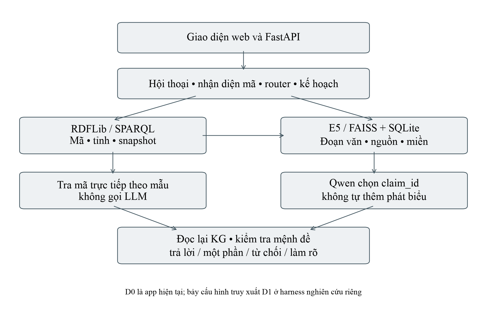
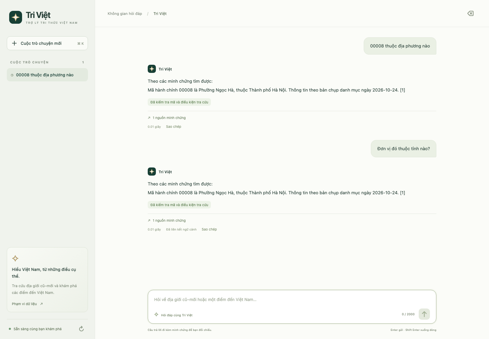

# CHƯƠNG 4 THIẾT KẾ VÀ TRIỂN KHAI HỆ THỐNG

## 4.1 Giới thiệu

Chương này trình bày sản phẩm đã triển khai và giải thích mối liên hệ giữa quyết định thiết kế với lỗi cần ngăn chặn. Kiến trúc ba lớp được hiện thực bằng các module Python, kho RDF, chỉ mục FAISS, SQLite metadata và giao diện web. Các chức năng có trong app D0 được tách khỏi các cấu hình mới chỉ chạy trong script nghiên cứu D1.

Phần triển khai có hai nguyên tắc chính. Thứ nhất, mọi kết quả phải có đường liên kết tới bản ghi hoặc đoạn nguồn đã được truy xuất. Thứ hai, một điều kiện chưa được dữ liệu và bộ thực thi xác nhận không được lược bỏ trong câu trả lời. Hai nguyên tắc này dẫn tới đường trả lời trực tiếp cho mã hành chính, giới hạn nội dung LLM được chọn và chính sách báo thiếu bằng chứng khi không gian hoặc thời gian vượt phạm vi.

## 4.2 Công trình và thiết kế liên quan

RDF và SPARQL tạo cơ sở cho việc biểu diễn và truy vấn quan hệ [10]. RAG và E5 cung cấp cơ sở cho nhánh văn bản [1,2], còn Qwen3 là họ mô hình của thành phần ngôn ngữ đang sử dụng [11]. Các tham khảo này xác định thành phần kỹ thuật, không tự chứng minh rằng bản cài đặt đã đạt mọi đặc tính được mô tả trong công trình gốc.

Một đường tích hợp graph và văn bản có thể lọc ứng viên theo thực thể trước khi tìm mô tả. Tuy nhiên, đây không đồng nghĩa triển khai hệ thống GraphRAG gồm community detection và community summarization. Dự án sử dụng KG theo mẫu truy vấn và phạm vi nguồn; không báo cáo kết quả như thể đã cài đặt toàn bộ một framework GraphRAG khác.

Cơ chế provenance và kiểm tra phát biểu giúp theo dõi câu trả lời ở mức chi tiết. Song việc câu đúng với một đoạn nguồn vẫn khác việc nguồn đó đúng trong thực tế. Kiến trúc vì thế giữ source_verified=false theo phạm vi hiện tại và dùng nhãn giao diện phân biệt “có minh chứng trích dẫn” với kiểm tra điều kiện tra mã. Đánh giá độc lập về nguồn và nội dung vẫn cần được tổ chức riêng.

## 4.3 Phương pháp thiết kế và triển khai

### 4.3.1 Thành phần và lưu trữ

Frontend sử dụng HTML, CSS và JavaScript thuần, được FastAPI phục vụ cùng origin. Không có bước build React/Vue. API tiếp nhận JSON, kiểm tra schema, giải quyết tham chiếu hội thoại rồi gọi lớp xử lý câu hỏi hoặc lớp trả lời. Cấu hình đường dẫn đọc từ biến môi trường và file cấu hình của dự án; dữ liệu và artifacts mặc định nằm cạnh thư mục SOURCE.

KG được RDFLib nạp từ Turtle vào bộ nhớ. Truy vấn SPARQL lấy từ mười mẫu có tham số trong thư mục queries. Có file RDF/XML và CSV phục vụ kiểm tra hoặc nạp Neo4j, nhưng đường query chính của API không sử dụng Neo4j. Chỉ mục FAISS lưu vector; SQLite chunks giữ doc_id, chunk_id, văn bản, miền, tiêu đề và nguồn. Không có bảng tài khoản người dùng hoặc kho lịch sử hội thoại ở backend.

Các dịch vụ được tái sử dụng trong một process qua cơ chế single_instance. Khóa thực thi mô hình tuần tự hóa công việc E5/Qwen trong process để hạn chế tranh chấp tài nguyên, nhất là khi sử dụng MPS. Khóa này không phải cơ chế điều phối nhiều worker hoặc nhiều máy. Vì vậy, hướng dẫn vận hành local ưu tiên một process và không suy ra năng lực phục vụ tải lớn từ việc demo hoạt động được.

### 4.3.2 Tiếp nhận và lập kế hoạch câu hỏi

QuestionRequest yêu cầu câu hỏi dài 2–2.000 ký tự sau chuẩn hóa và top_k trong khoảng 1–20 ở HTTP. ChatRequest bổ sung tối đa 12 lượt lịch sử với role user hoặc assistant. Các giới hạn này được schema kiểm tra; giá trị không hợp lệ trả lỗi validation thay vì đi thẳng vào mô hình.

Bộ nhận diện hành chính dùng chung ở router, planner, hội thoại và cross-check. Nó bảo toàn mã dưới dạng chuỗi, hiểu một số cách hỏi không dấu và phân biệt các trường hợp như mã bưu chính, mã đặt phòng, nhiều mã hoặc số đứng riêng. Các số trong “Phường 12” hay “Quận 10” được xem xét như phần tên địa phương, không tự coi là mã tỉnh.

Với mã được nhận diện rõ, route được ưu tiên về administration/kg. Điều này tránh phụ thuộc hoàn toàn vào dự đoán thống kê trên một câu rất ngắn. Planner chọn tra mã mặc định hoặc tra tại ngày/tỉnh khi có điều kiện rõ ràng. Khi ngày sai, có khoảng thời gian chưa hỗ trợ hoặc yêu cầu bán kính, kế hoạch ghi điều kiện chưa đáp ứng và không thực thi một truy vấn hiện tại thay thế.

Với câu không thuộc đường mã, router dùng mô hình TF-IDF/Logistic Regression, danh sách tên/alias và quy tắc. Nhãn route và query plan là hai lớp thông tin khác nhau. Dự đoán kg chỉ định hướng xử lý; planner vẫn phải tìm mẫu và tham số hợp lệ. Khi một truy vấn thực thể chung không tìm được dữ kiện, RAG fallback có thể được dùng, nhưng các truy vấn mã 03 và 09 không mở rộng sang RAG khi thiếu KG.

### 4.3.3 Tra cứu hành chính theo thời gian

Truy vấn 03_unit_by_code lấy bản được phần mềm đánh dấu current. Truy vấn 09_unit_at_time kiểm tra mã cùng ngày hoặc tỉnh cụ thể. Bộ thực thi và bộ kiểm tra sau truy vấn cùng xét điều kiện: snapshot phải đúng ngày, hoặc phải có khoảng hiệu lực đủ căn cứ. So sánh tỉnh ở đường thực thi sử dụng toàn tên sau chuẩn hóa dấu và tiền tố; chuỗi con như “Hà” không đủ để khớp “Hà Nội”.

Processor loại dòng sai mã, sai loại thực thể, thiếu tên hoặc thiếu tỉnh ở loại đơn vị cần tỉnh. Nếu không còn dòng phù hợp, dịch vụ trả lời báo missing_verified_code và không tạo trích dẫn giả. Nếu nhiều dòng phù hợp không thể phân giải, hệ thống yêu cầu thêm ngày hoặc địa phương. Việc thiếu dòng không được diễn đạt thành bằng chứng rằng mệnh đề người dùng hỏi là sai.

Câu tra mã đơn giản được dựng từ một bản ghi duy nhất bằng mẫu có kiểm tra. Trước khi trả lời, cùng kế hoạch KG được truy vấn lại; tập định danh và các giá trị đã sử dụng được so sánh. Như vậy, đường này có thể hoạt động ngay cả khi LLM chưa được nạp. Mốc snapshot được nêu trong câu để người dùng không nhầm bản danh mục lưu sẵn với một dịch vụ pháp lý cập nhật tức thời.

### 4.3.4 Nhánh RAG và hybrid của ứng dụng

FaissRetriever mã hóa query, tìm vector tương tự và nối kết quả với metadata SQLite. Bộ lọc miền và danh sách tài liệu hoặc tên thực thể được áp vào tập ứng viên. Với hybrid, KG có thể cung cấp source_record_ids và tên để giới hạn văn bản mô tả. Nếu graph không cung cấp đủ định danh nguồn, processor giữ cảnh báo; không coi việc tìm được một đoạn văn chung là đã xác nhận cùng thực thể.

Nếu thiếu file chỉ mục nhưng còn metadata phù hợp, đường dự phòng có thể dùng ứng viên từ FTS5 rồi mã hóa và xếp hạng vector trên tập đó. Chế độ được công bố là lexical_candidates_faiss. Chế độ này có phạm vi ứng viên và độ trễ khác full_faiss; kết quả lịch sử hai chế độ không được gộp để tuyên bố một mức chất lượng chung.

build_evidence lựa chọn các dòng KG và chunk đủ điều kiện. Ngưỡng mặc định cho RAG là 0,70, giới hạn evidence là 6. Các câu trích xuất được chọn theo ranh giới câu và mức giao từ với câu hỏi. Đây là heuristic ở tầng chuẩn bị mệnh đề, không phải cross-encoder reranker. Các giá trị cấu hình chưa được chứng minh là tối ưu qua một nghiên cứu siêu tham số độc lập.

### 4.3.5 LLM và kiểm tra mệnh đề

Danh sách allowed_claims được tạo trên máy chủ. Mệnh đề fact gồm trường, giá trị, mã evidence và mẫu diễn đạt; mệnh đề extractive là câu được trích từ văn bản. Qwen trả một JSON claim_ids. Bộ parse từ chối ID lạ, ID trùng, khóa bổ sung hoặc nội dung vượt hợp đồng. Vì vậy, mô hình không được tự viết thêm câu mô tả hoặc suy ra dữ kiện ngoài danh sách.

CrossChecker kiểm tra mệnh đề fact so với giá trị KG và câu render tương ứng; mệnh đề extractive phải khớp câu nguồn. Với câu mã, hợp đồng truy vấn được dựng lại từ câu hỏi để phát hiện việc planner làm mất mã, ngày hoặc tỉnh. Khi KG được đọc lại mà tập thành viên hoặc giá trị đã thay, hệ thống không xuất nội dung dựa trên snapshot cũ.

Có ba giới hạn cần nêu. Một trích đoạn đúng nguyên văn có thể chỉ trả lời một phần câu hỏi. Một nguồn chính thức vẫn có thể cần kiểm tra ngày hiệu lực. Và một mệnh đề được hỗ trợ không chứng minh mọi phát biểu người dùng mong muốn đã có đủ. Dịch vụ dùng trạng thái partial khi thiếu trường hoặc phần mô tả, abstained khi thiếu bằng chứng và needs_clarification khi cần làm rõ.

### 4.3.6 Hội thoại và giao diện

Bộ giải quyết tham chiếu dùng các lượt user để tìm chủ đề; không dùng mã hoặc địa danh do assistant bịa trong lịch sử làm bằng chứng. Câu tiếp nối có thể giữ mã và ngày qua nhiều lượt. Nếu người dùng nêu mã mới rõ ràng, mã đó được ưu tiên. Lịch sử mơ hồ hoặc chỉ có một loại mã khác sẽ dẫn tới yêu cầu làm rõ thay vì đoán từ một lượt cũ không liên quan.

Giao diện lưu cuộc trò chuyện tại localStorage, có thao tác gửi, hủy ở trình duyệt, thử lại, sao chép và mở nguồn. Hủy fetch chỉ giải phóng trạng thái phía trình duyệt; không bảo đảm dừng tức thời việc thực thi mô hình ở máy chủ. Dữ liệu lịch sử cũ không được tự viết lại sau khi sửa code. Người dùng cần gửi lại câu hỏi để nhận kết quả theo luồng mới.

### 4.3.7 Ranh giới với phương pháp nghiên cứu mới

Bảy cấu hình TF-IDF/BM25/E5/RRF và các điều kiện bổ sung được thực thi trong script run_research_experiments.py. Đây là một harness nghiên cứu có thể đọc D0 hoặc D1, không phải toàn bộ bộ điều phối đang phục vụ /v1/chat. Việc một cấu hình có điểm tốt trong harness không có nghĩa nó đã được thay vào app, có giao diện hoặc có kiểm thử end-to-end tương ứng.

Tương tự, các đoạn pháp lý mới chủ yếu được bổ sung vào văn bản RAG; builder không tự suy diễn toàn bộ đoạn thành các cạnh chuyển đổi đã được xác thực. Các cạnh nền vẫn đi từ bộ chuyển đổi có cấu trúc. Mọi kết luận về mức giảm ảo giác do khai thác đoạn mới cần một thí nghiệm câu trả lời riêng.

## 4.4 Thực nghiệm phần mềm và đối chứng chức năng

Lần kiểm tra lại đạt 353 unit test, bao phủ dữ liệu, KG, truy xuất, API, sinh, cross-check và hội thoại. Các ca dùng fake hoặc hashing encoder kiểm tra tính chất phần mềm, không được tính như các câu hỏi chấm chất lượng bằng mô hình thật.

Báo cáo HTTP của bản sửa mã D0 có 65 ca đạt, bao gồm câu có mã không tiền tố, câu không dấu, ngày/tỉnh sai, mã không tồn tại, input sai schema và hội thoại. Trong 19 phản hồi trả theo structured_kg của báo cáo này, thời gian generation ghi bằng 0 và nguồn được sử dụng là KG. Đây là bằng chứng của đường xử lý, không phải so sánh độ trễ tổng quát giữa mọi kiểu câu.

Báo cáo UI D0 ghi 33 kiểm tra Chromium đạt. Có hai trao đổi backend thật và nhiều tình huống mô phỏng lỗi mạng, 503 hoặc JSON không hợp lệ. Các kiểm tra cũng xác nhận nhãn tra mã được lưu đúng sau khi tải lại lịch sử, nguồn không an toàn không được tạo liên kết, và văn bản có HTML được hiển thị như văn bản. Không diễn giải 33 check thành 33 điểm đánh giá factuality độc lập.

Các tình huống ngoại lệ được đối chiếu như sau. Mã không được KG xác nhận dẫn tới từ chối và không chuyển sang đoạn du lịch gần nghĩa. Nhiều mã cần làm rõ. Câu có yêu cầu mô tả chưa đủ thì trả partial. Yêu cầu bán kính hoặc gần nhất không có bộ dữ liệu và phép tính tương ứng thì không được xác nhận. Câu hỏi ngoài phạm vi được giải thích theo miền ứng dụng, không tiếp tục trả lời mở.

Ngày 18/11/2026, candidate D1 được nạp đồng bộ graph, router và FAISS trên cổng 8011, đạt 65/65 ca HTTP và 33/33 kiểm tra UI. Health xác nhận full_faiss và Qwen/Transformers sẵn sàng. Kết quả ở research_validation_2026-11-18 bổ sung bằng chứng tương thích tích hợp; chưa phải chấm factuality, benchmark tải hoặc nghiệm thu triển khai cloud.

## 4.5 Kết luận

Hệ thống đã hiện thực đường KG, truy xuất văn bản, chọn mệnh đề và kiểm tra câu trả lời. Runtime Qwen3/Transformers và tra mã trực tiếp được ghi đúng trong bảng đối chứng. Chương 5 đánh giá nghiên cứu trên D0/D1, tách biệt với kiểm thử phần mềm ở chương này.
