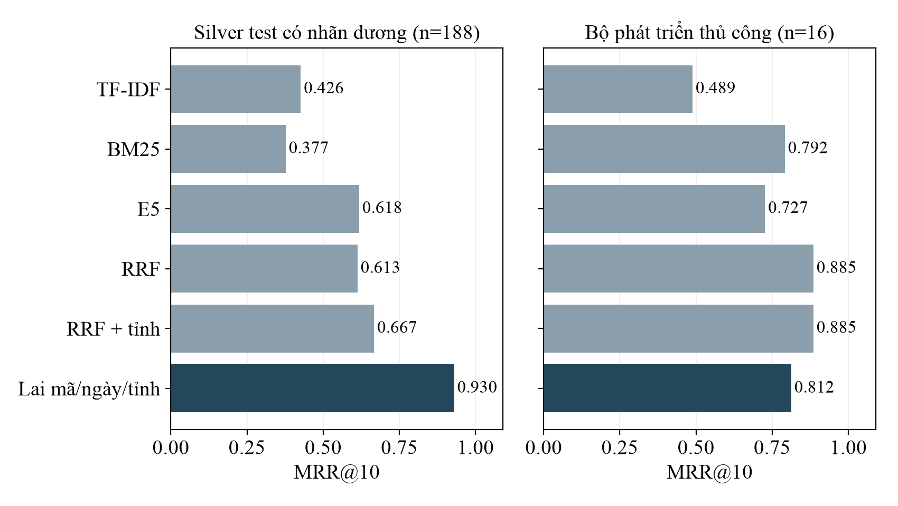
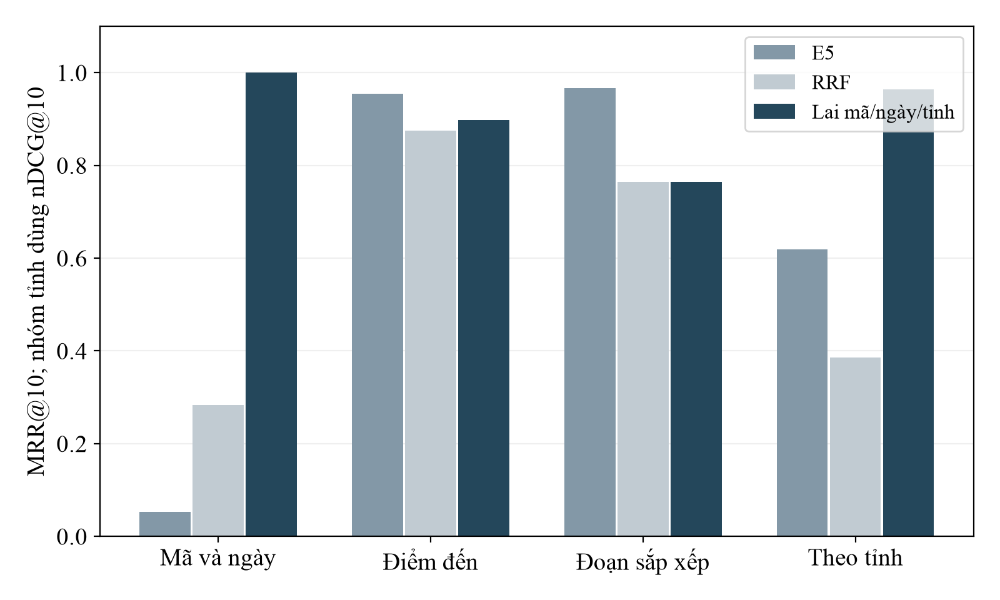

# CHƯƠNG 5 THỰC NGHIỆM VÀ PHÂN TÍCH KẾT QUẢ

## 5.1 Giới thiệu

Chương 5 trả lời các câu hỏi nghiên cứu bằng số đo đã lưu và nêu rõ giới hạn của từng phép đo. Đối tượng đánh giá gồm độ phủ dữ liệu, khả năng truy xuất, cơ chế xử lý ca thiếu snapshot, router và các kiểm thử của sản phẩm. Chương không thay mục tiêu trong kế hoạch bằng một tỷ lệ duy nhất, vì một hệ thống có nhiều tầng với các đơn vị đánh giá khác nhau.

Kết quả được phân biệt thành ba lớp. Lớp thứ nhất là kiểm tra phần mềm và truy vấn trên các ca được thiết kế. Lớp thứ hai là benchmark phát triển truy xuất trên câu hỏi có nhãn suy từ nguồn. Lớp thứ ba là đánh giá câu trả lời và tính đúng ngoài đời, hiện chưa có đầy đủ người chấm độc lập. Sự phân biệt này đặc biệt quan trọng khi đưa kết quả vào một báo cáo tốt nghiệp.

## 5.2 Công trình và nguyên tắc đánh giá liên quan

BEIR cho thấy việc đánh giá truy xuất cần xét nhiều phương pháp và nhiều kiểu tập dữ liệu [5]. Đồ án vận dụng nguyên tắc so sánh có đối chứng, nhưng chưa chạy bộ benchmark BEIR. Các kết quả trong chương không phải điểm zero-shot BEIR, GS-QA, MapQA hoặc Tourism QA.

RAGAs phân biệt các chiều của chất lượng RAG [9]. Trong phạm vi sản phẩm, mệnh đề fact có thể kiểm tra với graph và trích đoạn có thể kiểm tra với văn bản. Tuy nhiên, mức độ bám câu hỏi, độ đầy đủ, tính đúng của nguồn và chất lượng diễn đạt cần những tiêu chí chấm riêng. Một kiểm tra exact match không thay mọi chiều đánh giá ngữ nghĩa.

RRF là phương pháp gộp thứ hạng đã được công bố [4]. Thí nghiệm cần giữ lại trường hợp RRF tốt hơn và kém hơn retriever riêng, thay vì chỉ chọn một tập câu thuận lợi để quảng bá hướng lai. Tương tự, bộ lọc có thể tăng độ đúng điều kiện nhưng cũng làm giảm khả năng trả lời khi cách diễn đạt chưa được hỗ trợ.

## 5.3 Phương pháp và dữ liệu thực nghiệm

### 5.3.1 Phiên bản và môi trường

D0 dùng 31.949 tài liệu, 33.169 vector và các artifacts đang hoạt động trước mở rộng. D1 dùng 38.993 tài liệu, 41.280 vector và graph xây lại từ dữ liệu candidate. Các mô hình embedding là E5 pretrained, cùng chiều 768 và cùng giao thức query/passage. Không có fine-tune E5 hoặc Qwen trong thí nghiệm này.

Máy kiểm kê báo cáo là macOS trên arm64 với bộ nhớ 16 GiB; cấu hình encoding trong artifacts ghi thiết bị MPS và batch size 16 cho các lượt refresh. Thời điểm kiểm kê phần cứng không thay cho một log đo nhiệt độ, mức tải hoặc bộ nhớ cực đại tại từng lượt chạy. Vì vậy, chương không đưa ra kết luận về khả năng mở rộng hạ tầng hoặc tốc độ giữa các phương pháp từ những thông tin chưa được đo.

Bộ phân miền của D0 được dùng chung trong thí nghiệm truy xuất trên hai corpus. Router D1 được train lại trên 5.598 câu và có đánh giá riêng. Quyết định này giúp hạn chế việc thay đồng thời dữ liệu và router khi xét tác động của corpus. Hash dữ liệu và hash script trong reproducibility_manifest.json hỗ trợ kiểm tra phiên bản, kể cả khi working tree có thay đổi chưa commit.

### 5.3.2 Tập câu hỏi và đơn vị đánh giá

Tập silver có 263 câu, chia 52 dev và 211 test theo nhóm thực thể. Trong test có 188 câu với ít nhất một nhãn dương và 23 câu không có snapshot được hỗ trợ. Cùng một mã ở các snapshot khác nhau nằm chung split. Seed của bootstrap là 42; tham số RRF k = 60 và số ứng viên 200 được cố định, không chọn lại sau khi đọc điểm test.

Ngoài ra có 16 câu thủ công từ tập phát triển cũ. Cả hai bộ được chạy trên D0 và D1, nhưng số đo được lưu tách. Những câu silver về đoạn hành chính mới đương nhiên có thể không có tài liệu dương trong D0. Vì thế, so sánh điểm tổng D0/D1 phản ánh cả việc có thêm kiến thức và sự thay đổi thứ hạng; bảng chỉ câu hỏi cũ được dùng để làm rõ yếu tố thứ hai.

Đơn vị đánh giá là tài liệu sau gộp chunk theo doc_id. Một tài liệu xuất hiện qua nhiều chunk không được tính thành nhiều tài liệu dương độc lập. Với câu tỉnh, nhiều điểm du lịch trong corpus có thể là đáp án. Với một câu hỏi chung không nêu ngày, hai dòng quan sát NSO có cùng nội dung liên quan có thể đều phù hợp, dù nhãn thủ công cũ mới chỉ liệt kê một ID.

### 5.3.3 Phép đo và giới hạn

Hit@1 và Hit@5 đánh giá sự xuất hiện của ít nhất một tài liệu dương. MRR@10 chú trọng tài liệu dương đầu tiên. nDCG@10 phản ánh chất lượng thứ tự của tập dương ở top 10. Known-positive Recall@10 được giữ trong JSON, đặc biệt hữu ích với câu danh sách tỉnh. Các chỉ số chỉ tính trên 188 câu có nhãn dương ở test; 23 ca còn lại được dùng để tính khả năng từ chối.

Khoảng tin cậy cho chênh lệch MRR được bootstrap 1.000 lần theo 142 nhóm thực thể của các câu test có đáp án. Điều này giảm vấn đề lấy các câu cùng mã như độc lập hoàn toàn. Khoảng percentile 95% vẫn là khoảng của bộ silver hiện có, không phải bảo đảm về một quần thể câu hỏi người dùng chưa quan sát.

Trường ranking_ms của harness đo tổng phần xếp hạng của các cấu hình cùng lúc, không phải latency riêng mỗi phương pháp. Thời gian mã hóa query cũng được ghi riêng và có phần tải mô hình. Vì vậy, không dùng cột này để tuyên bố một phương pháp nhanh hơn phương pháp khác. Muốn so sánh tốc độ cần tách runner, warmup, số lượt lặp và phân bố tải.

## 5.4 Kết quả và thảo luận

### 5.4.1 Ma trận phương pháp trên D0 và D1

Bảng 5.1 Kết quả D0 trên silver test

| Phương pháp | Hit@1 | Hit@5 | MRR@10 | nDCG@10 | Từ chối đúng |
|---|---|---|---|---|---|
| TF-IDF | 0.0851 | 0.4415 | 0.2524 | 0.3022 | 0.0000 |
| BM25 | 0.1862 | 0.3085 | 0.2459 | 0.2468 | 0.0000 |
| E5 | 0.2926 | 0.3298 | 0.3106 | 0.2658 | 0.0000 |
| RRF | 0.2500 | 0.3883 | 0.3063 | 0.2882 | 0.0000 |
| RRF + miền | 0.2500 | 0.3883 | 0.3063 | 0.2882 | 0.0000 |
| RRF + miền + tỉnh | 0.3191 | 0.4309 | 0.3634 | 0.3824 | 0.0000 |
| Lai mã/ngày/tỉnh | 0.6436 | 0.6702 | 0.6531 | 0.6491 | 1.0000 |

Ở D0, nhiều câu hỏi về dữ liệu mới không có đủ nhãn dương trong corpus. “Độ phủ đầy đủ nhãn dương” đạt 56,22% theo định nghĩa của script: mọi tài liệu dương được liệt kê phải có trong corpus. Giá trị này không phải tỷ lệ câu có ít nhất một thông tin hữu ích. Với câu danh sách tỉnh, D0 có thể đã có nhiều điểm nhưng vẫn thiếu một số điểm mới trong tập nhãn D1.

Bảng 5.2 Kết quả D1 trên silver test

| Phương pháp | Hit@1 | Hit@5 | MRR@10 | nDCG@10 | Từ chối đúng |
|---|---|---|---|---|---|
| TF-IDF | 0.2128 | 0.6968 | 0.4264 | 0.4992 | 0.0000 |
| BM25 | 0.2553 | 0.5213 | 0.3769 | 0.4154 | 0.0000 |
| E5 | 0.5798 | 0.6596 | 0.6181 | 0.5865 | 0.0000 |
| RRF | 0.5160 | 0.7553 | 0.6127 | 0.6039 | 0.0000 |
| RRF + miền | 0.5160 | 0.7553 | 0.6127 | 0.6042 | 0.0000 |
| RRF + miền + tỉnh | 0.5904 | 0.7926 | 0.6669 | 0.6985 | 0.0000 |
| Lai mã/ngày/tỉnh | 0.8936 | 0.9840 | 0.9297 | 0.9402 | 1.0000 |

Trên D1, biến thể mã/ngày/tỉnh có MRR@10 bằng 0,9297 và Hit@5 bằng 0,9840. E5 đạt MRR 0,6181, còn RRF thường đạt 0,6127. Những giá trị này cho thấy tổ hợp có điều kiện phù hợp với cấu trúc của bộ câu phát triển, nhất là các mã và ngày chính xác. Chúng không được diễn giải thành 92,97% câu trả lời ngoài đời đúng hoặc một mức factual accuracy mới.

Hai cấu hình RRF và RRF thêm miền có kết quả gần như nhau ở lượt đo. Điều này là một kết quả có ích: bước phân miền không tạo mức tăng rõ trong tập này. Khi thêm tỉnh, MRR tăng lên 0,6669; khi thêm đường mã/ngày thì tăng mạnh hơn. So sánh ablation giúp xác định phần đóng góp thay vì gán toàn bộ chênh lệch cho việc “kết hợp AI”.

Cấu hình đề xuất từ chối đúng 23/23 ca test không có snapshot; các baseline truy xuất luôn cung cấp kết quả nên không có hành vi từ chối tương ứng. Lợi ích này đến từ một chính sách kiểm tra điều kiện có cấu trúc. Không nên mô tả nó như một phép đo thuần túy về năng lực hiểu ngữ nghĩa của embedding.

### 5.4.2 Phân tích theo loại câu hỏi

Bảng 5.3 Kết quả D1 theo nhóm câu

| Phương pháp | Mã/ngày MRR | Điểm đến MRR | Đoạn sắp xếp MRR | Theo tỉnh nDCG |
|---|---|---|---|---|
| TF-IDF | 0.4049 | 0.6502 | 0.3109 | 0.0622 |
| BM25 | 0.3622 | 0.5323 | 0.2887 | 0.0980 |
| E5 | 0.0524 | 0.9542 | 0.9667 | 0.6184 |
| RRF | 0.2838 | 0.8750 | 0.7650 | 0.3858 |
| RRF + miền | 0.2838 | 0.8750 | 0.7650 | 0.3880 |
| RRF + miền + tỉnh | 0.2838 | 0.8972 | 0.7650 | 0.9639 |
| Lai mã/ngày/tỉnh | 1.0000 | 0.8972 | 0.7650 | 0.9639 |

Ở nhóm mã/ngày, MRR của E5 chỉ 0,0524, trong khi đường kiểm tra khóa và snapshot đạt 1,0. Đây là nhóm được thiết kế rõ ràng theo mã và ngày ISO, nên phép tra có cấu trúc có lợi thế phù hợp bài toán. Kết quả không chứng minh E5 không dùng được trong toàn bộ miền hành chính; chính E5 lại xử lý tốt nhóm văn bản hành chính dài hơn.

Ở nhóm điểm đến, E5 đạt MRR 0,9542, cao hơn biến thể đề xuất 0,8972. Ở đoạn sắp xếp, E5 đạt 0,9667 còn biến thể lai đạt 0,7650. Các số này cho thấy gộp hạng có thể làm giảm thứ hạng của một tài liệu phù hợp ngữ nghĩa khi nhánh từ vựng không hỗ trợ cùng tài liệu. Đây là mô tả một cơ chế có thể xảy ra; cần đọc các ca lỗi trước khi khẳng định nguyên nhân cho từng câu cụ thể.

Ở câu tìm theo tỉnh, nDCG của E5 là 0,6184, RRF thường là 0,3858 và cấu hình có tỉnh đạt 0,9639. Tập câu này nhấn mạnh khả năng đáp ứng điều kiện tỉnh của các điểm trong corpus. Nó chưa chứng minh mọi địa chỉ đã được cập nhật đến xã mới hoặc mọi điểm của tỉnh đã có mặt trong dữ liệu.

### 5.4.3 Tác động bổ sung corpus trên câu hỏi cũ

Bảng 5.4 Chỉ các câu hỏi cũ trên hai corpus

| Phương pháp | D0 MRR@10 | D1 MRR@10 |
|---|---|---|
| TF-IDF | 0.4413 | 0.4669 |
| BM25 | 0.4047 | 0.3832 |
| E5 | 0.3275 | 0.3208 |
| RRF | 0.4053 | 0.4442 |
| RRF + miền | 0.4053 | 0.4442 |
| RRF + miền + tỉnh | 0.4053 | 0.4442 |
| Lai mã/ngày/tỉnh | 0.9668 | 0.9536 |

Điểm không tăng đồng loạt khi thêm tài liệu. E5 giảm từ 0,3275 xuống 0,3208 ở nhóm câu hỏi cũ, còn biến thể đề xuất giảm từ 0,9668 xuống 0,9536. Trong khi đó, RRF thường tăng từ 0,4053 lên 0,4442. Các thay đổi này cho thấy tác động của corpus cần được phân tích theo từng phương pháp và kiểu câu, không chỉ theo số lượng bản ghi.

Một phần khó khăn nằm ở các tài liệu tương đương nhưng chưa có nhãn. Chẳng hạn, dòng quan sát NSO mới có thể xếp trên dòng cũ và vẫn chứa ghi chú phù hợp với câu hỏi không chỉ rõ ngày. Nếu gold chỉ liệt kê dòng cũ, metric known-positive sẽ chấm tài liệu mới là không thuộc tập dương. Đây là lý do cần người duyệt nhãn và không được suy từ một thứ hạng thấp thành kết luận nội dung chắc chắn sai.

### 5.4.4 Kiểm tra bằng bộ phát triển thủ công

Bảng 5.5 Bộ phát triển thủ công giữ riêng

| Phương pháp | D0 MRR@10 | D1 MRR@10 |
|---|---|---|
| TF-IDF | 0.4881 | 0.4887 |
| BM25 | 0.7903 | 0.7917 |
| E5 | 0.8281 | 0.7266 |
| RRF | 0.8958 | 0.8854 |
| RRF + miền | 0.8958 | 0.8854 |
| RRF + miền + tỉnh | 0.8958 | 0.8854 |
| Lai mã/ngày/tỉnh | 0.8125 | 0.8125 |

Trên 16 câu thủ công, RRF thường đạt MRR 0,8854, cao hơn biến thể đề xuất 0,8125. E5 trên D1 đạt 0,7266. Kết quả thủ công là phản chứng đối với kết luận rằng biến thể có điều kiện luôn tốt hơn. Tập này nhỏ và đã dùng để phát triển, nhưng vẫn cần được giữ để phản ánh những cách hỏi ít bị khuôn silver chi phối hơn.

Hai câu hành chính không có kết quả ở đường có điều kiện là “Tra cứu mã 00070 Phường Hàng Trống trong danh mục trước sắp xếp tháng 7/2025” và “Xã Cờ Đỏ có mã số 31261 trong danh mục hành chính hiện tại”. Quy tắc từ chối các điều kiện thời gian chưa có phép giải rõ tương ứng. Vì vậy, metric truy xuất giảm nhưng hành vi không nhất thiết là phát biểu sai. Vấn đề cần giải quyết là chuẩn hóa cách diễn đạt thời gian và đánh giá cả mức độ hữu ích của phản hồi từ chối.

Câu thủ công về trải nghiệm tại khu phố cổ Hội An cũng không tìm thấy ID dương đã biết trong top 10 của biến thể đề xuất. Router vẫn phân miền du lịch; do đó, không thể quy lỗi này ngay cho phân miền. Cần kiểm tra ứng viên, thứ hạng và các nguồn thay thế trong annotation_review.csv. Báo cáo giữ ca lỗi và không thay nhãn sau khi đã xem kết quả để làm đẹp điểm.

### 5.4.5 Bootstrap và mức độ kết luận

Bảng 5.6 Bootstrap chênh lệch MRR trên D1

| Đối chứng | Chênh lệch MRR | Khoảng percentile 95% |
|---|---|---|
| BM25 | 0.5528 | [0.5055; 0.5918] |
| E5 | 0.3116 | [0.2026; 0.4134] |
| RRF | 0.3170 | [0.2430; 0.3918] |

Các khoảng bootstrap của chênh lệch trên silver test đều nằm phía dương trong lượt đo. Điều đó hỗ trợ nhận xét rằng tổ hợp có điều kiện tốt hơn những đối chứng được liệt kê trên cơ chế lấy mẫu hiện tại. Tuy nhiên, các mẫu câu và nhãn đã biết vẫn ưu ái các điều kiện có thể kiểm tra bằng khóa. Khoảng thống kê không khử được thiên lệch thiết kế này.

Không thực hiện điều chỉnh tham số sau khi xem test trong đợt báo cáo. Nếu phát triển tiếp cách gộp thích nghi theo kiểu câu, cần dùng dev để chọn thiết kế và một tập test kín mới để kết luận. Không được tận dụng những kết quả vừa phân tích làm cả căn cứ chọn phương pháp lẫn phép kiểm định cuối cùng trên chính các câu đó.

### 5.4.6 Kết quả router và KG

Router D1 train trên 5.598 câu, đạt route accuracy 25/26 = 0,9615 và domain accuracy 26/26 = 1,0 sau quy tắc. Router D0 được chạy lại với cùng code cũng đạt joint accuracy 0,9615. Câu lệch nhãn là một câu vừa có mã/ngày vừa yêu cầu mô tả: gold cũ ghi hybrid, còn quy tắc hiện ưu tiên kg và trả phần chưa đủ mô tả là partial. Đây là khác biệt chính sách cần ghi rõ, không phải bằng chứng đơn giản rằng dữ liệu mới làm mô hình kém hơn.

Trước quy tắc, route accuracy của mô hình thống kê D1 là 0,8846 và domain accuracy là 0,9231 trên cùng 26 câu. Các điểm này cần được tách khỏi điểm toàn pipeline. Tập 26 câu nhỏ và đã dùng phát triển; chưa có cơ sở dùng chúng như một benchmark phân loại độc lập có độ tổng quát cao.

KG D1 đạt 17/17 ca development. Trong 14 ca có expected_rows đầy đủ, tổng true positive là 9, false positive và false negative bằng 0; precision, recall và F1 bằng 1,0. Mẫu số binding dương nhỏ cần được nêu vì nhiều ca chủ yếu kiểm tra trả rỗng hoặc chống suy diễn điều kiện. Chỉ số này không xác nhận mọi quan hệ trong 28.832 cạnh đã được đọc và thẩm định pháp lý độc lập.

### 5.4.7 Đối chiếu yêu cầu chưa được đo

Kế hoạch đặt mục tiêu Accuracy/F1 90–98% và đánh giá Faithfulness, Context Relevancy. Hiện có metric cho router, KG và truy xuất, nhưng chưa có giao thức chấm độc lập đầy đủ cho câu trả lời cuối. Vì vậy, không có bảng điểm Faithfulness hoặc Context Relevancy thực nghiệm để điền bằng một con số ước lượng. Cross-check và unit test chỉ là bằng chứng kỹ thuật hỗ trợ.

Các bộ GS-QA, MapQA và Tourism QA mới ở mức khảo sát công trình liên quan. Chưa có kết quả tương ứng trong artifacts. Kế hoạch có tối ưu siêu tham số và so sánh prompt, nhưng lượt đo hiện cố định cấu hình. Không có ablation độc lập “bật/tắt cross-check” trên câu trả lời để định lượng tác động tới ảo giác và mức từ chối. Những công việc này được đưa vào backlog với tiêu chí nghiệm thu riêng.

## 5.5 Kết luận

Thực nghiệm xác nhận lợi ích của dữ liệu mới về độ phủ và lợi ích của ràng buộc chính xác đối với mã/ngày, tìm theo tỉnh. Đồng thời, E5 và RRF thường vẫn có lợi thế ở các nhóm mô tả hoặc tập thủ công. Kết quả phù hợp với việc sử dụng nhiều đường xử lý thay vì thay mọi truy vấn bằng một công thức duy nhất. Chương 5 cung cấp bằng chứng sơ bộ cho hướng lai, song còn cần nhãn độc lập, benchmark bên ngoài và đánh giá câu trả lời trước khi kết luận rộng về độ tin cậy của hệ thống.
