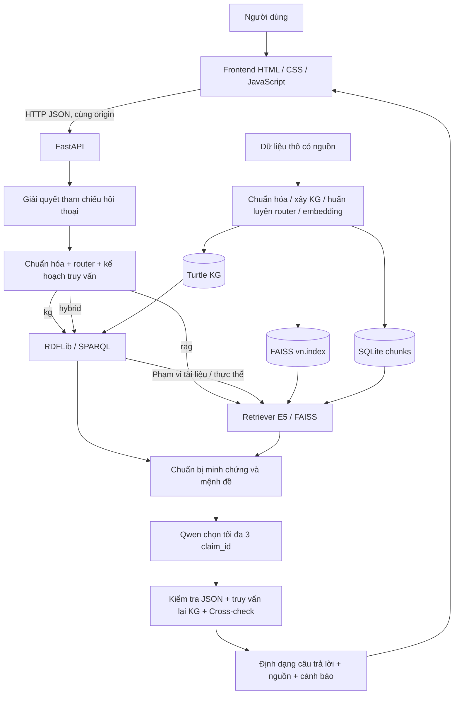

# Kiến trúc hệ thống Tri Việt

> Đối chiếu mã nguồn phiên bản ứng dụng `1.2.0` và artifacts đang lưu ngày **25/10/2026**. Các đường dẫn trong nội dung tính từ `DATN/`, trừ khi có chỉ dẫn khác. “Hiện có” mô tả code; “đề xuất” là phần chưa triển khai.
> Đợt cập nhật dữ liệu và huấn luyện lại: [DATA_REFRESH_2026-10-25.md](DATA_REFRESH_2026-10-25.md).

Tri Việt là trợ lý hỏi đáp tiếng Việt cho hai miền: **địa giới hành chính cũ–mới** và **du lịch Việt Nam**. Backend kết hợp tra cứu dữ kiện bằng Knowledge Graph (KG), tìm văn bản bằng RAG và chọn mệnh đề trả lời bằng LLM. Một câu trả lời có thể bị từ chối nếu không đủ minh chứng hoặc điều kiện truy vấn chưa được hỗ trợ.

## 1. Sơ đồ tổng thể

Nhánh KG có thể trả kết quả mà chưa cần nạp E5. Nhánh RAG không gọi LLM khi dùng trực tiếp `/v1/rag/search` hoặc `/v1/query`.

## 2. Frontend

| Thành phần | Hiện thực |
|---|---|
| Giao diện | `SOURCE/src/vn_assistant/static/index.html` |
| Trình bày | `static/style.css` |
| Tương tác | `static/app.js`, JavaScript thuần, `fetch` |
| Phân phối | FastAPI phục vụ `/` và mount `/assets` |
| Trao đổi | `GET /health`, `POST /v1/system/warmup`, `POST /v1/chat` |
| Lưu lịch sử | `localStorage`, khóa `triviet.chats.v1` |

Giao diện giữ tối đa 20 cuộc trò chuyện, 60 tin nhắn gần nhất mỗi cuộc; khi gọi API chỉ gửi 12 lượt gần nhất. Lượt gửi dùng `top_k=3`. Có hủy yêu cầu ở trình duyệt, thử lại, sao chép câu trả lời và hiển thị nguồn. Hủy `fetch` không bảo đảm dừng ngay tác vụ sinh đang chạy trên backend.

Không có bước build React/Vue, bảng tài khoản hoặc dịch vụ lưu lịch sử hội thoại trên server. Lịch sử tùy thuộc trình duyệt đang sử dụng.

## 3. Backend và ba lớp xử lý

| Lớp | Module chính | Trách nhiệm |
|---|---|---|
| Tiếp nhận và lập kế hoạch | `api.py`, `dialogue.py`, `router.py` | Kiểm tra request, giải quyết “đơn vị đó”, phân loại miền/route, nhận diện mã/ngày/tỉnh và giới hạn |
| Truy xuất tri thức | `question_processing.py`, `sparql_service.py`, `faiss_store.py` | SPARQL theo mẫu, tìm vector có bộ lọc miền và thực thể, gắn provenance |
| Sinh có kiểm soát và kiểm tra | `evidence.py`, `prompts.py`, `llm.py`, `generation.py`, `cross_check.py` | Tạo mệnh đề ứng viên, để LLM chọn, xác nhận lại dữ kiện, trả lời hoặc từ chối |

FastAPI sử dụng các hàm đồng bộ. `runtime.single_instance` tạo các dịch vụ dùng chung trong **một process**; khóa tải mô hình và `MODEL_EXECUTION_LOCK` tuần tự hóa công việc E5/Qwen, đặc biệt để hạn chế tranh chấp tài nguyên MPS. Khóa này không điều phối các process hoặc các máy khác nhau.

`config.py` đọc biến môi trường và `SOURCE/.env` khi import. Giá trị môi trường có sẵn được ưu tiên. Đường dẫn tương đối do người dùng cấu hình được tính từ `SOURCE`; khi tồn tại thư mục `data` bên cạnh `SOURCE`, mặc định dữ liệu, artifacts và models được tìm ở `DATN`.

## 4. AI và định tuyến

| Thành phần | Cấu hình hiện tại | Vai trò |
|---|---|---|
| Router | Hai pipeline TF-IDF từ/cụm ký tự + Logistic Regression, kết hợp quy tắc | Dự đoán `kg/rag/hybrid` và `administration/tourism` |
| Embedding | `intfloat/multilingual-e5-base`, vector 768 chiều trong chỉ mục hiện có | Mã hóa query và passage |
| LLM | `models/Qwen3-0.6B`, backend `transformers` | Chọn 0–3 mã mệnh đề từ danh sách có minh chứng |
| Cross-check | Python, kiểm tra trích đoạn và dữ kiện KG | Loại mệnh đề sai cấu trúc, không khớp hoặc vi phạm điều kiện |

Router đã được huấn luyện lại với 3.402 câu trong artifacts hiện có. E5 và Qwen dùng trọng số pretrained; pipeline không fine-tune hai mô hình này. Adapter `vllm` có trong code nhưng việc chạy trên server GPU cần kiểm chứng trên môi trường triển khai.

“Hybrid” ở đây là phối hợp **KG và RAG**. Nhánh FAISS đầy đủ không có bước cross-encoder reranking. Chi tiết ở [RAG_DESIGN.md](RAG_DESIGN.md).

## 5. Lưu trữ

| Kho | Tệp | Cách ứng dụng sử dụng |
|---|---|---|
| Bản ghi có cấu trúc | `data/structured_records.jsonl` | Đầu vào xây KG và tạo tập huấn luyện |
| Văn bản RAG | `data/rag_dataset_final.jsonl` | Đầu vào chunking và embedding |
| KG | `artifacts/kg/vn_knowledge_graph.ttl` | RDFLib nạp vào bộ nhớ, truy vấn SPARQL |
| Vector | `artifacts/faiss/vn.index` | FAISS tìm inner product trên vector chuẩn hóa |
| Metadata | `artifacts/faiss/metadata.sqlite3` | Ánh xạ vector → đoạn văn, tài liệu, miền và nguồn |
| Router | `artifacts/router/router.joblib` | Nạp mô hình và danh sách alias điểm đến |
| Neo4j tùy chọn | `SOURCE/docker-compose.yml`, CSV KG | Nạp graph để khảo sát; API hiện không truy vấn Neo4j |

Thống kê đối chiếu trực tiếp: **31.949 tài liệu**, **33.169 vector**, **17.973 node**, **28.460 quan hệ xuất CSV**. Số node bao gồm nhiều phiên bản của cùng mã hành chính. Bảng và quan hệ chi tiết ở [DATABASE.md](DATABASE.md).

## 6. Ba luồng truy vấn

1. **KG** — “Đơn vị có mã 00070 là gì?” → kế hoạch `03_unit_by_code` → lấy dữ kiện có cấu trúc → tạo mệnh đề → LLM chọn → truy vấn lại KG và kiểm tra.
2. **RAG** — “Giới thiệu hoạt động tham quan tại Hội An.” → lọc miền du lịch và tên/alias khi nhận diện được → E5/FAISS → trích câu từ các chunk đủ điểm → LLM chọn → kiểm tra trích đoạn.
3. **Hybrid** — “Hồ Hoàn Kiếm ở đâu và có gì đáng chú ý?” → KG xác định thực thể → lấy `source_record_ids`/tên làm bộ lọc ứng viên RAG → kết hợp dữ kiện và mô tả.

KG không có kết quả có thể dẫn sang `rag_fallback`. Riêng truy vấn ngày `09_unit_at_time` không dùng RAG để thay thế bằng chứng thời gian bị thiếu; dịch vụ trả lời cũng từ chối xác nhận mã nếu KG không chứng thực được mã đó.

## 7. Trạng thái, giới hạn và hướng mở rộng

Các trạng thái truy xuất gồm `ready`, `partial`, `no_evidence`, `unsupported_constraints`, `out_of_scope`. Kết quả trả lời gồm `answered`, `partial`, `abstained`; chat có thêm `needs_clarification`. HTTP 200 không đồng nghĩa đã trả lời thành công về nội dung.

Hiện có ba snapshot danh mục, không có timeline pháp lý liên tục; chưa có truy vấn bán kính, hình học biên giới hoặc khoảng cách. Dữ liệu du lịch giữ nguyên địa chỉ nguồn, có thể chứa tên hành chính cũ. Nguồn trích dẫn không tự tạo thành xác minh độc lập về tính đúng thực tế.

Chưa có xác thực API, phân quyền, rate limit, cơ sở dữ liệu hội thoại hoặc streaming token. Khi triển khai server cần bổ sung lớp truy cập và reverse proxy theo [DEPLOYMENT.md](DEPLOYMENT.md). Phương án nhiều replica, cơ sở dữ liệu nghiệp vụ và hệ thống cập nhật dữ liệu theo phiên bản là **đề xuất**, chưa phải thành phần hiện hữu.

## 8. Tài liệu liên quan

- [DATABASE.md](DATABASE.md), [API.md](API.md), [DEPLOYMENT.md](DEPLOYMENT.md).
- [DATA_SOURCES.md](DATA_SOURCES.md), [DATA_PIPELINE.md](DATA_PIPELINE.md).
- [RAG_DESIGN.md](RAG_DESIGN.md), [ADMINISTRATIVE_DATA.md](ADMINISTRATIVE_DATA.md), [TOURISM_DATA.md](TOURISM_DATA.md).
- [EVALUATION.md](EVALUATION.md).

Mã đối chiếu: [api.py](../src/vn_assistant/api.py), [config.py](../src/vn_assistant/config.py), [runtime.py](../src/vn_assistant/runtime.py), [question_processing.py](../src/vn_assistant/question_processing.py).
