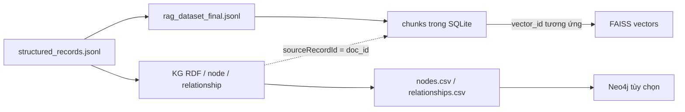
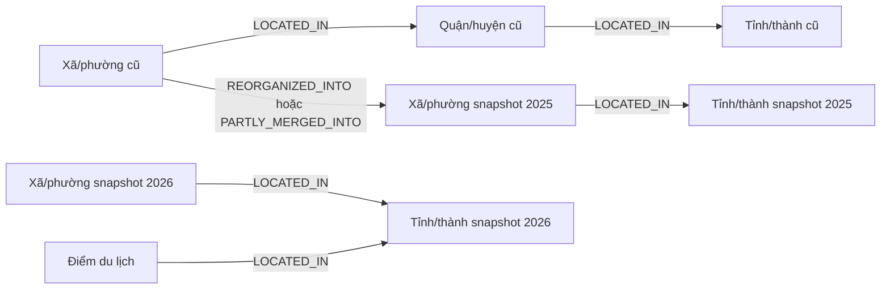

# Thiết kế lưu trữ và quan hệ dữ liệu

> Đối chiếu code và dữ liệu cục bộ ngày **25/10/2026**. Đường dẫn dữ liệu tính từ `DATN/`. Đây là thiết kế đang triển khai; các bảng mở rộng cuối tài liệu là đề xuất.
> Đợt cập nhật dữ liệu và huấn luyện lại: [DATA_REFRESH_2026-10-25.md](DATA_REFRESH_2026-10-25.md).

## 1. Các lớp dữ liệu

Hệ thống dùng JSONL làm dữ liệu đầu vào, RDF làm Knowledge Graph, FAISS làm chỉ mục vector và SQLite làm metadata. Không có PostgreSQL/MySQL, bảng người dùng hoặc bảng chat trong backend hiện tại.



Các liên kết giữa JSONL, RDF và SQLite là **quy ước định danh của ứng dụng**, không phải foreign key do một DBMS chung quản lý.

## 2. Bản ghi có cấu trúc

`data/structured_records.jsonl` lưu một JSON object mỗi dòng.

| Trường chung | Kiểu | Ý nghĩa |
|---|---|---|
| `record_id` | string | ID ổn định do `stable_id` sinh |
| `record_type` | string | `administrative_snapshot`, `administrative_conversion`, `administrative_source_document`, `administrative_reference`, `tourism_place` |
| `domain` | string | Dữ liệu hoạt động: `administration` hoặc `tourism` |
| `source_name` | string | Tên bộ dữ liệu/cơ quan nguồn |
| `source_url` | string | URL danh mục, văn bản hoặc hồ sơ |
| `data` | object | Các thuộc tính riêng của loại bản ghi |

Phân bố hiện có: 17.520 snapshot, 10.618 liên kết chuyển đổi, 37 hồ sơ thuộc tính văn bản, 3.321 dòng đối chiếu chính thức và 453 hồ sơ du lịch, tổng **31.949** bản ghi. Các trường riêng được giải thích ở [ADMINISTRATIVE_DATA.md](ADMINISTRATIVE_DATA.md) và [TOURISM_DATA.md](TOURISM_DATA.md).

`stable_id(kind, *parts)` chuẩn hóa khóa, nối các thành phần và lấy 16 ký tự đầu của SHA-1, thêm tiền tố loại. Đây là ID kỹ thuật, không phải mã hành chính hoặc chữ ký xác minh nội dung.

## 3. Tài liệu RAG

`data/rag_dataset_final.jsonl` có cấu trúc:

```json
{
  "id": "tourism_place_example",
  "domain": "tourism",
  "title": "Tên điểm đến",
  "text": "Tên điểm đến. Địa chỉ được nguồn ghi nhận: ... Mô tả ...",
  "source": {"name": "Tên nguồn", "url": "https://example.org/place"},
  "metadata": {"record_type": "tourism_place", "source_verified": false, "country": "VN"}
}
```

Ví dụ minh họa cấu trúc, không phải bản ghi thực tế. `document_from_record` gán `id = record_id`, giúp RAG và KG cùng tham chiếu bản ghi nguồn. `record_to_document` chuyển `id` thành `doc_id`; metadata tùy ý của tài liệu không được chuyển nguyên vẹn vào bảng `chunks`.

## 4. Bảng SQLite đang dùng

DDL trong `faiss_store.py`:

```sql
CREATE TABLE IF NOT EXISTS chunks (
    vector_id INTEGER PRIMARY KEY,
    chunk_id TEXT NOT NULL UNIQUE,
    doc_id TEXT NOT NULL,
    text TEXT NOT NULL,
    title TEXT NOT NULL,
    domain TEXT NOT NULL,
    source TEXT NOT NULL,
    source_url TEXT NOT NULL
);
CREATE INDEX IF NOT EXISTS idx_chunks_domain ON chunks(domain);
CREATE INDEX IF NOT EXISTS idx_chunks_doc ON chunks(doc_id);
```

| Cột | Vai trò |
|---|---|
| `vector_id` | ID số nguyên cũng được ghi vào FAISS `IndexIDMap2` |
| `chunk_id` | Duy nhất, dạng `{doc_id}:{chunk_number}`, số chunk bắt đầu từ 0 |
| `doc_id` | Một tài liệu có nhiều chunk; không có bảng `documents` làm khóa ngoại |
| `text`, `title` | Nội dung chunk và tiêu đề tài liệu |
| `domain` | Bộ lọc miền trước tìm vector |
| `source`, `source_url` | Nguồn hiển thị cho minh chứng |

`vector_id` phụ thuộc lần build và thứ tự dữ liệu; không dùng làm ID bền vững giữa các phiên bản corpus. SQLite không chứa cột embedding, ngày hiệu lực, thời điểm crawl hoặc điểm tin cậy; các thông tin này nằm ở dữ liệu gốc/KG/manifest tùy loại.

Kiểm tra chỉ đọc từ `DATN/`:

```bash
sqlite3 -readonly artifacts/faiss/metadata.sqlite3 \
  'SELECT domain, COUNT(*), COUNT(DISTINCT doc_id) FROM chunks GROUP BY domain;'
sqlite3 -readonly artifacts/faiss/metadata.sqlite3 'PRAGMA integrity_check;'
```

Kết quả đếm đã đối chiếu: `administration` có **31.496 chunk / 31.496 tài liệu**; `tourism` có **1.673 chunk / 453 tài liệu**.

## 5. Vector database / FAISS

| Thuộc tính | Giá trị trong `artifacts/faiss/index_config.json` |
|---|---|
| Loại chỉ mục | `IndexIDMap2(IndexFlatIP(768))` |
| Số vector | 33.169 |
| Số tài liệu | 31.949 |
| Kiểu số | `float32` |
| Embedding | `intfloat/multilingual-e5-base` |
| Đo tương tự | Inner product trên vector chuẩn hóa L2, tương đương cosine |
| Chunk | Tối đa 900 ký tự, overlap 150 ký tự |

FAISS là chỉ mục trong process, không phải một dịch vụ vector database chạy độc lập. Vector được lưu trong `vn.index`; tên và văn bản được nối từ SQLite bằng `vector_id`. Nội dung vector thô ở checkpoint `vn.index.build/vectors.f32` phục vụ tiếp tục build, không phải tệp cần đọc cho tìm kiếm thông thường.

Retriever kiểm tra số dòng metadata bằng `index.ntotal` và số chiều khớp encoder. Kiểm tra số lượng chưa chứng minh mọi vector gắn đúng văn bản: cần giữ index, metadata và config từ cùng một lần build.

## 6. Knowledge Graph

Namespace ontology: `https://w3id.org/vn-assistant/ontology#`; namespace thực thể: `https://w3id.org/vn-assistant/resource/`.

| Lớp có node trong bản build hiện tại | Số node | Giải thích |
|---|---:|---|
| `HistoricalProvince` | 63 | Snapshot tỉnh/thành cũ |
| `District` | 696 | Quận/huyện lịch sử |
| `HistoricalAdministrativeUnit` | 10.051 | Xã/phường lịch sử |
| `Province` | 68 | 34 ở snapshot 2025 và 34 ở snapshot thu thập 2026 |
| `Ward` | 6.642 | 3.321 ở mỗi snapshot mới |
| `TourismPlace` | 453 | Điểm đến, di tích, bảo tàng và nơi tham quan |

Tổng **17.973 node**. Ontology còn khai báo lớp di sản/pháp luật phục vụ tương thích; không có nghĩa corpus hiện tại có dữ liệu cho mọi lớp. `administrative_source_document` và `administrative_reference` đi vào RAG, chưa có nhánh ingest riêng để tạo node văn bản/sự kiện tương ứng trong KG. Các snapshot hiện tại được cập nhật nguồn và 29 tên theo bảng chính thức, giữ nguyên ID bản ghi và phiên bản 2025.

Thuộc tính node gồm tên, mã, mô tả, `validFrom`, `validTo`, `snapshotDate`, `isCurrentSnapshot`, `address`, `sourceName`, `sourceUrl`, `sourceRecordId`; tọa độ chỉ được ghi nếu nhánh ingest tương ứng cung cấp. Không giả định mọi node có tất cả thuộc tính.

| Quan hệ đang có | Số quan hệ trong báo cáo build | Ý nghĩa |
|---|---:|---|
| `LOCATED_IN` / `vn:locatedIn` | 17.842 | Đơn vị hoặc địa điểm thuộc đơn vị hành chính |
| `REORGANIZED_INTO` / `vn:reorganizedInto` | 9.513 | Liên kết chuyển đổi giữa hai snapshot |
| `PARTLY_MERGED_INTO` / `vn:partlyMergedInto` | 1.105 | Chuyển một phần hoặc trường hợp không thể coi là nhập toàn bộ |

Tổng **28.460 quan hệ xuất CSV**. RDF lưu triple quan hệ; `source_record_id` của từng cạnh được giữ trong `relationships.csv` nhưng không được biểu diễn dưới dạng reification/trường trên cạnh RDF. Provenance node không thay thế provenance pháp lý đầy đủ cho từng sự kiện.



Không tự suy ra quan hệ chuyển tiếp giữa snapshot 2025 và 2026 chỉ vì mã giống nhau.

## 7. Neo4j và chỉ mục dự phòng

`nodes.csv` lưu `id,label,name,code,description,valid_from,valid_to,source,source_record_id,latitude,longitude,address,source_url,snapshot_date,is_current_snapshot`. `relationships.csv` lưu `source_id,type,target_id,source_record_id`.

`neo4j_loader.py` tạo constraint duy nhất cho `(:Entity).id` và nạp theo lô. Loader hiện chỉ gán một tập thuộc tính node, **chưa gán** `address`, `source_url`, `snapshot_date`, `is_current_snapshot`; vì vậy Neo4j chưa là bản sao đầy đủ của RDF/CSV. API dùng RDFLib trực tiếp, không có bước đồng bộ hai chiều.

Nếu thiếu `vn.index` nhưng còn metadata, `MetadataFaissRetriever` có thể tạo `lexical.sqlite3`: bảng FTS5 `passages(text,title,content='',tokenize='unicode61 remove_diacritics 2')`, `rowid = vector_id`. Tệp này là cache sinh lại được, lấy ứng viên BM25 rồi mã hóa/tìm vector trên tập nhỏ. Không đánh đồng kết quả chế độ này với tìm kiếm toàn bộ chỉ mục.

## 8. Tính toàn vẹn và mở rộng

Khi cập nhật, giữ một bộ phiên bản gồm corpus, KG, router, FAISS, metadata, config và manifest; dừng tiến trình phục vụ trước khi thay toàn bộ bộ dữ liệu rồi khởi động lại. `os.replace` từng tệp trong builder không tạo transaction chung cho cả bộ artifacts.

**Đề xuất mở rộng:** thêm bảng `sources`, `documents`, `administrative_units`, `administrative_events`, `tourism_places`, `evaluation_cases` khi cần CRUD nghiệp vụ. Sự kiện nên có ngày hiệu lực, văn bản căn cứ và phạm vi chuyển đổi; địa điểm nên tách địa chỉ nguồn và địa chỉ chuẩn hóa. Các bảng này chưa tồn tại và API hiện không có endpoint CRUD tương ứng.

Mã đối chiếu: [dataio.py](../src/vn_assistant/dataio.py), [kg_builder.py](../src/vn_assistant/kg_builder.py), [faiss_store.py](../src/vn_assistant/faiss_store.py), [metadata_retriever.py](../src/vn_assistant/metadata_retriever.py), [neo4j_loader.py](../src/vn_assistant/neo4j_loader.py).
