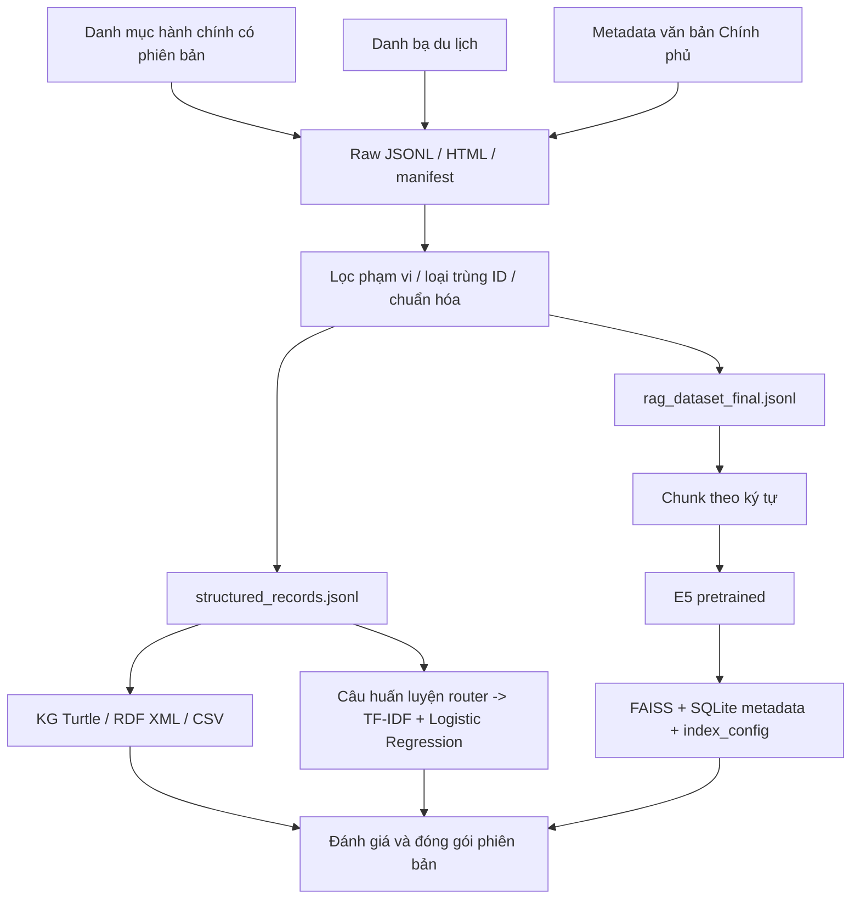

# Pipeline thu thập, chuẩn hóa và xây tri thức

> Theo code và artifacts ngày **25/10/2026**. Đường dẫn tính từ `DATN/`; các lệnh được chạy ở `DATN/SOURCE` bằng môi trường `../.venv`. Đây là quy trình xử lý dữ liệu, không phải một job tự chạy theo lịch.
> Đợt cập nhật dữ liệu và huấn luyện lại: [DATA_REFRESH_2026-10-25.md](DATA_REFRESH_2026-10-25.md).

## 1. Luồng dữ liệu



## 2. Thu thập

Đợt bổ sung sử dụng `crawl_domain_refresh.py` và `crawl_official_admin_refresh.py`, ghi vào `data/raw/2026-10-24-refresh/`. Kết quả gồm 440 hồ sơ du lịch và 3.321 dòng đối chiếu hành chính, kèm bảng tỉnh hiện tại và bảng tỉnh năm 2025. Collector hành chính dùng phân trang hiển thị của bảng DevExpress; crawler du lịch kiểm tra robots, cache và giãn lượt truy cập.

| Bước | Script / hàm | Kết quả và giới hạn |
|---|---|---|
| Danh mục hành chính + danh bạ du lịch | `collect_domain_data.py`, `collect_administration`, `collect_tourism` | Raw JSONL, cache HTML, manifest và báo cáo |
| Thuộc tính văn bản chính thức | `collect_official_administration.py` | 37 hồ sơ metadata, không phải toàn văn phụ lục |
| Bổ sung địa điểm được chọn | `collect_selected_destinations.py` | Tìm theo tên địa điểm và bộ lọc tỉnh |
| Ghép bổ sung | `append_selected_destinations.py` | Thêm hồ sơ chưa có ID, bao gồm phần vị trí Vịnh Hạ Long |

Ví dụ lệnh thu thập cho **workspace staging riêng**:

```bash
../.venv/bin/python -m pip install -e '.[dev,data]'
../.venv/bin/python scripts/collect_domain_data.py --per-province 6
../.venv/bin/python scripts/collect_official_administration.py
```

Collector danh mục xác nhận package đúng `2026.9.0` và kiểm tra số lượng đầu vào dự kiến. Crawler tôn trọng robots.txt, có cache, timeout và delay theo host; lỗi được ghi vào báo cáo. `collect_domain_data.py` có `--output`; collector văn bản và một số script bổ sung đang gắn thư mục raw `2026-10-24`, cần điều chỉnh trước chu kỳ mới để không ghi lẫn phiên bản.

## 3. Làm sạch và kiểm soát phạm vi

`prepare_domain_corpus.py` lọc miền di sản riêng và các mẫu di sản phi vật thể, loại hồ sơ lễ hội độc lập; địa điểm có giá trị lịch sử/văn hóa vẫn được giữ nếu thuộc phạm vi tham quan. Dữ liệu cũ được lọc rồi nén vào archive, không ghép tự động vào tập hoạt động.

Quy trình yêu cầu có bản ghi mới, có miền du lịch và không trùng `record_id`. Hàm `clean_text` chuẩn hóa NFC, bỏ NUL, gộp khoảng trắng. `normalized_key` tạo khóa tìm/ID bằng cách loại dấu kết hợp và ký tự ngoài tập quy định; đây không phải công cụ chuẩn hóa địa danh toàn diện. Không tự sửa tên đơn vị nguồn.

**Không chạy lại migration để cập nhật thường xuyên:** script từ chối khi đã có `domain_migration_2026-10-24.json`; lần thực thi thành công còn xóa các thư mục artifacts cũ và tệp dataset JSON cũ. Cần giữ nguyên nhật ký đã hoàn thành, tạo workspace/bộ dữ liệu phiên bản mới và xây artifacts riêng. Không xóa guard để ép chạy trên dữ liệu đang phục vụ.

`record_to_document` còn hỗ trợ lọc nội dung kỹ thuật/nguồn không dùng, đọc JSON array, object `records` và JSONL theo luồng. Tài liệu dưới 40 ký tự bị bỏ qua. Kiểm tra lại số đầu vào/đầu ra để biết có tài liệu nào bị loại.

## 4. Chuẩn hóa hai miền

Hành chính giữ mã dưới dạng chuỗi có số 0 đầu, phân biệt `legacy`, `reorganized2025`, `current`; không gộp node chỉ vì cùng mã. Liên kết chuyển đổi chỉ trỏ tới snapshot đã tồn tại, giữ `is_partial` và danh sách liên kết bỏ qua trong báo cáo.

Du lịch lấy tên, địa chỉ và mô tả; chuẩn hóa tỉnh bằng mã/bộ lọc danh bạ nhưng giữ nguyên địa chỉ nguồn. Trùng URL được kiểm soát trong collector; trùng ID được kiểm tra ở bước chuẩn bị. Chưa có thuật toán gộp mọi hồ sơ khác URL nhưng cùng địa điểm thực tế.

`document_from_record` tạo tài liệu RAG với `id=record_id`, tiêu đề, văn bản, miền và nguồn. Với chuyển đổi, tiêu đề chứa cặp tên/mã cũ–mới; với điểm đến, văn bản ghi rõ “Địa chỉ được nguồn ghi nhận”. Metadata có `source_verified=false`.

`prepare_corpus_refresh.py` là đường cập nhật bổ sung hiện tại: chuẩn bị một thư mục release riêng, ghép điểm đến theo URL và giữ ID cũ, đối chiếu nguồn, cập nhật tên hiện tại, lọc từng câu phi vật thể bằng `domain_scope.py`. Script kiểm tra ngày tra cứu chính thức khớp snapshot hiện tại; không tự áp dữ liệu khác ngày vào snapshot cũ. Bản nguồn thô và bản trước khi công bố nằm ngoài dữ liệu huấn luyện/truy xuất.

## 5. Xây KG và huấn luyện router

Đường cập nhật hiện tại dùng `train_domain_models.py`: xây KG từ `structured_records.jsonl`, sinh mẫu câu theo thực thể, loại câu trùng nguyên văn với tập test, huấn luyện hai bộ phân loại và ghi thêm danh sách thực thể/alias du lịch vào artifact router.

Đợt bổ sung dùng `retrain_domain_refresh.py --release <thư-mục-release>` để thực hiện các bước này bên trong release và không ghi đè dữ liệu đang phục vụ. Script tái sử dụng cách sinh mẫu của `train_domain_models.py`, sau đó đánh giá KG/router. Bản đã công bố có 3.402 câu train.

```bash
../.venv/bin/python scripts/train_domain_models.py
```

Kết quả gồm RDF Turtle/XML, `nodes.csv`, `relationships.csv`, báo cáo build, `router_training.csv`, `router.joblib`, báo cáo train/eval. Bộ mới nhất có **3.402 câu huấn luyện**, hai miền và ba route. Loại trùng nguyên văn chưa giải quyết rò rỉ theo thực thể hoặc mẫu câu; xem [EVALUATION.md](EVALUATION.md).

CLI `build-kg` và `train-router` có thể chạy riêng. Tuy nhiên `train-router` thông thường không thêm các bảng alias như script miền; nếu cần giữ hành vi nhận diện địa điểm hiện có, dùng quy trình miền hoặc bổ sung bước tạo alias tương đương.

`run_pipeline.py` là pipeline tổng quát dùng cùng một `--dataset` cho KG và FAISS. Với bố cục hiện tại có **hai tệp đầu vào chuyên biệt**, nên dùng nhánh xây KG/router và nhánh build RAG tách như trên; không giả định hai JSONL thay thế cho nhau.

## 6. Chunking và embedding

| Tham số | Hiện thực |
|---|---|
| Đơn vị chia | Ký tự Python, không phải token |
| Kích thước mặc định | 900 ký tự |
| Overlap | 150 ký tự |
| Điểm ngắt | Ưu tiên `. ` hoặc newline trong nửa sau đoạn khi tìm được |
| ID chunk | `{doc_id}:0`, `{doc_id}:1`, ... |
| Prefix | `passage: ` cho văn bản; `query: ` cho câu hỏi |
| Mở rộng từ | Từ viết tắt/thuật ngữ từ `DOMAIN_EXPANSIONS`, mặc định bật |
| Encoder | `intfloat/multilingual-e5-base`, pretrained, chuẩn hóa L2 |
| Vector | 768 chiều trong artifact hiện tại, float32 |

`clean_text` gộp xuống dòng trước chunking nên nhiều văn bản không còn ngắt dòng nguyên thủy. Thuật toán không bảo đảm toàn bộ chunk luôn là câu hoàn chỉnh. Kích thước theo ký tự không bảo đảm không vượt giới hạn tokenizer cho mọi loại văn bản.

Để build theo cấu hình mặc định hiện tại, tải cache E5 trước rồi chạy:

```bash
../.venv/bin/python scripts/download_runtime_models.py --models e5
../.venv/bin/python scripts/build_vectors.py \
  --dataset ../data/rag_dataset_final.jsonl \
  --output ../artifacts/faiss \
  --device cpu --batch-size 32
```

Thay `cpu` bằng `mps` trên Mac hoặc `cuda` khi đã xác nhận thiết bị. Script `build_vectors.py` dùng model E5 mặc định trong `EmbeddingConfig`; muốn chọn model khác cần dùng CLI `build-faiss --model ...` và bảo đảm đầu vào là RAG JSONL. Đây là mã hóa lại dữ liệu, không phải fine-tune E5.

## 7. Checkpoint và công bố chỉ mục

Trong `vn.index.build/`, builder giữ `signature.json`, `metadata.sqlite3`, `vectors.f32`. Signature gồm đường dẫn/kích thước/mtime dataset, model/device/batch/preprocessing, chunk/overlap, giới hạn tài liệu và phiên bản định dạng.

Mỗi batch ghi vector, flush/fsync rồi commit metadata. Khi tiếp tục, số dòng SQLite là mốc xác định phần vector đã commit; phần dư do crash được cắt bỏ. Nếu dataset đổi, builder chỉ chấp nhận khi cấu hình tương thích và toàn bộ prefix đã mã hóa vẫn khớp metadata. Không dùng cơ chế resume như một quy trình cập nhật tùy ý.

Theo dõi `artifacts/faiss/build_progress.json`; các trạng thái gồm `encoding`, `writing_index`, `complete`, `interrupted`. Chỉ chạy một builder cho một output. Giữ nguyên tham số khi tiếp tục; đổi device/batch cũng làm khác signature.

Khi hoàn tất, builder tạo FAISS `IndexIDMap2(IndexFlatIP)`, sao lưu SQLite và dùng `os.replace` để công bố từng tệp. Việc thay `vn.index`, metadata và config không nguyên tử như một bộ; cần ngừng phục vụ hoặc chuyển nguyên thư mục phiên bản trong cửa sổ triển khai rồi restart API.

`refresh_vectors.py` / `vector_refresh.py` bổ sung cách xây release mới từ một seed index: khôi phục cấu hình encoder của seed, giữ vector khi **toàn bộ text chunk không đổi**, mã hóa đoạn mới/đã sửa và bỏ mọi chunk không còn trong corpus. Output phải khác thư mục seed, chưa có bộ index cũ; nhánh này chưa có resume checkpoint giữa chừng. Sau khi kiểm thử, `publish_domain_refresh.py` công bố dữ liệu/KG/router/FAISS và giữ bản trước làm rollback ngoài corpus hoạt động.

## 8. Kiểm tra đầu ra

| Đối tượng | Đối chiếu sau công bố ngày 25/10/2026 |
|---|---:|
| Bản ghi/tài liệu hoạt động | 31.949 |
| Hành chính / du lịch | 31.496 / 453 |
| Chunk/vector | 33.169 |
| Node / quan hệ KG xuất CSV | 17.973 / 28.460 |
| Trạng thái build vector | `complete` |

Đối chiếu số tài liệu theo miền, ID duy nhất, quan hệ cha/con, tham chiếu chuyển đổi, checksum nguồn, số vector bằng metadata, số chiều/model và bộ câu hỏi đại diện trước khi dùng. `production_ready=true` trong config chỉ có nghĩa builder dùng transformer và không giới hạn tài liệu; không thay cho đánh giá chất lượng dữ liệu hay readiness triển khai.

Code chưa có scheduler/orchestrator hay hàng đợi cập nhật. Đã có ghép release và tái sử dụng vector văn bản không đổi; việc duyệt nguồn, chọn snapshot/ngày, kiểm tra báo cáo và dừng service trước công bố vẫn do người vận hành thực hiện.

Mã đối chiếu: [corpus_update.py](../src/vn_assistant/corpus_update.py), [prepare_domain_corpus.py](../scripts/prepare_domain_corpus.py), [train_domain_models.py](../scripts/train_domain_models.py), [dataio.py](../src/vn_assistant/dataio.py), [faiss_store.py](../src/vn_assistant/faiss_store.py).
