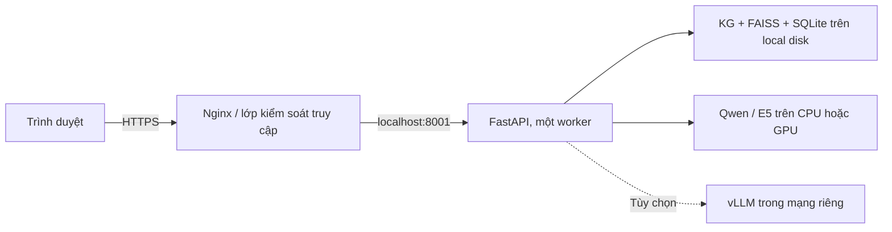

# Triển khai trên server hoặc cloud VM

> Hướng dẫn theo mã nguồn ngày **25/10/2026**. Chạy local trên Mac đã có script; quy trình Linux, systemd và Nginx dưới đây là cấu hình triển khai đề xuất, chưa được xác nhận bằng một lần deploy cloud trong bộ tài liệu này. Các khối cấu hình cần thay domain và đường dẫn cho môi trường thật.
> Đợt cập nhật dữ liệu và huấn luyện lại: [DATA_REFRESH_2026-10-25.md](DATA_REFRESH_2026-10-25.md).

## 1. Mô hình triển khai



Có thể dùng một VM Linux trên nhà cung cấp cloud bất kỳ. Mã nguồn chưa có cấu hình Kubernetes, Terraform, Dockerfile ứng dụng hay CI/CD. `docker-compose.yml` hiện chỉ khởi chạy **Neo4j**, không triển khai toàn hệ thống.

## 2. Chuẩn bị máy và bộ tệp

Code yêu cầu Python >=3.10; nên dùng Python 3.12+ nếu cần thu thập với dependency `vietnam-provinces` đã pin. Cài môi trường Linux phù hợp với PyTorch/FAISS. CPU có thể chạy nhưng cần đo độ trễ; GPU CUDA là tùy chọn, MPS chỉ áp dụng trên Mac có hỗ trợ.

Ước lượng khởi đầu cho thử nghiệm: VM 4 vCPU, RAM 8–16 GB và SSD còn trống tối thiểu 10 GB. Đây không phải ngưỡng đã benchmark; kiểm tra dung lượng corpus, model, cache, checkpoint và tải thực tế trước khi chốt cấu hình. Với CPU, Qwen được code nạp float32; CUDA/MPS dùng float16.

Giữ bố cục:

```text
/srv/vn-assistant/
├── SOURCE/                  # Code, static, ontology, queries, .env
├── data/                    # structured_records.jsonl, rag_dataset_final.jsonl, router_training.csv
├── artifacts/
│   ├── kg/                  # vn_knowledge_graph.ttl và báo cáo/CSV nếu cần
│   ├── faiss/               # vn.index, metadata.sqlite3, index_config.json
│   └── router/              # router.joblib
├── models/Qwen3-0.6B/
└── .venv/                   # Tạo mới trên server
```

Chuyển code cùng bộ artifacts tương ứng từ máy nguồn bằng công cụ truyền tệp của bạn. Không sao chép `.venv` macOS sang Linux. Dữ liệu raw và báo cáo cần giữ để tái lập, nhưng API không cần đọc tất cả raw/cache trong hoạt động thông thường.

Không chỉ lấy Git remote rồi giả định có đủ model/artifacts: nhiều tệp dữ liệu đang nằm ngoài repository `SOURCE`. `router.joblib` là định dạng nạp đối tượng Python; chỉ sử dụng artifact từ nguồn tin cậy của dự án.

## 3. Cài Python và model

Giả định tài khoản dịch vụ `vnassistant` đã có quyền đọc bộ tệp và quyền ghi thư mục cache cần thiết. Tạo thư mục và tài khoản bằng quy trình quản trị server của bạn. Chạy các bước cài đặt bằng tài khoản sẽ chạy ứng dụng:

```bash
cd /srv/vn-assistant
python3.12 -m venv .venv
.venv/bin/python -m pip install --upgrade pip
cd SOURCE
../.venv/bin/python -m pip install -e '.[dev,data]'
../.venv/bin/python scripts/download_runtime_models.py --models all
```

`[dev,data]` hữu ích cho kiểm thử và thu thập; máy phục vụ thuần túy có thể cài `-e .`. Trên máy GPU, cài bản PyTorch phù hợp phần cứng/driver của môi trường rồi kiểm tra `torch.cuda.is_available()`; lệnh cài mặc định chưa chứng minh CUDA đã sẵn sàng.

Script tải Qwen về `models/Qwen3-0.6B`; E5 về cache Hugging Face của tài khoản đang chạy. Revision được pin trong `download_runtime_models.py`, manifest ở `artifacts/backend/`. Để chạy offline, tải trước cache E5 và bảo đảm service sử dụng đúng cache/tài khoản đó.

Lưu ý: `FaissRetriever` khôi phục tên model và cách tiền xử lý từ `index_config.json`; đổi riêng `EMBEDDING_MODEL` không thay model của một chỉ mục đã có config. Khi chuyển cache/model sang server, phải giữ model/revision tương thích hoặc build một bộ chỉ mục mới.

## 4. Cấu hình `.env`

Sao chép `.env.example` khi chưa có cấu hình môi trường đích; không ghi đè `.env` hiện có mà chưa đối chiếu. Ví dụ cho server CPU, lưu tại `/srv/vn-assistant/SOURCE/.env`:

```dotenv
DATASET_PATH=../data/structured_records.jsonl
KG_TTL_PATH=../artifacts/kg/vn_knowledge_graph.ttl
FAISS_INDEX_PATH=../artifacts/faiss/vn.index
FAISS_METADATA_PATH=../artifacts/faiss/metadata.sqlite3
ROUTER_MODEL_PATH=../artifacts/router/router.joblib
EMBEDDING_MODEL=intfloat/multilingual-e5-base
EMBEDDING_DEVICE=cpu
LLM_BACKEND=transformers
LLM_MODEL=../models/Qwen3-0.6B
LLM_DEVICE=cpu
LLM_MAX_NEW_TOKENS=384
LLM_CONTEXT_WINDOW=4096
LLM_TIMEOUT_S=60
LLM_LOCAL_FILES_ONLY=true
ANSWER_MAX_EVIDENCE=6
ANSWER_MIN_RAG_SCORE=0.70
```

Đổi `LLM_DEVICE=cuda` và `EMBEDDING_DEVICE=cuda` chỉ sau khi xác nhận CUDA. Các đường dẫn tương đối được tính từ `SOURCE`. Sau khi đổi cấu hình hoặc artifacts phải khởi động lại process vì Settings và dịch vụ được cache.

## 5. Kiểm tra và chạy thử

Chạy từ `SOURCE`, dùng terminal riêng cho process server:

```bash
../.venv/bin/python -m vn_assistant.cli serve --host 127.0.0.1 --port 8001
```

Sau đó:

```bash
curl --fail http://127.0.0.1:8001/health
curl --fail -X POST http://127.0.0.1:8001/v1/system/warmup
curl --fail http://127.0.0.1:8001/v1/chat \
  -H 'Content-Type: application/json' \
  -d '{"question":"Đơn vị có mã 00070 là gì?","top_k":3,"history":[]}'
```

Yêu cầu readiness: warmup `status=ready`, `/health` có `kg_ready`, `llm.ready`; nếu triển khai chỉ mục đầy đủ thì `retrieval_mode=full_faiss` và `artifacts_present.faiss=true`. HTTP 200 hoặc `status=ok` ở health chưa đủ. Kiểm tra thêm một câu RAG và một câu hybrid để đi qua E5 và Qwen thật.

## 6. Chạy nền bằng systemd

Ví dụ `/etc/systemd/system/vn-assistant.service` trên Linux dùng systemd. Tài khoản/nhóm `vnassistant` phải được tạo trước:

```ini
[Unit]
Description=Tri Viet VN Hybrid Assistant
After=network-online.target
Wants=network-online.target

[Service]
Type=simple
User=vnassistant
Group=vnassistant
WorkingDirectory=/srv/vn-assistant/SOURCE
EnvironmentFile=/srv/vn-assistant/SOURCE/.env
Environment=PYTHONUNBUFFERED=1
Environment=PYTHONFAULTHANDLER=1
ExecStart=/srv/vn-assistant/.venv/bin/python -m uvicorn vn_assistant.api:app --host 127.0.0.1 --port 8001 --workers 1
Restart=on-failure
RestartSec=5
TimeoutStopSec=90

[Install]
WantedBy=multi-user.target
```

```bash
sudo systemctl daemon-reload
sudo systemctl enable --now vn-assistant
sudo systemctl status vn-assistant
sudo journalctl -u vn-assistant -n 100 --no-pager
```

Dùng một worker cho bản triển khai đầu tiên: mỗi process nạp riêng KG/E5/Qwen; khóa đồng bộ không chia sẻ giữa các worker. Warmup lại sau restart trước khi mở traffic. systemd `active` chỉ xác nhận process chạy, chưa phải model đã sẵn sàng.

## 7. Nginx và HTTPS

Ví dụ server block HTTP để kiểm tra reverse proxy, thay `assistant.example.com` bằng domain thật:

```nginx
server {
    listen 80;
    server_name assistant.example.com;
    client_max_body_size 1m;

    location / {
        proxy_pass http://127.0.0.1:8001;
        proxy_http_version 1.1;
        proxy_set_header Host $host;
        proxy_set_header X-Real-IP $remote_addr;
        proxy_set_header X-Forwarded-For $proxy_add_x_forwarded_for;
        proxy_set_header X-Forwarded-Proto $scheme;
        proxy_read_timeout 180s;
        proxy_send_timeout 180s;
    }
}
```

Kiểm tra `sudo nginx -t` trước reload. Khối trên chưa cấu hình TLS: cấp chứng chỉ cho domain bằng công cụ quản trị chứng chỉ của môi trường, bật listener 443 và chuyển HTTP sang HTTPS trước khi mở truy cập công khai. Dùng cùng origin cho giao diện và API; backend chưa cấu hình CORS cho frontend nằm ở domain khác.

Vì ứng dụng hiện chưa có auth/rate limit, triển khai thử nghiệm nên dùng VPN, allowlist hoặc lớp đăng nhập tại reverse proxy. Firewall chỉ mở cổng cần thiết, giữ Uvicorn và vLLM trong mạng riêng. Không đưa `.env`, thư mục model hoặc artifacts thành static public.

## 8. Lựa chọn vLLM và Neo4j

Adapter vLLM cần `GET /v1/models`, `POST /tokenize` và `POST /v1/chat/completions`; server chỉ có endpoint chat tương thích OpenAI là chưa đủ. Đặt `LLM_BACKEND=vllm`, `LLM_BASE_URL=http://127.0.0.1:8002/v1`, `LLM_MODEL` bằng đúng ID server công bố và `LLM_API_KEY` nếu cần. Nên dùng ID không bắt đầu bằng `.` hoặc `/`, vì `config.py` xử lý các giá trị đó như đường dẫn cục bộ. Cần kiểm chứng adapter trên phiên bản server lựa chọn; không có lần deploy vLLM thực tế được xác nhận ở đây.

Neo4j chỉ cần nếu muốn duyệt graph/import CSV. Sửa thông tin đăng nhập mặc định trong Compose, khớp `NEO4J_PASSWORD` rồi mới chạy từ `SOURCE`:

```bash
docker compose up -d neo4j
../.venv/bin/python -m vn_assistant.cli load-neo4j
```

Giới hạn cổng 7474/7687 trong mạng riêng hoặc bind loopback. API hiện vẫn dùng RDFLib dù Neo4j đã nạp thành công; giới hạn thuộc tính loader ở [DATABASE.md](DATABASE.md).

## 9. Cập nhật, sao lưu và rollback

1. Chuẩn bị corpus và build toàn bộ artifacts ở thư mục phiên bản mới; không chạy migration dọn dữ liệu trên server đang phục vụ.
2. Kiểm tra số vector/dòng metadata, KG, router và câu hỏi đại diện; lưu checksum, manifest, cấu hình và phiên bản dependency.
3. Dừng service, sao lưu bộ cũ, chuyển nguyên bộ tệp phiên bản mới rồi khởi động lại. Builder thay tệp riêng lẻ, không có transaction chung cho toàn bộ bộ dữ liệu.
4. Warmup, kiểm tra mode và smoke test. Khi lỗi, dừng service và phục hồi nguyên bộ trước đó.

Sao lưu `data`, artifacts phục vụ, model manifest/revision và `.env` theo chính sách bí mật. Checkpoint và cache có thể tốn nhiều đĩa; không xóa khi build đang chạy. Lịch sử chat nằm trong trình duyệt, không có trong bản sao lưu server.

## 10. Xử lý sự cố

| Hiện tượng | Kiểm tra |
|---|---|
| 503 khi warmup | Đường dẫn model/KG/metadata, quyền đọc, cache E5, thiết bị CUDA/MPS |
| `lexical_candidates_faiss` ngoài dự kiến | Thiếu `vn.index`, sai đường dẫn hoặc chưa restart sau build |
| `Index and metadata counts differ` | Index và SQLite có cùng phiên bản không |
| Model sai số chiều/backend | `index_config.json`, model/revision và preprocessing dùng khi build |
| 400 context | `LLM_CONTEXT_WINDOW`, số minh chứng, ngân sách token sinh |
| Nginx 502/504 | Service/log, cổng proxy, warmup, thời gian chờ thực tế |
| RAM/VRAM tăng mạnh | Số process, model đang nạp, batch embedding, tác vụ build chạy chung |
| Trả `abstained` | Xem warnings, query plan, dữ liệu nguồn và điều kiện; không chỉ tăng timeout |

Mã đối chiếu: [config.py](../src/vn_assistant/config.py), [cli.py](../src/vn_assistant/cli.py), [run_assistant.sh](../scripts/run_assistant.sh), [download_runtime_models.py](../scripts/download_runtime_models.py), [docker-compose.yml](../docker-compose.yml).
