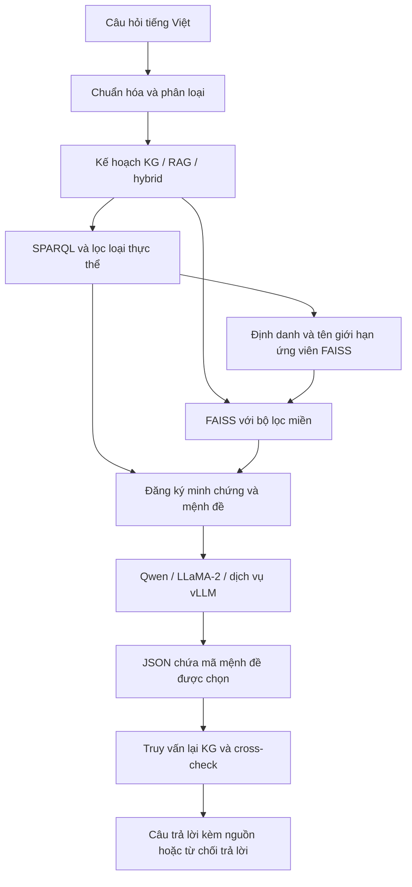

# Giải thích triển khai trợ lý kiến trúc ba lớp

**Đề tài:** Trợ lý ảo phục vụ tra cứu di sản, du lịch và hành chính Việt Nam.  
**Ngày cập nhật:** 23/10/2026.  
**Phạm vi:** Question Processing, LLM, cross-check, giao diện đàm thoại, khôi phục chỉ mục và kiểm thử hệ thống. Tài liệu này giải thích code bên ngoài các tệp nguồn. Kết quả ngày 10/10 được giữ riêng như số liệu của lần triển khai trước.

## 1. Cơ sở lý thuyết và lựa chọn thiết kế

Trong hệ thống hỏi đáp, mô hình ngôn ngữ có thể tạo câu văn phù hợp nhưng thiếu căn cứ. Vì vậy, hệ thống cần phân biệt nhiệm vụ xác định dữ kiện với nhiệm vụ trình bày nội dung. Nhánh KG lưu các thực thể và quan hệ theo cấu trúc; nhánh RAG tìm những đoạn văn liên quan; LLM sử dụng các kết quả này để lựa chọn nội dung trả lời.

Nghiên cứu RAG của Lewis và cộng sự kết hợp bộ nhớ tham số của mô hình với bộ nhớ truy xuất ngoài mô hình [1]. Đồ án vận dụng nguyên tắc cung cấp minh chứng ngoài mô hình, nhưng sử dụng thêm KG và bộ định tuyến câu hỏi. Đây là lựa chọn kiến trúc của đồ án, không phải khẳng định rằng mô hình RAG gốc đã có đầy đủ các thành phần này.

Việc gắn một trích dẫn vào câu trả lời chưa đủ để chứng minh câu đó đúng. ALCE đánh giá riêng chất lượng nội dung và chất lượng trích dẫn [2]. Do đó, backend quản lý nguồn ở phía máy chủ và kiểm tra từng mệnh đề trước khi xuất câu trả lời. Hệ thống không cho LLM tự tạo URL hoặc mã nguồn.

Trong phiên bản này, LLM chọn và sắp xếp các mệnh đề đã được chuẩn bị từ minh chứng. Các dữ kiện KG được diễn đạt bằng mẫu xác định; phần văn bản dùng đoạn trích nguyên câu. Thiết kế này giúp kiểm tra tự động một cách rõ ràng, nhưng hạn chế khả năng diễn giải tự do. Đây là sự đánh đổi chủ động để ưu tiên tính truy vết trong giai đoạn kiểm thử.

## 2. Kiến trúc và luồng xử lý



Ba lớp có trách nhiệm liên thông: lớp tri thức cung cấp dữ kiện, lớp truy xuất cung cấp văn bản, lớp ngôn ngữ lựa chọn nội dung để trình bày. Question Processing điều phối luồng; cross-check đặt ở sau bước lựa chọn của LLM. API sử dụng RDFLib để thực thi SPARQL trên KG cục bộ; việc chạy backend này không bắt buộc phải khởi động Neo4j.

| Tệp | Vai trò chính |
|---|---|
| `router.py` | Phân loại route/domain, trích xuất tham số và ràng buộc |
| `question_processing.py` | Thực hiện bước 1–2, lọc KG, điều phối FAISS và đo thời gian |
| `sparql_service.py` | Render tham số an toàn và thực thi SPARQL |
| `faiss_store.py` | Lọc tập ứng viên trước tìm kiếm, trả top-k và metadata |
| `metadata_retriever.py` | Tìm ứng viên bằng FTS5 rồi xếp hạng bằng E5 và FAISS khi thiếu chỉ mục toàn bộ |
| `index_recovery.py` | Khôi phục vector từ metadata, ghi checkpoint và xuất chỉ mục toàn bộ |
| `evidence.py` | Xây dựng sổ minh chứng và các mệnh đề có thể lựa chọn |
| `prompt_templates/*.txt`, `prompts.py` | Bộ prompt và tạo hội thoại cho LLM |
| `llm.py` | Adapter Transformers/PyTorch và dịch vụ vLLM |
| `generation.py` | Kết nối truy xuất, LLM, kiểm tra lại KG và định dạng kết quả |
| `cross_check.py` | Xác nhận dữ kiện, đoạn trích và nguồn trích dẫn |
| `api.py`, `cli.py` | Giao diện HTTP và terminal |
| `dialogue.py` | Giải quyết một số câu hỏi nối tiếp dựa trên câu hỏi trước của người dùng |
| `static/index.html`, `static/style.css`, `static/app.js` | Giao diện Tri Việt, hội thoại và kết nối API |
| `config.py` | Đường dẫn, mô hình, giới hạn và cấu hình từ môi trường |
| `runtime.py` | Khóa khởi tạo tài nguyên và điều phối thao tác mô hình trong cùng tiến trình |

## 3. Question Processing: bước 1 và bước 2

### 3.1. Phân loại câu hỏi

`QuestionRouter` chuẩn hóa khoảng trắng và Unicode, sau đó dùng mô hình TF-IDF kết hợp Logistic Regression để dự đoán nhánh và miền dữ liệu. Đặc trưng gồm n-gram từ và ký tự. Các luật nhận diện mã hành chính, sáp nhập hoặc nhu cầu mô tả bổ sung cho mô hình thống kê.

Ba nhánh được sử dụng là `kg`, `rag` và `hybrid`. Miền gồm `administration`, `heritage`, `tourism`, `law`. Ví dụ, tra một mã hành chính thường đi qua KG; giới thiệu giá trị văn hóa của Ca trù đi qua RAG; hỏi loại di sản và giá trị của Ca trù đi qua cả hai nhánh.

`extract_query_plan` tạo tên SPARQL template, tham số, yêu cầu RAG và các ràng buộc. Các tên template được chọn trong chương trình; người dùng không được gửi một tệp SPARQL tùy ý. Mã như `00070` được giữ dưới dạng chuỗi để không mất số 0 ở đầu.

Giá trị confidence của lớp luật là hằng số phục vụ điều phối, chưa phải xác suất đã hiệu chuẩn. Tập train hiện có quy mô nhỏ; kết quả trên 11 câu regression chỉ xác nhận các ví dụ đó, không chứng minh chất lượng phân loại trên mọi câu hỏi.

### 3.2. Lọc dữ liệu ở nhánh KG và FAISS

Với tra cứu tên tổng quát, bộ xử lý loại những lớp thực thể không thuộc miền câu hỏi. Chẳng hạn, câu hỏi di sản về Mỹ Sơn không được sử dụng dữ kiện của `Ward` hoặc `HistoricalAdministrativeUnit` chỉ vì trùng tên. Khi không có KG phù hợp, hệ thống có thể tìm văn bản bổ sung; điều này chưa đảm bảo văn bản đủ để trả lời.

FAISS sử dụng vector L2-normalized với tích vô hướng. Khi cả vector truy vấn và vector tài liệu đã chuẩn hóa, tích vô hướng tương đương cosine similarity [3]. Cấu hình chỉ mục toàn bộ là `IndexIDMap2(IndexFlatIP)`; metadata của 456.108 đoạn văn được lưu trong SQLite, tương ứng 130.999 tài liệu và vector 768 chiều. Ngày 23/10, tệp `vn.index` không còn trong thư mục nên chương trình dùng nhánh dự phòng được trình bày ở mục 10.2 trong khi khôi phục chỉ mục.

Điều kiện truy xuất là:

```text
domain AND (doc_id thuộc tập nguồn KG OR văn bản/tựa đề chứa tên thực thể KG)
```

Ở chế độ chỉ mục toàn bộ, SQLite xác định các `vector_id` đủ điều kiện; `IDSelectorBatch` truyền tập này vào FAISS trước khi lấy top-k. Vì vậy, các vector ngoài phạm vi không chiếm chỗ trong kết quả. Ở chế độ dự phòng, bộ lọc được áp dụng trong truy vấn SQLite trước khi mã hóa ứng viên. Khi không có KG để giới hạn thực thể, hệ thống sử dụng bộ lọc miền; tra mã không tồn tại và một số tên di sản còn giữ ràng buộc từ vựng theo chính mã hoặc tên đang hỏi.

Tên thực thể được so khớp bằng Unicode casefold và kiểm tra chuỗi con. Đây là giới hạn ứng viên theo từ vựng, chưa phải giải quyết đầy đủ bài toán entity linking. Dùng cả tên tỉnh trong điều kiện OR có thể mở rộng phạm vi hơn mong muốn. Cache bộ lọc chỉ phù hợp khi metadata không đổi; sau khi xây lại chỉ mục, cần khởi động lại backend.

### 3.3. Ràng buộc không gian và thời gian

Template `09_unit_at_time.rq` kết hợp mã đơn vị, tên tỉnh/thành phố và một ngày cụ thể. Ví dụ: “Ngày 01/07/2025, đơn vị mã 00070 thuộc thành phố Hà Nội không?”. Ngày được chuẩn hóa từ `dd/mm/yyyy` hoặc ISO sang `yyyy-mm-dd`; mã giữ nguyên số 0 đầu. Bộ xử lý từ chối ngày không tồn tại như 31/02/2025.

Nếu KG có cả `validFrom` và `validTo`, thời điểm phải thuộc khoảng đóng mà đồ án quy ước cho hai trường này. Nếu chỉ có một mốc, hệ thống chỉ chấp nhận đúng ngày được ghi nhận; một snapshot bắt đầu 01/07/2025 không đủ để xác nhận địa giới vào mọi ngày sau đó. Vì vậy, câu hỏi tại ngày 23/10/2026 có thể bị từ chối dù tra cùng mã tại 01/07/2025 có kết quả. Đây là giới hạn độ bao phủ dữ liệu theo thời gian.

KG chưa có dữ liệu hình học và bộ máy GeoSPARQL để tính bán kính, khoảng cách hoặc giao hình học. Câu hỏi “cách bao nhiêu km”, “gần nhất”, phạm vi nhiều ngày, “trước/sau/từ ngày”, thời gian tương đối như “hôm qua”, “hiện nay” và lịch sử chỉ nêu năm chưa được hỗ trợ đầy đủ. Chúng được đánh dấu `unsupported_constraints`, bỏ qua truy xuất tốn thời gian và trả lời chưa đủ căn cứ. Một bộ lọc tỉnh không được phép xóa các ràng buộc thời gian còn thiếu, kể cả khi câu đã có thêm một ngày hợp lệ. Nhánh văn bản không được dùng để lấp chỗ trống của ràng buộc thời gian hoặc hình học. Câu ngoài phạm vi đã nhận diện cũng được kết thúc sớm.

Tên tỉnh trong template được so khớp chuỗi con không phân biệt hoa thường, chưa phải định danh địa giới chuẩn. Trong lần kiểm thử thực tế, các câu kết hợp đúng mã, đúng ngày và sai tỉnh đã bị từ chối. Truy vấn ngày dùng so sánh chuỗi ISO đã chuẩn hóa vì phép chuyển kiểu `xsd:date()` không cho binding đúng trong cấu hình RDFLib được kiểm thử.

## 4. Embedding và lexical gap

Nhánh văn bản dùng `intfloat/multilingual-e5-base`. Theo model card, đầu vào cần tiền tố `query:` cho câu hỏi và `passage:` cho đoạn văn; mô hình có chiều vector 768 và giới hạn đầu vào 512 token [4]. Bộ mã hóa chuẩn hóa vector trước tìm kiếm. Các cấu hình đã dùng khi xây chỉ mục được đọc lại từ `index_config.json` để tránh thay đổi cách biểu diễn trong lúc truy vấn.

`expand_domain_terms` mở rộng một số từ viết tắt như UBND hoặc TTHC bằng dạng đầy đủ. Biện pháp này bổ sung tín hiệu từ vựng cho truy xuất. Code hiện có mở rộng truy vấn và cấu hình E5; chưa có một đợt fine-tuning embedding mới trong phiên triển khai này. Muốn kết luận lexical gap đã giảm, cần đánh giá đối chứng trên tập truy vấn gán nhãn, báo cáo Recall@k hoặc MRR.

Ngưỡng `ANSWER_MIN_RAG_SCORE=0.70` là tham số thử nghiệm để loại những ứng viên điểm thấp trước bước sinh. Model card E5 lưu ý điểm tuyệt đối có thể tập trung trong khoảng cao; thứ tự tương đối của các kết quả có ý nghĩa hơn [4]. Ngưỡng này chưa được hiệu chuẩn trên tập đánh giá riêng và không biểu diễn xác suất một câu trả lời đúng.

## 5. Triển khai LLM và prompt

### 5.1. Runtime đang chạy trên Mac

Theo lựa chọn của người thực hiện đồ án, mô hình kiểm thử cục bộ là `Qwen/Qwen3-0.6B`. Model card yêu cầu phiên bản Transformers hỗ trợ Qwen3 và cho phép tắt thinking bằng `enable_thinking=False` [5]. Adapter dùng chat template của tokenizer thay vì tự ghép token hội thoại.

`TransformerGenerator` tải tokenizer và trọng số khi cần, chọn CUDA, MPS hoặc CPU theo khả năng thiết bị, chuyển mô hình sang chế độ đánh giá và chạy trong `inference_mode`. MPS là backend PyTorch cho thiết bị Apple có hỗ trợ Metal [6]. Cấu hình hiện tại dùng 384 token sinh tối đa, cửa sổ 4.096 token và greedy decoding để giảm biến động trong kiểm thử. Cửa sổ 4.096 là giới hạn của ứng dụng, không phải tuyên bố về giới hạn tối đa của Qwen3.

Trọng số Qwen lưu ở `DATN/models/Qwen3-0.6B`. E5 được lưu trong Hugging Face cache. Script `download_runtime_models.py` tải các tệp cần thiết với revision cố định và ghi manifest vào `DATN/artifacts/backend`.

### 5.2. LLaMA-2 và vLLM

Adapter Transformers sử dụng `AutoModelForCausalLM`, nên có thể cấu hình trọng số LLaMA-2 Chat tương thích theo tài liệu chính thức [7]. Kho LLaMA-2 trên Hugging Face yêu cầu được chấp thuận truy cập [8]. Phiên này chưa tải và chưa kiểm thử trọng số LLaMA-2; không nên ghi trong báo cáo rằng LLaMA-2 đã vận hành ổn định trên Mac.

`VLLMGenerator` kết nối một dịch vụ vLLM qua HTTP: kiểm tra mô hình từ `/v1/models`, đếm token qua `/tokenize`, sau đó gọi `/v1/chat/completions`. Adapter đã được kiểm thử bằng kết nối giả lập; chưa triển khai một tiến trình vLLM thật trong phiên này. Tài liệu vLLM mô tả các môi trường triển khai; hỗ trợ CPU trên macOS có tính thử nghiệm, và hướng Metal liên quan plugin riêng [9]. Backend PyTorch MPS đang kiểm thử không được xem là một lần chạy vLLM.

Khi có máy chạy vLLM và quyền truy cập trọng số, ví dụ cấu hình phía dịch vụ:

```bash
vllm serve meta-llama/Llama-2-7b-chat-hf --port 8002 --max-model-len 4096
```

Trong `.env` của backend:

```dotenv
LLM_BACKEND=vllm
LLM_MODEL=meta-llama/Llama-2-7b-chat-hf
LLM_BASE_URL=http://127.0.0.1:8002/v1
LLM_CONTEXT_WINDOW=4096
```

Đây là cấu hình cho môi trường vLLM đã được cài đúng theo tài liệu; lệnh không tự giải quyết quyền truy cập trọng số hoặc tài nguyên phần cứng. Với LLaMA-2 cục bộ trên Transformers, dùng `LLM_BACKEND=transformers` và đặt `LLM_MODEL` tới thư mục trọng số đã tải.

### 5.3. Bộ prompt và giới hạn

`system.txt` xác định vai trò, yêu cầu không tự thêm dữ kiện và chỉ trả JSON. `select_claims.txt` đưa câu hỏi cùng các mệnh đề có mã. LLM chỉ trả danh sách `claim_ids`, ví dụ `{"claim_ids":["E01-C01"]}`; nội dung và nguồn tương ứng do backend tra từ sổ minh chứng.

Thay placeholder được thực hiện một lượt trên template, tránh sửa lại một câu hỏi chỉ vì nó chứa chuỗi placeholder. Dữ liệu được mã hóa JSON. Cách này kết hợp phân tách chỉ thị với kiểm tra đầu ra; riêng câu nhắc trong prompt không được xem là một bảo đảm chống prompt injection.

Runtime từ chối ngữ cảnh vượt giới hạn thay vì âm thầm cắt minh chứng. Phản hồi bị cắt do hết token hoặc JSON không hợp lệ không được xuất như câu trả lời hoàn chỉnh. Khóa sinh bảo vệ mô hình trước các lượt gọi đồng thời. Giới hạn thời gian local là giới hạn mềm: không thể bảo đảm ngắt ngay một lần chạy kernel hoặc quá trình tải trọng số đang thực thi.

## 6. Phát sinh câu trả lời và nguồn minh chứng

`build_evidence` đánh số các kết quả thành `E01`, `E02` và chuẩn bị mệnh đề. Với KG, bản ghi gốc và URI được giữ để đối chiếu; các trường diễn đạt được giới hạn theo mẫu như tên, mã, loại hoặc tỉnh. Với RAG, chương trình chọn các câu hoàn chỉnh ngắn trong đoạn truy xuất, giữ nguyên phủ định và đăng ký nguồn từ metadata.

Các câu hỏi trong dữ liệu dạng FAQ không được đưa vào danh sách câu trả lời. Khi tra một tên bằng KG không có kết quả phù hợp, văn bản fallback phải chứa chính tên đang tra trong nội dung hoặc tựa đề. Điều kiện này chặn việc dùng đoạn văn về biển Mỹ Khê hoặc võ Tây Sơn để trả lời câu hỏi về Mỹ Sơn chỉ vì điểm tương đồng cao.

`AnswerService.answer` thực hiện một lượt sinh. Sau khi giải mã JSON, chương trình chỉ chấp nhận tối đa ba mã đã đăng ký, không chấp nhận mã lặp, mã ngoài sổ hoặc khóa JSON dư. Nếu mô hình chọn rỗng hoặc trả định dạng sai, hệ thống trả `abstained`.

Sau cross-check, chương trình ghép các mệnh đề được chấp nhận, thêm ký hiệu `[1]`, `[2]` và danh sách nguồn ở cuối. URL chỉ lấy từ metadata đã lưu và được kiểm tra định dạng HTTP/HTTPS. Bản ghi KG không có URL được ghi rõ là nguồn nội bộ; JSON giữ các mã bản ghi nguồn nếu có. `source_verified=false` phản ánh việc chương trình chưa xác nhận độc lập tính đúng đắn của nguồn gốc.

Backend còn kiểm tra độ bao phủ của các trường được hỏi. Một câu tra mã hoặc số lượng không được xem là đã trả lời nếu LLM chỉ chọn đoạn mô tả, dù đoạn đó có nguồn. Thiếu mã hoặc số lượng cần xác minh dẫn tới từ chối; thiếu một trường bổ sung như loại di sản hoặc tỉnh được đánh dấu `partial` và thông báo rõ. Phần nguồn ở cuối câu trả lời dùng tên bộ dữ liệu và số bản ghi để tránh liệt kê hàng trăm mã; các mã đầy đủ được giữ trong trường `citations` của JSON.

Ba trạng thái đầu ra chính:

| Trạng thái | Ý nghĩa |
|---|---|
| `answered` | Có mệnh đề được chấp nhận trong phạm vi kiểm tra |
| `partial` | Có phần được chấp nhận nhưng danh sách bị giới hạn, thực thể còn mơ hồ hoặc một số mệnh đề bị loại |
| `abstained` | Không đủ minh chứng phù hợp, ràng buộc chưa hỗ trợ hoặc đầu ra không đạt |

Trạng thái `answered` không tương đương chứng nhận dữ liệu đúng với thực tế tại thời điểm hiện tại. KG và FAISS là các snapshot đã xây trước đó.

## 7. Cơ chế cross-check và tối ưu độ trễ

### 7.1. Đối chiếu có cấu trúc

Sau bước LLM, hệ thống thực thi lại kế hoạch KG trên đồ thị đang nạp. Nếu tập URI thay đổi hoặc việc truy vấn lại thất bại, câu trả lời bị từ chối. Bộ lọc miền được áp dụng giống bước truy xuất ban đầu. Mỗi mệnh đề fact được đối chiếu giá trị trường với bản ghi ban đầu và bản ghi vừa truy vấn, sau đó được diễn đạt lại độc lập để so khớp với nội dung trả lời.

Các trường hợp có thể phát hiện gồm mã sai, mất số 0 đầu mã, ngày khác bản ghi, trường không tồn tại, nguồn trích dẫn không có và nội dung thêm ngoài mẫu dữ kiện. Với tên khớp nhiều URI, đầu ra ghi rõ còn nhiều thực thể phù hợp và chuyển trạng thái `partial`.

### 7.2. Đối chiếu văn bản

Một mệnh đề văn bản phải là đoạn trích liên tục từ minh chứng, trên ranh giới câu. Cắt bỏ từ “không” trong “không được” không tạo thành một mệnh đề hợp lệ. Nếu phát hiện một mã hoặc mốc hiệu lực mâu thuẫn rõ với thực thể KG cùng tên, bộ kiểm tra loại mệnh đề đó.

Cơ chế hiện tại chưa thực hiện suy luận ngữ nghĩa tổng quát, chưa chứng minh một câu trích có trả lời đầy đủ ý định người hỏi và chưa phát hiện mọi mâu thuẫn giữa các nguồn. Nếu chunk gốc thiếu ngữ cảnh hoặc dữ liệu nguồn sai, kiểm tra khớp nguyên văn vẫn có thể chấp nhận nội dung thiếu chính xác. Do đó, báo cáo nên mô tả mục tiêu là hạn chế ảo giác trong phạm vi dữ kiện và minh chứng kiểm tra được, không khẳng định đã loại bỏ hoàn toàn ảo giác.

### 7.3. Các biện pháp giảm độ trễ

FAISS và các mô hình được giữ trong bộ nhớ sau lần nạp đầu. Truy vấn KG thành công ở nhánh thuần KG không buộc nạp FAISS. Bộ lọc SQLite được cache trong vòng đời retriever. Số minh chứng, số mệnh đề và số token sinh được giới hạn; backend không gọi vòng sửa câu trả lời nhiều lần.

Trong `08_entity_facts`, service tìm URI có tên phù hợp trước rồi thêm `VALUES ?entity` vào truy vấn SPARQL đối với tập ứng viên nhỏ. `VALUES` là cơ chế đưa binding vào truy vấn theo chuẩn SPARQL 1.1 [10]. FILTER, ORDER BY và LIMIT vẫn được giữ. Truy vấn lại KG không dùng cache kết quả, nhằm giữ khả năng phát hiện thay đổi trong đồ thị đang nạp.

`SparqlService` còn cache tối đa 128 truy vấn đã phân tích cú pháp bằng `prepareQuery`. Cache này giữ kế hoạch, không giữ các dòng kết quả; mỗi lượt cross-check vẫn đọc đồ thị đang nạp. Khóa truy vấn bảo vệ việc dùng chung service trong các request đồng thời. Thay tệp Turtle trên đĩa vẫn cần nạp lại service; truy vấn mới không tự tải lại tệp.

Phép đo chẩn đoán trên cùng máy cho thấy truy vấn tên Mỹ Sơn ban đầu khoảng 11,36 giây; sau thu hẹp URI, một lần chạy đo được khoảng 74 ms. Hai phép đo ở các trạng thái tiến trình khác nhau nên chưa phải benchmark kiểm soát. Cần đánh giá nhiều lượt và báo cáo p50/p95 trước khi đưa ra kết luận về mức tăng tốc chung.

API trả `timings_ms` cho các giai đoạn. Thời gian nạp trọng số và chỉ mục ở lần đầu có thể cao hơn đáng kể thời gian các câu hỏi sau; khi đánh giá cần tách cold start và warm run.

## 8. Chạy, kiểm thử và tái lập

Terminal mở tại `DATN/SOURCE`. Dữ liệu và artifacts nằm ở thư mục cha sau khi sắp xếp lại thư mục đồ án:

```bash
../.venv/bin/python -m pip install -e '.[dev]'
../.venv/bin/python scripts/download_runtime_models.py --models qwen
bash scripts/run_assistant.sh
```

Mở `http://127.0.0.1:8001/` để dùng giao diện hoặc `/docs` để xem API. Giao diện kiểm tra `/health` và gọi `/v1/system/warmup` khi cần nạp KG, E5 và Qwen trước. Endpoint `/v1/answer` giữ chức năng một lượt hỏi đáp; `/v1/chat` bổ sung ngữ cảnh hội thoại. Ví dụ body cho chat:

```json
{"question":"Đơn vị có mã hành chính 00070 là gì?","top_k":3,"history":[]}
```

Để kiểm tra bằng terminal trong một tiến trình riêng:

```bash
../.venv/bin/python -m vn_assistant.cli answer 'Đơn vị có mã hành chính 00070 là gì?' --top-k 3
../.venv/bin/python -m pytest -q
../.venv/bin/python scripts/verify_system.py
../.venv/bin/python -m playwright install chromium
../.venv/bin/python scripts/verify_ui.py
```

Hai script `verify_system.py` và `verify_ui.py` cần server đang chạy, mặc định tại cổng 8001. Script HTTP gọi server có sẵn nên không tải thêm bản sao mô hình. CLI có bộ nhớ mô hình riêng; khi hạn chế RAM, nên dừng server trước khi chạy hỏi đáp bằng CLI. Khi tắt máy, trọng số và checkpoint trên đĩa vẫn còn; cần khởi động lại chương trình để tiếp tục công việc tương ứng.

`tests/` kiểm tra việc định tuyến, bộ lọc FAISS thật trên chỉ mục nhỏ, bảo toàn phủ định, mã có số 0 đầu, trích dẫn giả, đầu ra JSON sai, thay đổi KG và xử lý lỗi runtime. Những tests dùng generator giả kiểm tra logic điều phối, không chứng minh chất lượng Qwen.

`scripts/verify_backend.py` sử dụng Qwen, E5, KG và FAISS thật. Kết quả lưu ở `DATN/artifacts/backend/integration_report.json`; manifest mô hình ghi revision. Các câu kiểm thử này là smoke test của hệ thống, chưa phải tập đánh giá gán nhãn độc lập đủ lớn. Cần bổ sung kiểm tra relevance, độ đầy đủ câu trả lời, chất lượng nguồn, tỷ lệ từ chối đúng và độ trễ p95 để đánh giá toàn diện.

### Kết quả đã chạy ngày 10/10/2026

Bộ kiểm thử tự động đạt **191/191 tests**. Có một cảnh báo deprecation từ Starlette/TestClient; không có test thất bại. Kiểm thử tích hợp thực tế đạt **7/7 trường hợp** với Qwen trên MPS, E5 trên CPU và toàn bộ chỉ mục FAISS hiện có:

| Câu hỏi/tình huống | Kết quả | Nguồn được chọn | Thời gian một lượt |
|---|---|---|---|
| Tra mã `00070` | Trả Phường Hoàn Kiếm, giữ đúng mã | KG | 0,732 giây |
| Loại di sản và giá trị Ca trù | Trả dữ kiện KG cùng đoạn văn | KG + RAG | 13,577 giây |
| Giới thiệu giá trị văn hóa Ca trù | Trả các đoạn trích có nguồn | RAG | 1,257 giây |
| Mỹ Sơn nhưng KG chỉ có xã trùng tên | Từ chối trả lời | Không xuất mệnh đề | 0,054 giây |
| Di sản gần nhất trong bán kính 5 km | Từ chối ràng buộc chưa hỗ trợ | Không xuất mệnh đề | 0,026 giây |
| Địa giới trong năm 2020 | Từ chối ràng buộc chưa hỗ trợ | Không xuất mệnh đề | 0,025 giây |
| Mã không có `99999` | Từ chối dữ kiện chưa xác minh | Không xuất mệnh đề | 0,024 giây |

Lượt hybrid trên đây là lần đầu nạp FAISS/E5 trong tiến trình, nên có chi phí cold start. Warmup Qwen đo được khoảng 8,34 giây; khởi tạo dịch vụ và KG khoảng 2,67 giây, được ghi riêng. Bảng là phép đo từng lượt kiểm thử, không phải trung bình hoặc p95. Kết quả 7/7 xác nhận các bất biến của những tình huống đã chọn; không được diễn giải thành độ chính xác 100% trên mọi câu hỏi.

Backend cũng đã được khởi động trên `127.0.0.1:8001` và kiểm thử bằng HTTP thật: warmup, tra mã, câu hybrid và câu hình học chưa hỗ trợ đều trả HTTP 200 với trạng thái nội dung đúng kỳ vọng. `/health` xác nhận router, KG, FAISS đã nạp và Qwen sẵn sàng trên MPS. Báo cáo HTTP lưu trong `DATN/artifacts/backend/api_smoke_report.json`.

## 9. Giao diện và hội thoại Tri Việt

### 9.1. Tổ chức giao diện

Giao diện được phục vụ cùng backend FastAPI: `/` trả HTML và `/assets` trả CSS, JavaScript, biểu tượng. Trình duyệt gọi đường dẫn API tương đối nên không cần máy chủ frontend hoặc cấu hình CORS riêng cho cách chạy cục bộ này. Tệp tĩnh được đưa vào cấu hình package để vẫn có khi cài ứng dụng.

Màn hình đầu có các gợi ý tra mã, di sản, thời điểm và một ví dụ kiểm tra giới hạn hình học. Sau khi gửi, khu vực hội thoại hiển thị câu hỏi, phản hồi, trạng thái đối chiếu, thời gian và danh sách nguồn có thể mở rộng. Khung nhập hỗ trợ Enter để gửi, Shift+Enter để xuống dòng; nút gửi bị khóa khi đang chờ. Giao diện có lịch sử, mở cuộc trò chuyện mới, sao chép và xóa cuộc trò chuyện hiện tại. Trên điện thoại, lịch sử chuyển thành menu bên; vùng nội dung phía sau bị đặt `inert` khi mở menu.

`app.js` quản lý danh sách hội thoại trong trình duyệt và một request đang chờ. Trước khi gọi API, chương trình lấy tối đa 12 lượt gần nhất; backend kiểm tra role và độ dài từng lượt bằng Pydantic. Lịch sử được lưu cục bộ bằng `localStorage`, giới hạn số cuộc trò chuyện và số tin nhắn. Phiên bản này chưa có đăng nhập hoặc đồng bộ lịch sử giữa các thiết bị.

### 9.2. Giải quyết câu hỏi nối tiếp

`resolve_question` trong `dialogue.py` nhận diện một số đại từ và mẫu câu như “đơn vị đó thuộc tỉnh nào?”. Chương trình tìm mã hoặc tên trong câu hỏi trước của người dùng, rồi bổ sung vào câu hiện tại trước khi phân loại. Nội dung do assistant nói trước đó không được dùng làm căn cứ tạo mã: ví dụ assistant cũ bịa mã `99999` không được thay mã `00070` trong câu hỏi trước của người dùng.

Khi thiếu đối tượng tham chiếu, API trả `needs_clarification` và yêu cầu người dùng nêu tên hoặc mã. Kết quả có `original_question` và `context_resolution` để truy vết việc bổ sung ngữ cảnh. Cơ chế này dựa trên luật, chưa giải quyết mọi cách quy chiếu trong hội thoại dài hoặc câu chuyển chủ đề mơ hồ.

### 9.3. Trạng thái chờ, lỗi và hiển thị nguồn

`AbortController` dùng để ngắt việc chờ fetch trong trình duyệt [13]. Mỗi request có số thứ tự; khi chuyển cuộc trò chuyện hoặc dừng chờ, số này thay đổi để phản hồi cũ không ghi vào phiên mới. Dừng chờ không đồng nghĩa kernel PyTorch trên server bị dừng ngay. Thời gian chờ UI là 90 giây; lỗi 503, dữ liệu JSON không đọc được và mất mạng có thông báo cùng cách thử lại.

Nội dung câu trả lời và tiêu đề nguồn được gán bằng `textContent`. Địa chỉ nguồn chỉ tạo liên kết khi dùng HTTP/HTTPS và không chứa thông tin đăng nhập. Chuỗi HTML hoặc URL `javascript:` nhận từ API không được thực thi. Trạng thái “Đã đối chiếu minh chứng” thể hiện nội dung đã qua quy tắc kiểm tra; nó không khẳng định nguồn đã được kiểm chứng độc lập.

Lỗi cuộn khi mở cuộc trò chuyện mới được xử lý bằng cách hủy lịch `requestAnimationFrame` cũ, kiểm tra cuộc trò chuyện còn tin nhắn trước khi cuộn xuống, và đưa màn hình rỗng về đầu ngay lập tức. Ảnh giao diện di động trong kiểm thử được chụp sau khi menu đã hoàn tất chuyển động đóng.

## 10. Dữ liệu, khôi phục chỉ mục và kiểm thử ngày 23/10/2026

### 10.1. Các thành phần dữ liệu được sử dụng

KG đang dùng có 17.387 thực thể. Metadata RAG có 456.108 đoạn thuộc 130.999 tài liệu; các đoạn đã chia và định danh được giữ nguyên. Trong lần tiếp tục này, trọng số Qwen đã được tải lại theo revision cố định `c1899de289a04d12100db370d81485cdf75e47ca`. E5 sử dụng cache có sẵn. Đây là khôi phục mô hình và mã hóa lại dữ liệu, không phải huấn luyện hoặc fine-tuning Qwen/E5.

Tệp `vn.index` bị thiếu không thể suy ra lại toàn bộ vector chỉ từ trọng số của bộ phân loại câu hỏi. Cần dùng đúng mô hình nhúng để mã hóa lại văn bản đã lưu. Tập dữ liệu thô v2 bị thiếu cũng không được tự tạo một bản mang tên cũ rồi xem như dữ liệu gốc đã phục hồi. KG và metadata còn tồn tại được giữ làm nguồn phục vụ và khôi phục.

### 10.2. Truy xuất khi chưa có chỉ mục toàn bộ

`prepare_lexical_index` tạo bảng FTS5 từ toàn bộ metadata. FTS5 cung cấp tìm kiếm toàn văn, tokenizer Unicode và hàm BM25 [11]. Chỉ mục phụ này có 456.108 đoạn; lần xây trên máy kiểm thử mất khoảng 13,826 giây. Kết quả được ghi sang tệp tạm rồi công bố để không đưa tệp đang xây vào sử dụng.

`MetadataFaissRetriever.search` thực hiện các bước:

1. Chuẩn hóa câu hỏi, bỏ một số từ ít thông tin và tạo điều kiện tìm kiếm toàn văn.
2. Áp dụng miền, mã tài liệu và tên thực thể trong SQLite; lấy tối đa 48 ứng viên khi `top_k` không vượt 48.
3. Mã hóa các ứng viên bằng E5, chuẩn hóa L2 và tạo `IndexFlatIP` trong bộ nhớ.
4. Tính điểm cosine qua tích vô hướng, trả top-k cùng metadata và chế độ truy xuất.

Cache tối đa 4.096 vector ứng viên giảm số lần mã hóa lặp lại. Mã đơn vị không tồn tại được giữ làm điều kiện tìm ứng viên, giúp kết thúc trước khi mã hóa những đoạn hành chính không liên quan. Chỉ mục phụ chỉ đọc metadata gốc và được xây lại khi chữ ký kích thước/thời gian sửa của tệp thay đổi trong một lần chuẩn bị mới.

API báo `retrieval_mode=lexical_candidates_faiss` cho chế độ này. Nó dùng FAISS thật để xếp hạng ứng viên, nhưng **không tương đương tìm cosine trên toàn bộ 456.108 vector**: đoạn không lọt bước từ vựng sẽ không được E5 đánh giá. Đây là giới hạn cần nêu khi báo cáo chất lượng truy xuất. Chế độ `full_faiss` chỉ được sử dụng khi tệp toàn bộ đã có và backend được nạp lại. `/health` phản ánh retriever đang nạp, kể cả khi tiến trình nền vừa xuất xong một tệp mới.

### 10.3. Khôi phục toàn bộ vector có checkpoint

`scripts/rebuild_index_from_metadata.py` đọc cấu hình nhúng đã lưu và gọi `recover_index`. Hàm xác nhận SHA-256 của metadata cùng cấu hình mô hình, lấy lại số vector đã hoàn thành từ `recovery/state.json`, rồi tiếp tục mã hóa các dòng còn lại. Vector được lưu FP32 trong `recovery/vectors.f32`, chuẩn hóa L2 và ghi checkpoint sau mỗi nhóm 256 đoạn. Nếu tiến trình dừng giữa nhóm, lần chạy sau tính lại nhóm chưa được xác nhận.

Sau khi đủ vector, chương trình dựng `IndexIDMap2(IndexFlatIP)`, giữ `vector_id` gốc, kiểm tra số lượng/chiều và công bố `vn.index` bằng thao tác thay tệp. Metadata không bị chia lại hoặc ghi đè. Khóa tiến trình ngăn hai lần recovery cùng ghi vào một checkpoint. Chương trình từ chối ghi đè nếu `vn.index` đã tồn tại.

Để chạy tiếp với cấu hình checkpoint hiện tại:

```bash
cd '/Users/amyas/HK1 26-27/DATN/SOURCE'
/usr/bin/caffeinate -i ../.venv/bin/python scripts/rebuild_index_from_metadata.py --device mps --batch-size 32
```

Tiến độ nằm trong `DATN/artifacts/faiss/recovery_progress.json`; không chạy thêm bản thứ hai khi tiến trình cũ còn hoạt động. Sau khi tắt máy, chạy lại cùng lệnh để tiếp tục checkpoint. Vector tính lại trên phiên bản thư viện hoặc phần cứng khác có thể có sai số dấu phẩy động; không khẳng định tệp khôi phục giống từng byte với tệp đã xóa. Khi hoàn thành, khởi động lại API để chuyển sang chỉ mục toàn bộ.

### 10.4. Kiểm tra chéo bổ sung

Ngoài xác nhận các giá trị mệnh đề với KG được truy vấn lại, `CrossChecker._verify_constraints` kiểm tra độc lập ngày và tỉnh đối với template 09. Đoạn văn dù khớp nguyên văn cũng không được dùng để xác minh điều kiện này. Thiếu mốc thời gian, sai khoảng hiệu lực hoặc sai tỉnh đều khiến mệnh đề bị loại. `constraints_checked` và `kg_rechecked` cho biết hai việc kiểm tra đã diễn ra trong phản hồi tương ứng.

Điều này hạn chế một số lỗi khi LLM chọn sai hoặc khi đầu ra truy xuất không đáp ứng điều kiện. Nó chưa xác minh mọi phát biểu lịch sử, ngữ nghĩa của văn bản và độ đúng của dữ liệu gốc. Trường `source_verified=false` vẫn được giữ nếu chưa có bước thẩm định nguồn độc lập.

### 10.5. Thiết kế kiểm thử và kết quả

Kiểm thử được chia thành ba mức để phân biệt lỗi logic với khả năng chạy thực tế. Pytest kiểm tra các bất biến bằng KG nhỏ, SQLite, FAISS nhỏ và bộ sinh giả ở những trường hợp cần điều khiển lỗi. Bộ HTTP dùng mô hình Qwen/E5, KG và kho metadata thật. Playwright điều khiển trình duyệt Chromium để thử thao tác của người dùng [12]; hai lượt hỏi đáp đầu gọi backend thật, còn lỗi mạng và phản hồi nguy hiểm được mô phỏng có chủ đích.

| Mức kiểm tra | Kết quả | Nội dung chính |
|---|---|---|
| Pytest | 232/232 đạt sau sửa crash | Các kiểm tra trước cùng kiểm tra khởi tạo đồng thời, encoder dùng chung và khóa thực thi mô hình |
| HTTP thật | 40/40 đạt | KG, RAG, hybrid, mã có số 0 đầu, điều kiện kết hợp, từ chối đúng phạm vi và kiểm tra dữ liệu đầu vào |
| Chromium | 30/30 đạt | Hội thoại, nguồn, lưu lịch sử, dừng chờ, thử lại, lỗi mạng/JSON, hiển thị an toàn và giao diện 390 px |

40 trường hợp HTTP nằm trong `evaluation/system_queries.json`. Trong đó có 11 phản hồi `answered`, 25 phản hồi `abstained`, một phản hồi cần làm rõ và ba request sai định dạng bị trả 422. Các câu khó về ngày tương lai chưa có dữ liệu, sai tỉnh, thời gian tương đối kết hợp tỉnh, bán kính, khoảng cách hoặc mã không tồn tại được kiểm tra theo kỳ vọng từ chối. Tỷ lệ 40/40 thể hiện các tình huống phát triển đạt kỳ vọng, **không phải độ chính xác trả lời 100% trên một tập nhãn độc lập**.

Các lỗi đã phát hiện và sửa gồm hiểu sai “tỉnh thành nào” thành tên tỉnh, bỏ sót mẫu “cách bao nhiêu km”, tìm văn bản quá rộng khi mã không tồn tại, suy diễn ngày tùy ý từ snapshot một mốc, xóa nhầm yêu cầu thời gian khi câu có bộ lọc tỉnh, và cuộn nhầm màn hình mới trên điện thoại.

Phép đo HTTP được thực hiện trên Mac có 16 GB RAM, Qwen3-0.6B và E5 qua MPS, ở chế độ `lexical_candidates_faiss`. Tiến trình khôi phục chỉ mục được tạm dừng trong lúc đo để giảm cạnh tranh GPU. Mô hình và KG được warmup trước khi chạy các câu thử:

| Đại lượng | Kết quả trong lần đo |
|---|---|
| Warmup toàn hệ thống | 22,075 giây, ghi riêng với thời gian trả lời |
| 11 câu có câu trả lời: p50 | 0,545 giây |
| 11 câu có câu trả lời: p95 | 5,811 giây |
| 25 câu từ chối: p50 | 0,003 giây |
| 25 câu từ chối: p95 | 0,020 giây |

p95 dùng vị trí nearest-rank trên nhóm mẫu tương ứng. Với 11 mẫu có câu trả lời, p95 cũng là giá trị lớn nhất của nhóm; quy mô này chưa đủ để kết luận độ trễ vận hành dài hạn. Không dùng p50 của cả tập, vốn chứa nhiều câu từ chối nhanh, để đại diện tốc độ sinh câu trả lời. Các lần máy đang tải, chạy recovery đồng thời hoặc gọi đầu tiên có thể chậm hơn.

Báo cáo máy đọc được nằm trong `DATN/artifacts/system_tests/backend_report.json`, `ui_report.json`; ảnh desktop và mobile nằm trong thư mục `screenshots/`. Bộ UI có một lần chờ câu nối tiếp vượt timeout trong quá trình phát triển; lần chạy hoàn tất sau đó đạt 30 kiểm tra và không ghi nhận lỗi JavaScript. Các số đo HTTP ở bảng trên được thực hiện trước bản sửa khởi tạo đồng thời ở mục 10.6, với recovery tạm dừng; không dùng chúng để đại diện độ trễ khi chạy nhiều yêu cầu cùng lúc hoặc khôi phục chỉ mục. Kết quả này chưa thay thế kiểm thử tải hoặc kiểm chứng độ ổn định qua nhiều phiên dài.

### 10.6. Khắc phục SIGSEGV khi khởi tạo đồng thời

Trong lần người dùng chạy server lúc 23:48 ngày 23/10/2026, Python thoát bởi SIGSEGV sau khi mở giao diện. Báo cáo `Python-2026-10-23-234814.ips` của macOS cho thấy hai luồng 6 và 8 cùng nằm trong `MetalShaderLibrary::exec_unary_kernel`, qua thao tác copy/cast tensor của PyTorch MPS; luồng 8 gây lỗi truy cập địa chỉ không hợp lệ. Đây là lỗi native làm chết tiến trình, không phải một ngoại lệ Python mà FastAPI có thể bắt bằng `try/except`.

Từ báo cáo crash và đường xử lý request, lỗi phù hợp với tình huống các lượt tải lại trang cùng gọi warmup: bộ nhớ đệm cũ dùng `lru_cache` nhưng chưa khóa việc khởi tạo. Tài liệu Python xác nhận hàm được bọc vẫn có thể chạy nhiều lần nếu các luồng gọi khi lần đầu chưa hoàn tất [14]. Vì thế, có cache không đồng nghĩa chỉ nạp một mô hình trong giai đoạn khởi động.

Bản sửa bổ sung ba lớp đồng bộ. `single_instance` đặt khóa bên ngoài cache để mỗi tài nguyên API chỉ được tạo một lần tại một thời điểm. Thuộc tính `MetadataFaissRetriever.encoder` giữ khóa cả lúc kiểm tra và nạp encoder. `MODEL_EXECUTION_LOCK` là khóa tái nhập dùng chung cho thao tác nạp/mã hóa của E5 và nạp/sinh của Qwen trong một tiến trình. Endpoint warmup toàn hệ thống còn có khóa riêng, bỏ qua mã hóa mồi khi retriever đã sẵn sàng. Trình khởi chạy bật `PYTHONFAULTHANDLER` để lưu thêm dấu vết nếu còn lỗi native.

Khóa mô hình được đặt trong tiến trình server; nó không ngăn tiến trình recovery riêng sử dụng GPU. Trong lần thử sau sửa, recovery vẫn chạy và tăng từ 26.368 lên 28.416 vector trong khi bộ kiểm tra gửi 12 request thực tế. Sáu request giai đoạn đầu gồm bốn warmup toàn hệ thống, một warmup Qwen và một câu hỏi KG được gửi đồng thời từ trạng thái chưa nạp LLM. Sáu request tiếp theo kết hợp warmup, hai câu KG và hai câu RAG. Cả 12 trả HTTP 200 theo kỳ vọng, server vẫn trả health và không bị crash.

Lần thử cạnh tranh này ghi nhận các warmup toàn hệ thống khoảng 34,9 giây; các câu trả lời trong nhóm thứ hai mất khoảng 4,4–31,0 giây, bao gồm chờ lượt và cạnh tranh tài nguyên với recovery. Kết quả không tương đương phép đo tuần tự khi tạm dừng recovery. Khóa giảm khả năng chạy song song trong một server để tránh truy cập MPS đồng thời và nạp trùng mô hình; không khẳng định đã sửa mọi lỗi MPS hoặc đạt độ trễ cố định.

Chạy lại bằng một server vừa khởi động nếu muốn kiểm tra trạng thái chưa nạp mô hình:

```bash
../.venv/bin/python scripts/verify_concurrent_startup.py
```

Báo cáo lưu tại `DATN/artifacts/system_tests/startup_concurrency_report.json` và ghi rõ `cold_start`. Các kiểm thử lỗi đồng thời trong `tests/test_runtime_concurrency.py` chạy bằng tài nguyên giả để kiểm soát lịch thực thi; kết quả mô hình thật nằm trong báo cáo HTTP riêng này.

Các dòng 404 của favicon/apple-touch-icon chỉ cho biết trình duyệt không tìm được biểu tượng tương ứng. Cảnh báo semaphore lúc thoát xuất hiện trong quá trình dọn tài nguyên sau lỗi native; chúng không thay thế dấu vết SIGSEGV để xác định nguyên nhân. Lỗi `python: command not found` tại `.zshrc` đến từ cấu hình Spark của shell; launcher sử dụng Python trong `DATN/.venv` bằng đường dẫn cụ thể.

## 11. Phạm vi cần phát triển tiếp

Trong giai đoạn tiếp theo, đồ án cần mở rộng tập câu hỏi có nhãn, hoàn thiện entity linking, kiểm tra chất lượng dữ liệu nguồn và tăng số truy vấn KG có cấu trúc. Truy vấn lịch sử đầy đủ, hình học, đếm theo phạm vi và các danh sách đầy đủ cần được bổ sung trước khi công bố hỗ trợ. Cần đánh giá riêng chế độ chỉ mục toàn bộ sau khôi phục; kết quả của chế độ ứng viên không thay thế phép đo này. Phát sinh diễn giải tự do cần một cơ chế kiểm tra ngữ nghĩa và đánh giá riêng; không nên bỏ bộ kiểm tra xác định chỉ để câu trả lời dài hoặc trôi chảy hơn.

Đối với yêu cầu LLaMA-2/vLLM, phần adapter và cấu hình đã có; việc nghiệm thu mô hình thật cần thực hiện tiếp trên môi trường có quyền truy cập trọng số và tài nguyên phù hợp. Qwen nhỏ dùng trong phiên này xác nhận đường đi liên thông của backend theo lựa chọn kiểm thử trên Mac.

## 12. Cập nhật phạm vi và dữ liệu ngày 24/10/2026

### 12.1. Phạm vi được áp dụng

Theo yêu cầu cập nhật, hệ thống phục vụ hai mảng: địa giới hành chính cũ–mới và thông tin du lịch Việt Nam. Nhánh dữ liệu di sản riêng, đặc biệt nội dung về nghệ thuật, thực hành tín ngưỡng và di sản phi vật thể, được loại khỏi tập hoạt động. Một địa điểm như bảo tàng, chùa hoặc di tích vẫn được giữ khi hồ sơ cung cấp thông tin tham quan. Vì vậy, bộ lọc không xóa mọi văn bản chỉ vì có từ “di sản”.

Những mục trước trong tài liệu ghi lại các lần triển khai trước ngày cập nhật, trong đó có dữ liệu Ca trù và chế độ khôi phục chỉ mục cũ. Các số liệu đó là lịch sử thực nghiệm; cấu hình và dữ liệu hiện tại được trình bày trong mục này. Kết quả tìm kiếm của lần cập nhật phải được đánh giá lại, không kế thừa độ chính xác hoặc độ trễ của bộ dữ liệu cũ.

### 12.2. Thu thập, nguồn và giới hạn xác minh

`corpus_update.py` tổ chức hai luồng thu thập. Luồng hành chính sử dụng bản cố định `vietnam-provinces==2026.9.0`, gồm danh mục cũ, danh mục sau sắp xếp và các liên kết chuyển đổi. Thư viện công bố tham chiếu dữ liệu Cục Thống kê, có giấy phép GPL-3.0-or-later và yêu cầu Python từ 3.12 [15]. Tuy nhiên, đây vẫn là gói do cộng đồng duy trì. Đồ án chưa đối chiếu độc lập toàn bộ mã, tên và quan hệ chuyển đổi với phụ lục pháp lý; không ghi nhận tất cả bản ghi là đã được xác minh.

Luồng du lịch lấy hồ sơ tại Cơ sở dữ liệu ngành Du lịch [16]. Bộ thu thập sử dụng bộ lọc tỉnh/thành của trang, truy cập có khoảng nghỉ, kiểm tra robots.txt và lưu bản HTML kèm URL, thời điểm truy cập, SHA-256. Nội dung được tách thành tên địa điểm, địa chỉ và phần giới thiệu. Crawler đã thu được 189 hồ sơ; sau khi loại ba mục lễ hội độc lập, tập hoạt động còn 186 địa điểm thuộc 34 nhóm tỉnh/thành. Đây là mẫu hồ sơ theo từng nhóm, chưa phải toàn bộ điểm đến Việt Nam.

Ngoài ra, `collect_official_administration.py` thu thập 37 trang thuộc tính văn bản từ Cổng thông tin điện tử Chính phủ: 34 nghị quyết sắp xếp cấp xã được liên kết từ trang tổng hợp, Quyết định 19/2025/QĐ-TTg, Nghị quyết 202/2025/QH15 và Nghị quyết 36/2026/QH16 [17]–[20]. Dữ liệu lấy được gồm số hiệu, ngày ban hành, ngày hiệu lực, cơ quan ban hành và trích yếu; chưa trích toàn văn hoặc OCR phụ lục ký số. Không dùng thuộc tính văn bản để tuyên bố đã kiểm chứng mọi xã/phường.

Danh sách nguồn, phạm vi trích xuất, phiên bản và báo cáo nằm trong `data/raw/2026-10-24/`. Website vietnam.travel được xem xét nhưng không dùng làm nguồn crawl do điều kiện sử dụng. Dữ liệu trang du lịch có thể giữ địa chỉ theo địa giới cũ; chương trình lưu nguyên văn và ghi rõ giới hạn này, không tự đổi từng địa chỉ xã/phường.

### 12.3. Biểu diễn địa giới theo snapshot

Một mã hành chính có thể được tái sử dụng sau sắp xếp. Chẳng hạn, mã `00070` trong danh mục cũ mang tên Phường Hàng Trống, trong danh mục sau sắp xếp mang tên Phường Hoàn Kiếm. Nếu chỉ dùng mã làm khóa duy nhất, dữ liệu cũ sẽ bị ghi đè hoặc hòa lẫn. `KnowledgeGraphBuilder` bổ sung khóa nhận dạng có thành phần snapshot; mỗi phiên bản có URI riêng và quan hệ trực thuộc riêng.

Bộ dữ liệu hiện giữ ba mốc: danh mục cũ quy chiếu 30/06/2025, danh mục sau sắp xếp quy chiếu 01/07/2025, và danh mục hiện có trong gói được thu thập ngày 24/10/2026. Snapshot là ảnh chụp danh mục tại mốc tham chiếu, không phải chứng minh đầy đủ lịch sử hiệu lực liên tục. Mốc thu thập năm 2026 không được tự gán thành ngày bắt đầu hiệu lực pháp lý. Quyết định 19/2025/QĐ-TTg có hiệu lực ngày 01/07/2025 [18]; hiệu lực của Nghị quyết 202/2025/QH15 là 12/06/2025 [19], cần phân biệt với mốc vận hành danh mục sau sắp xếp.

Tên trong gói Python hiện tại có cập nhật năm 2026, trong khi JSON đi kèm còn thể hiện tên của danh mục 2025. Chương trình tách hai phiên bản thay vì lấy tên mới để suy ngược. Ví dụ, tên Tỉnh Quảng Ninh của snapshot 2025 được giữ riêng với Thành phố Quảng Ninh trong snapshot thu thập năm 2026; Nghị quyết 36/2026/QH16 có ngày hiệu lực 01/09/2026 [20]. Các thay đổi khác trong gói vẫn cần đối chiếu pháp lý riêng.

Trường `isCurrentSnapshot` giúp các truy vấn thông thường chỉ lấy danh mục hiện đang được chọn. Truy vấn `09_unit_at_time` kết hợp mã, ngày và tỉnh, đồng thời chỉ nhận ngày đúng snapshot được lưu. Một câu hỏi về ngày nằm giữa hai snapshot sẽ nhận thông báo chưa đủ minh chứng. Cách xử lý này tránh giả định rằng một đơn vị không thay đổi trong toàn bộ khoảng thời gian chưa được thu thập.

Các liên kết chuyển đổi được biểu diễn bằng `reorganizedInto` hoặc `partlyMergedInto`. Quan hệ thứ hai được dùng khi nguồn cho biết chỉ chuyển một phần hoặc có nhiều đơn vị kế tiếp. Câu trả lời giữ cụm “chuyển một phần địa bàn”, không đổi thành khẳng định sáp nhập toàn bộ. Bộ thu thập ghi nhận 10 mã cũ được bảng chuyển đổi tham chiếu nhưng không tìm thấy trong danh mục cũ; các liên kết này được bỏ qua và ghi vào báo cáo thay vì tạo thực thể không có căn cứ.

### 12.4. Làm sạch và chuyển tập đang dùng

`prepare_domain_corpus.py` tạo hai tệp đầu vào mới: `structured_records.jsonl` cho KG và `rag_dataset_final.jsonl` cho nhánh văn bản. Cả hai có 28.361 bản ghi, gồm 28.138 bản ghi danh mục/chuyển đổi, 37 trang thuộc tính văn bản và 186 hồ sơ du lịch. Không còn tài liệu mang miền `heritage` trong tập hoạt động.

Tập RAG cũ đã loại 29.206 tài liệu thuộc miền di sản hoặc chứa chủ đề phi vật thể cần bỏ. Tập JSON thô cũ loại thêm 73 bản ghi; hai số này thuộc hai phiên bản dữ liệu có thể giao nhau, không cộng lại để suy ra số tài liệu duy nhất. Phần còn lại được nén tại `data/archive/` và không được API đọc. Cách lưu này giữ dữ liệu ngoài phạm vi xóa đã yêu cầu để có thể đối chiếu sau này.

Các câu hỏi du lịch nước ngoài và hội thoại mô tả ảnh cũ không được đưa vào lần lập chỉ mục mới. Những câu trả lời về tọa độ, giờ mở cửa hoặc giá vé không có nguồn xác minh không được dùng làm minh chứng chỉ vì chúng xuất hiện trong QA cũ. Các metadata, chỉ mục thử, KG và bộ phân loại cũ chứa nhánh di sản được xóa trước khi dựng artifacts mới. Nhật ký đường dẫn, số lượng và checksum nằm tại `artifacts/maintenance/domain_migration_2026-10-24.json`.

### 12.5. Huấn luyện lại và truy xuất

`train_domain_models.py` tạo lại tập 1.806 câu có nhãn cho hai miền `administration`, `tourism` và ba route `kg`, `rag`, `hybrid`. Tập này dùng mẫu câu gắn với thực thể có trong dữ liệu. Các câu trùng nguyên văn với tập kiểm tra được loại trước khi huấn luyện. Hai mô hình Logistic Regression, lần lượt dự đoán route và miền, học trên đặc trưng TF-IDF từ và ký tự. Luật nhận dạng mã, địa giới, câu hỏi mô tả và danh sách được áp dụng sau dự đoán. Báo cáo tách kết quả mô hình thuần với kết quả có luật; bộ câu hỏi phát triển nhỏ chưa phản ánh khả năng khái quát trên người dùng thực tế.

Với E5, lần cập nhật sử dụng trọng số đã huấn luyện sẵn và mã hóa lại toàn bộ văn bản; không cập nhật trọng số Transformer hoặc Qwen. Văn bản được chia thành đoạn 900 ký tự, chồng lấn 150 ký tự, thêm tiền tố passage/query phù hợp và chuẩn hóa vector trước khi lưu vào FAISS. Inner product giữa hai vector có chuẩn bằng 1 tương đương cosine similarity [3], [4]. Vì vậy, thuật ngữ “train lại” trong đợt này gồm huấn luyện router, dựng lại KG và lập lại chỉ mục nhúng, không có nghĩa fine-tune toàn bộ mô hình ngôn ngữ.

Các câu hỏi du lịch có tên địa điểm nhận diện được sẽ giới hạn ứng viên FAISS theo thực thể. Route hybrid còn sử dụng định danh bản ghi và tên từ KG để lọc trước tìm kiếm. Truy vấn `10_tourism_in_province` lấy hồ sơ du lịch theo nhóm tỉnh. Với các truy vấn có tên, `SparqlService` thêm VALUES chứa URI ứng viên sau khi đối chiếu điều kiện tên; cách này giữ phép truy vấn SPARQL nhưng giảm lượng quan hệ phải xét. Đây là thay đổi cần thiết vì phép nối của truy vấn lịch sử trên toàn đồ thị có thể tạo nhiều tổ hợp trung gian.

### 12.6. Kiểm tra chéo và đánh giá

Minh chứng KG lưu URL của bản ghi nguồn và snapshot liên quan. Cross-check xác nhận tên trường, giá trị, bản ghi và ràng buộc ngày/tỉnh trước khi xuất câu trả lời. Minh chứng RAG vẫn chỉ cho phép sử dụng câu trích nguyên văn phù hợp. Kiểm tra này hạn chế phát sinh thông tin ngoài ngữ cảnh; nó không chứng minh nguồn dữ liệu luôn đúng hoặc bảo đảm loại bỏ mọi dạng ảo giác.

Kiểm thử bổ sung tập trung vào việc tái sử dụng mã qua ba snapshot, tên tỉnh thay đổi theo năm, chuyển một phần địa bàn, địa chỉ du lịch, liên kết nguồn và từ chối câu hỏi phi vật thể ngoài phạm vi. Bộ truy vấn HTTP cũng được đổi từ Ca trù sang Hồ Hoàn Kiếm và bổ sung câu hỏi về danh mục cũ–mới. Các kết quả chạy thật, độ trễ và chế độ FAISS được ghi trong `artifacts/system_tests/`; báo cáo KG và router nằm trong các thư mục artifacts tương ứng. Các tập này là kiểm tra phát triển và hồi quy của đồ án, chưa phải benchmark độc lập về tính đúng đắn thực tế.

## Tài liệu tham khảo

[1] Lewis, P. và cộng sự (2020). *[Retrieval-Augmented Generation for Knowledge-Intensive NLP Tasks](https://arxiv.org/abs/2005.11401)*. NeurIPS.

[2] Gao, T. và cộng sự (2023). *[Enabling Large Language Models to Generate Text with Citations](https://aclanthology.org/2023.emnlp-main.398/)*. EMNLP.

[3] Meta, FAISS. *[MetricType and distances](https://github.com/facebookresearch/faiss/wiki/MetricType-and-distances)*.

[4] intfloat. *[multilingual-e5-base model card](https://huggingface.co/intfloat/multilingual-e5-base)*.

[5] Qwen. *[Qwen3-0.6B model card](https://huggingface.co/Qwen/Qwen3-0.6B)*.

[6] PyTorch. *[MPS backend](https://docs.pytorch.org/docs/2.14/notes/mps.html)*.

[7] Hugging Face. *[Transformers: Llama 2](https://huggingface.co/docs/transformers/en/model_doc/llama2)*.

[8] Meta. *[Llama-2-7b-chat-hf model card và điều kiện truy cập](https://huggingface.co/meta-llama/Llama-2-7b-chat-hf)*.

[9] vLLM. *[Installation](https://docs.vllm.ai/en/latest/getting_started/installation/); [CPU](https://docs.vllm.ai/en/stable/getting_started/installation/cpu/index.html); [OpenAI-Compatible Server](https://docs.vllm.ai/en/latest/serving/openai_compatible_server.html)*.

[10] W3C (2013). *[SPARQL 1.1 Query Language](https://www.w3.org/TR/sparql11-query/#inline-data)*, mục Inline Data/VALUES.

[11] SQLite. *[FTS5 Extension](https://www.sqlite.org/fts5.html)*, các mục Unicode61, Contentless Tables và BM25.

[12] Microsoft, Playwright. *[Playwright for Python: Introduction](https://playwright.dev/python/docs/intro)*.

[13] MDN. *[AbortController](https://developer.mozilla.org/en-US/docs/Web/API/AbortController)*.

[14] Python. *[functools.lru_cache](https://docs.python.org/3/library/functools.html#functools.lru_cache)*, lưu ý về các lời gọi đồng thời trước khi kết quả đầu tiên được cache.

Các tài liệu của lần triển khai trước được tra cứu ngày 10/10/2026; các nguồn cho phần bổ sung về FTS5, kiểm thử trình duyệt, hủy fetch và trích dẫn được kiểm tra lại ngày 23/10/2026. Phần mô tả code và các giới hạn là phân tích từ triển khai thực tế; các lựa chọn như số minh chứng, ngưỡng điểm và giới hạn token là cấu hình của đồ án.

[15] VietnamProvinces. *[Phiên bản 2026.9.0](https://pypi.org/project/vietnam-provinces/2026.9.0/)*; mã nguồn [sunshine-tech/VietnamProvinces](https://github.com/sunshine-tech/VietnamProvinces).

[16] Trung tâm Thông tin du lịch. *[Cơ sở dữ liệu ngành Du lịch](https://csdl.vietnamtourism.gov.vn/)*.

[17] Báo Điện tử Chính phủ. *[34 nghị quyết của UBTVQH về sắp xếp các đơn vị hành chính cấp xã](https://baochinhphu.vn/34-nghi-quyet-cua-ubtvqh-ve-sap-xep-cac-don-vi-hanh-chinh-cap-xa-102250618163209716.htm)*.

[18] Thủ tướng Chính phủ. *[Quyết định 19/2025/QĐ-TTg](https://vanban.chinhphu.vn/?classid=1&docid=214409&orggroupid=3&pageid=27160)*.

[19] Quốc hội. *[Nghị quyết 202/2025/QH15](https://congbao.chinhphu.vn/van-ban/nghi-quyet-so-202-2025-qh15-45050.htm)*.

[20] Quốc hội. *[Nghị quyết 36/2026/QH16](https://chinhphu.vn/?classid=0&docid=219325&pageid=27160)*.

Các nguồn [15]–[20] và các trang hồ sơ cụ thể trong manifest được truy cập ngày 24/10/2026.
